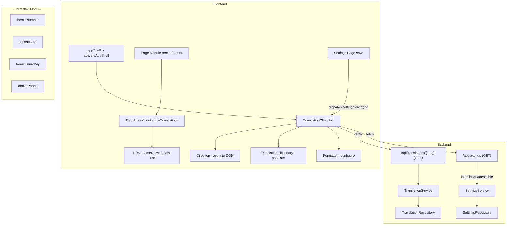

# Design Document: Active Regional Settings

## Overview

This feature activates the regional settings already stored in `settings_regional` by building a frontend formatting layer and a translation system. The architecture introduces two new frontend modules (`Formatter` and `TranslationClient`) and one new backend endpoint (`/api/translations/{lang}`), while enhancing the existing `/api/settings` endpoint to include language direction.

The system follows the existing patterns:
- **Backend**: PHP Controller → Service → Repository, using `BaseController` conventions for JSON responses and JWT auth via `AuthContext`.
- **Frontend**: ES module pattern with `apiFetch` for authenticated requests, integrated into the `appShell.js` activation lifecycle.

### Key Design Decisions

1. **Formatter as a pure-function module** — All formatting functions are stateless transformations that accept a value and a format configuration. This makes them independently testable without DOM or network dependencies.
2. **TranslationClient as a singleton with event-driven reload** — Translations and settings are loaded once on shell activation and can be reloaded via a custom event (`settings:changed`) dispatched after a successful save.
3. **No separate direction API call** — The direction field is joined into the existing `/api/settings` response, avoiding an extra round-trip.
4. **DOM-based translation application** — Using `data-i18n` attributes allows translation to be applied declaratively without modifying each page module's render logic.

## Architecture



### Initialization Flow

1. User logs in → router resolves → `activateAppShell()` is called
2. `activateAppShell()` calls `TranslationClient.init()`
3. `TranslationClient.init()` fetches `/api/settings` (which now includes `direction`)
4. Settings response is passed to `Formatter.configure()` to parse format descriptors
5. `TranslationClient.init()` fetches `/api/translations/{lang}` using the language from settings
6. Translation dictionary is stored in memory
7. Direction is applied to `<html>` and `<body>` elements
8. Page module renders → calls `TranslationClient.applyTranslations()` on its container

### Settings Change Flow

1. User saves settings on the Settings page
2. On success, the Settings page dispatches `window.dispatchEvent(new CustomEvent('settings:changed'))`
3. `TranslationClient` listens for this event and re-runs `init()`
4. Formatter is reconfigured, translations reloaded, direction updated
5. `TranslationClient.applyTranslations(document.body)` re-applies to the visible page

## Components and Interfaces

### Backend Components

#### TranslationController (`src/Controllers/TranslationController.php`)

```php
class TranslationController extends BaseController {
    // GET /translations/{lang}
    public function index(string $lang): void;
}
```

#### TranslationService (`src/Services/TranslationService.php`)

```php
class TranslationService {
    /**
     * Returns all key-value pairs for the given language code.
     * @throws \InvalidArgumentException if language code not found
     */
    public function getByLanguage(string $lang): array;
}
```

#### TranslationRepository (`src/Repository/TranslationRepository.php`)

```php
class TranslationRepository {
    /** Check if a language code exists in the languages table */
    public function languageExists(string $lang): bool;

    /** Fetch all translations for a language as [key => value] */
    public function findByLanguage(string $lang): array;
}
```

#### SettingsService Enhancement

The existing `SettingsService::get()` method is enhanced to join the `languages` table and include the `direction` field in the returned array.

```php
// Enhanced return shape:
[
    'business_id'     => 1,
    'language'        => 'ar',
    'timezone'        => 'Asia/Beirut',
    'date_format'     => 'd/m/Y',
    'number_format'   => '1.234,56',
    'currency_format' => 'USD',
    'phone_format'    => '+961 ## ### ###',
    'direction'       => 'RTL'  // NEW
]
```

### Frontend Components

#### Formatter (`public/assets/js/i18n/formatter.js`)

Pure-function module. No side effects, no DOM access.

```javascript
// State (module-level, set by configure())
let config = { thousands_sep: ',', decimal_sep: '.', date_format: 'Y-m-d', currency_format: 'USD', phone_format: '' };

export function configure(settings) { /* parse and store */ }
export function formatNumber(value, decimals) { /* returns formatted string */ }
export function formatDate(dateStr) { /* returns formatted string */ }
export function formatCurrency(value, decimals) { /* returns formatted string */ }
export function formatPhone(rawDigits) { /* returns formatted string */ }
export function parseNumberFormat(pattern) { /* returns { thousands_sep, decimal_sep } */ }
```

#### TranslationClient (`public/assets/js/i18n/translationClient.js`)

Singleton module managing translations, settings loading, and direction.

```javascript
let dictionary = {};
let currentLang = 'en';

export async function init() { /* fetch settings + translations, configure formatter, apply direction */ }
export function t(key) { /* returns translated value or key */ }
export function applyTranslations(container) { /* applies to data-i18n elements within container */ }
export function getFormatter() { /* returns reference to configured formatter functions */ }
```

#### Integration Points

- `appShell.js` → calls `TranslationClient.init()` inside `activateAppShell()`
- Page modules → call `TranslationClient.applyTranslations(container)` after rendering HTML
- Settings page → dispatches `settings:changed` event after successful save

## Data Models

### Database Tables (Existing)

#### `settings_regional`
| Column | Type | Description |
|--------|------|-------------|
| business_id | int (PK) | FK to businesses |
| language | varchar(10) | FK to languages.code |
| timezone | varchar(50) | Timezone identifier |
| date_format | varchar(20) | Date format pattern |
| number_format | varchar(20) | Number format pattern |
| currency_format | varchar(10) | Currency code or symbol |
| phone_format | varchar(30) | Phone template with # placeholders |

#### `languages`
| Column | Type | Description |
|--------|------|-------------|
| code | varchar(10) (PK) | Language code (e.g., "en", "ar") |
| name | varchar(50) | Display name |
| direction | varchar(3) | "LTR" or "RTL" |

#### `tbl_translations`
| Column | Type | Description |
|--------|------|-------------|
| lang | varchar(10) (PK) | FK to languages.code |
| key | varchar(200) (PK) | Translation key |
| value | text | Translated string |

### API Response Shapes

#### GET `/api/settings` (enhanced)
```json
{
  "success": true,
  "data": {
    "business_id": 1,
    "language": "ar",
    "timezone": "Asia/Beirut",
    "date_format": "d/m/Y",
    "number_format": "1.234,56",
    "currency_format": "USD",
    "phone_format": "+961 ## ### ###",
    "direction": "RTL"
  }
}
```

#### GET `/api/translations/{lang}`
```json
{
  "success": true,
  "data": {
    "dashboard.title": "لوحة القيادة",
    "settings.save": "حفظ",
    "common.cancel": "إلغاء"
  }
}
```

#### GET `/api/translations/{lang}` — 404 (invalid language)
```json
{
  "success": false,
  "data": null,
  "message": "Language not found"
}
```

### Frontend Data Structures

#### Format Descriptor (parsed from `number_format` pattern)
```javascript
{
  thousands_sep: '.',   // extracted from pattern
  decimal_sep: ','      // extracted from pattern
}
```

#### Number Format Pattern Mapping
| Pattern | thousands_sep | decimal_sep |
|---------|--------------|-------------|
| `1,234.56` | `,` | `.` |
| `1.234,56` | `.` | `,` |
| `1 234,56` | ` ` | `,` |


## Correctness Properties

*A property is a characteristic or behavior that should hold true across all valid executions of a system — essentially, a formal statement about what the system should do. Properties serve as the bridge between human-readable specifications and machine-verifiable correctness guarantees.*

### Property 1: Number format parsing and formatting round-trip

*For any* valid number format pattern (from the set of supported patterns like "1,234.56", "1.234,56", "1 234,56"), parsing the pattern into separators and then formatting any numeric value with those separators SHALL produce a string where the thousands grouping uses the parsed thousands_separator and the fractional part is delimited by the parsed decimal_separator.

**Validates: Requirements 1.2, 2.1**

### Property 2: Decimal precision preservation

*For any* numeric value with N decimal places (where N ≥ 0) and any valid separator configuration, formatting the number SHALL produce a string whose decimal portion contains exactly N digits.

**Validates: Requirements 2.5**

### Property 3: Date formatting correctness

*For any* valid date (year, month, day) and any supported date format pattern ("d/m/Y", "Y-m-d", "m/d/Y"), formatting the date SHALL produce a string that contains the correct day, month, and year values positioned according to the pattern's structure.

**Validates: Requirements 3.1**

### Property 4: Currency formatting combines number formatting with prefix rules

*For any* numeric value and any valid currency format string, formatting as currency SHALL produce a string where: (a) the numeric portion is formatted identically to what formatNumber would produce, and (b) if the currency format is a multi-letter code (e.g., "USD"), it appears as a prefix followed by a space, or if it is a symbol (single non-alphanumeric character like "$"), it appears as a prefix without a space.

**Validates: Requirements 4.1, 4.2, 4.3, 4.4**

### Property 5: Phone template formatting

*For any* raw digit string whose length equals the number of "#" placeholders in the phone format template, formatting SHALL produce a string where every "#" in the template is replaced by the corresponding digit from the raw string, and all non-"#" characters in the template remain in their original positions.

**Validates: Requirements 5.1**

### Property 6: Translation lookup returns value or key

*For any* translation dictionary and any key string, calling `t(key)` SHALL return the dictionary's value for that key if the key exists in the dictionary, or return the key itself if it does not exist.

**Validates: Requirements 6.5**

### Property 7: DOM translation application

*For any* DOM tree containing elements with `data-i18n` attributes and any translation dictionary: after applying translations, every element whose `data-i18n` key exists in the dictionary SHALL have its `textContent` set to the corresponding value, every element with a `data-i18n-placeholder` key that exists in the dictionary SHALL have its `placeholder` attribute set to the corresponding value, and every element whose key does NOT exist in the dictionary SHALL retain its original text unchanged.

**Validates: Requirements 7.2, 7.3, 7.4, 7.5**

## Error Handling

### Backend Error Handling

| Scenario | Response | HTTP Status |
|----------|----------|-------------|
| Settings fetch fails (DB error) | `{ "success": false, "message": "Failed to load settings" }` | 500 |
| Translations fetch — invalid language | `{ "success": false, "message": "Language not found" }` | 404 |
| Translations fetch — DB error | `{ "success": false, "message": "Failed to load translations" }` | 500 |
| Translations fetch — no JWT | `{ "success": false, "message": "Unauthorized" }` | 401 |

### Frontend Error Handling

| Scenario | Behavior |
|----------|----------|
| `/api/settings` returns error or network failure | Formatter uses defaults: number "1,234.56", date "Y-m-d", currency "USD", phone "+1 (###) ###-####" |
| `/api/translations/{lang}` returns error or 404 | Translation dictionary remains empty; `t(key)` returns the key itself; original English text stays |
| Invalid date passed to `formatDate()` | Returns empty string `""` |
| Null/empty phone passed to `formatPhone()` | Returns empty string `""` |
| Phone digits fewer than template placeholders | Returns raw unformatted phone string |
| `data-i18n` key not found in dictionary | Element text left unchanged |

### Graceful Degradation

The system is designed so that failures in the i18n layer never break core functionality:
- If translations fail to load, the UI remains in English (hardcoded text stays)
- If settings fail to load, formatting uses sensible US/international defaults
- If direction cannot be determined, LTR is assumed (the default for most browsers)

## Testing Strategy

### Property-Based Tests (Vitest + fast-check)

Property-based tests validate the universal correctness properties defined above. Each test runs a minimum of 100 iterations with randomly generated inputs.

| Property | Module Under Test | Generator Strategy |
|----------|------------------|-------------------|
| P1: Number format parsing + formatting | `formatter.js` | Random numbers × supported format patterns |
| P2: Decimal precision preservation | `formatter.js` | Random floats with 0-6 decimal places × all separator configs |
| P3: Date formatting correctness | `formatter.js` | Random valid dates (year 1900-2100, valid month/day) × 3 format patterns |
| P4: Currency formatting | `formatter.js` | Random numbers × (3-letter codes ∪ single-char symbols) × separator configs |
| P5: Phone template formatting | `formatter.js` | Random digit strings × random templates with # placeholders (matching length) |
| P6: Translation lookup | `translationClient.js` | Random dictionaries × random keys (50% present, 50% absent) |
| P7: DOM translation application | `translationClient.js` | Random DOM trees with data-i18n elements × random dictionaries |

**Configuration:**
- Library: `fast-check` (already in devDependencies)
- Runner: `vitest` (already configured)
- Minimum iterations: 100 per property
- Tag format: `Feature: active-regional-settings, Property N: <title>`

### Unit Tests (Example-Based)

| Test | What it verifies |
|------|-----------------|
| Parse "1.234,56" → thousands=".", decimal="," | Requirement 2.2 |
| Parse "1,234.56" → thousands=",", decimal="." | Requirement 2.3 |
| Parse "1 234,56" → thousands=" ", decimal="," | Requirement 2.4 |
| Format date "2025-01-31" with "d/m/Y" → "31/01/2025" | Requirement 3.2 |
| Format date "2025-01-31" with "Y-m-d" → "2025-01-31" | Requirement 3.3 |
| Format date "2025-01-31" with "m/d/Y" → "01/31/2025" | Requirement 3.4 |
| Format invalid date → "" | Requirement 3.5 |
| Format null phone → "" | Requirement 5.4 |
| Short phone digits → raw string returned | Requirement 5.2 |
| Long phone digits → extra digits appended | Requirement 5.3 |
| API error → default settings applied | Requirement 1.4 |
| Translation API error → fallback to English | Requirement 6.4 |
| Direction "RTL" → html dir="rtl", body class "rtl" | Requirements 8.2, 8.4 |
| Direction "LTR" → html dir="ltr", no "rtl" class | Requirements 8.3, 8.4 |

### Integration Tests (Backend - PHPUnit)

| Test | What it verifies |
|------|-----------------|
| GET `/api/settings` includes `direction` field | Requirement 11.1 |
| GET `/api/translations/en` returns key-value pairs | Requirement 10.2 |
| GET `/api/translations/xx` returns 404 | Requirement 10.3 |
| GET `/api/translations/en` without JWT returns 401 | Requirement 10.4 |
| Response format matches `{ success, data }` shape | Requirement 10.5 |

### Test File Organization

```
tests/
  active-regional-settings/
    property1-number-format.test.js
    property2-decimal-precision.test.js
    property3-date-format.test.js
    property4-currency-format.test.js
    property5-phone-format.test.js
    property6-translation-lookup.test.js
    property7-dom-translation.test.js
    unit-formatter.test.js
    unit-translation-client.test.js
  Unit/
    TranslationControllerTest.php
```
