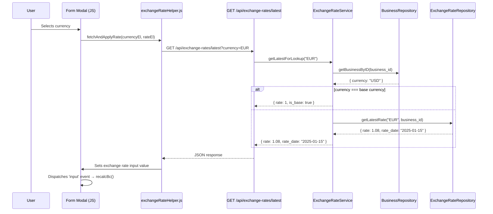

# Design Document: Auto Exchange Rate

## Overview

This feature adds automatic exchange rate population to all six financial document forms (Payment, Collection, Expense, Salary, Purchase Order, Sales Invoice). When a user selects a currency, the system fetches the most recent rate from the `exchange_rates` table and fills the exchange rate input field automatically. The user can still override the value manually. The backend also gains fallback logic: if a document is submitted without an exchange rate, the server looks it up before saving.

### Current State

- **Exchange rate table** (`exchange_rates`): stores rows with `currency`, `rate_date`, `rate`, `source`, scoped by `business_id` and `tenant_id`.
- **ExchangeRateService** already has a `getLatest(string $currency)` method that queries the most recent rate by `rate_date DESC`.
- **ExchangeRatesController** already exposes `GET /api/exchange-rates/latest?currency=XXX` (permission: `exchange-rates.manage`).
- **All six form modals** have a currency input and an exchange rate input. They already listen for `input` events on the exchange rate field to recalculate BC amounts. None of them currently fetch a rate on currency change.
- **Business table** has a `currency` field representing the base currency. The frontend stores `business_id` in `localStorage` and sends it via `X-Business-Id` header.

### Design Goals

1. Add a shared frontend utility that fetches the latest rate for a given currency and auto-populates the exchange rate field.
2. Modify the backend `latest` endpoint to accept any authenticated user (not just `exchange-rates.manage` permission holders) and to handle the base-currency short-circuit.
3. Add backend fallback logic in each financial document service to look up the rate when none is provided.
4. Keep the exchange rate field editable so users can override.

## Architecture



## Components and Interfaces

### 1. Backend: New `getLatestForLookup` method on `ExchangeRateService`

A new public method that wraps the existing `getLatest` with base-currency short-circuit logic and business currency resolution.

```php
// src/Services/ExchangeRateService.php

/**
 * Look up the latest exchange rate for a currency, with base-currency short-circuit.
 *
 * @param string $currency  The requested currency code.
 * @return array  Keys: rate (float), rate_date (string|null), is_base (bool)
 * @throws \InvalidArgumentException if currency is empty.
 */
public function getLatestForLookup(string $currency): array
```

**Logic:**
1. Validate `$currency` is non-empty; throw `InvalidArgumentException` if empty.
2. Fetch the business record via `BusinessRepository::getBusinessByID(AuthContext::businessId())`.
3. If `$currency === $business['currency']`, return `['rate' => 1, 'rate_date' => null, 'is_base' => true]`.
4. Otherwise, call `$this->repo->getLatestRate($currency, AuthContext::businessId())`.
5. If no rate found, return `['rate' => null, 'rate_date' => null, 'is_base' => false]`.
6. Otherwise, return `['rate' => (float)$row['rate'], 'rate_date' => $row['rate_date'], 'is_base' => false]`.

### 2. Backend: Updated `latest` endpoint on `ExchangeRatesController`

Update the existing `GET /api/exchange-rates/latest` endpoint to:
- Call `getLatestForLookup` instead of `getLatest`.
- Return a structured response with `rate`, `rate_date`, and `is_base` fields.
- Return a 422 error for empty/invalid currency codes.

```php
// Updated response format:
{
    "success": true,
    "data": {
        "rate": 1.08,
        "rate_date": "2025-01-15",
        "is_base": false
    }
}
```

### 3. Backend: Route permission change

The `GET /api/exchange-rates/latest` route currently requires `exchange-rates.manage` permission. This is too restrictive — any user creating financial documents needs rate lookup access. The route permission should be relaxed to allow any authenticated user (empty permission array or a new lightweight permission).

```php
// public/api/routes/exchange_rates.php
$router->get('/exchange-rates/latest',
    fn() => (new ExchangeRatesController())->latest(),
    []  // Any authenticated user can look up rates
);
```

### 4. Frontend: New shared utility `exchangeRateHelper.js`

A new module at `public/assets/js/utils/exchangeRateHelper.js` that encapsulates the rate lookup and auto-population logic.

```javascript
// public/assets/js/utils/exchangeRateHelper.js

import { apiFetch } from '../Auth/apiFetch.js';

/**
 * Fetch the latest exchange rate for the given currency and populate the rate input.
 * Dispatches an 'input' event on the rate input so existing recalcBc listeners fire.
 *
 * @param {string} currency       - The selected currency code.
 * @param {HTMLInputElement} rateInput - The exchange rate input element.
 * @param {HTMLElement|null} warningEl - Optional element to show "no rate found" warning.
 * @returns {Promise<void>}
 */
export async function fetchAndApplyRate(currency, rateInput, warningEl = null) { ... }

/**
 * Attach a 'change' event listener to a currency select/input that auto-fetches
 * the exchange rate on currency change.
 *
 * @param {HTMLElement} currencyEl - The currency select/input element.
 * @param {HTMLInputElement} rateInput - The exchange rate input element.
 * @param {HTMLElement|null} warningEl - Optional warning element.
 * @returns {Function} Cleanup function to remove the listener.
 */
export function attachRateAutoFetch(currencyEl, rateInput, warningEl = null) { ... }
```

**`fetchAndApplyRate` logic:**
1. If `currency` is empty, clear the rate input and hide warning. Return.
2. Call `GET /api/exchange-rates/latest?currency={currency}`.
3. If response has `rate !== null`:
   - Set `rateInput.value = rate`.
   - Dispatch `new Event('input', { bubbles: true })` on `rateInput` to trigger existing recalc listeners.
   - Hide warning element if present.
4. If `rate === null`:
   - Clear `rateInput.value`.
   - Show warning element with text "No exchange rate found for {currency}".

**`attachRateAutoFetch` logic:**
1. Create a `change` event listener on `currencyEl` that calls `fetchAndApplyRate`.
2. Return a cleanup function that removes the listener.

### 5. Frontend: Form modal integration

Each of the six form modals will be updated in their `mount()` function to:
1. Import `attachRateAutoFetch` from the shared utility.
2. Call `attachRateAutoFetch(F.currency(), F.exchangeRate(), warningEl)` during mount.
3. Store the returned cleanup function and call it in `unmount()`.
4. Add a small warning `<span>` or `<div>` near the exchange rate field for the "no rate found" message (or reuse existing validation feedback patterns).

The exchange rate field remains a normal editable `<input>`, so users can still type a value manually. The existing `input` event listeners on the exchange rate field (for recalcBc / recalcAllLines) continue to work because `fetchAndApplyRate` dispatches an `input` event after setting the value.

**Forms to update:**
- `paymentForm.modal.js` — currency: `inputPaymentCurrency`, rate: `inputPaymentExchangeRate`
- `collectionForm.modal.js` — currency: `inputCollectionCurrency`, rate: `inputCollectionExchangeRate`
- `expenseForm.modal.js` — currency: `inputExpenseCurrency`, rate: `inputExpenseExchangeRate`
- `salaryForm.modal.js` — currency: `inputSalaryCurrency`, rate: `inputSalaryExchangeRate`
- `poForm.modal.js` — currency: `inputPoCurrency`, rate: `inputPoExchangeRate`
- `invoiceForm.modal.js` — currency: `inputInvoiceCurrency`, rate: `inputInvoiceExchangeRate`

### 6. Backend: Fallback rate resolution in financial document services

Each financial document service (PaymentService, CollectionService, ExpenseService, SalaryService, PurchaseOrderService, SalesInvoiceService) will be updated in their `create` (and `update` where applicable) methods to:

1. Check if `exchange_rate` is provided in the payload.
2. If not provided (null, empty, or missing), call `ExchangeRateService::getLatestForLookup($currency)`.
3. If a rate is found, use it.
4. If no rate is found and none was provided, throw an `InvalidArgumentException` with message "Exchange rate is required for currency {currency}".
5. If `exchange_rate` is provided by the user, use it as-is without overriding.

This logic will be extracted into a shared helper method on `ExchangeRateService`:

```php
/**
 * Resolve the exchange rate for a document: use provided rate, or fall back to latest.
 *
 * @param string     $currency      The document currency.
 * @param float|null $providedRate  The user-provided rate, or null.
 * @return float The resolved exchange rate.
 * @throws \InvalidArgumentException if no rate can be resolved.
 */
public function resolveRate(string $currency, ?float $providedRate): float
```

## Data Models

### Existing: `exchange_rates` table

| Column       | Type         | Description                          |
|-------------|-------------|--------------------------------------|
| id          | INT (PK)    | Auto-increment primary key           |
| tenant_id   | INT (FK)    | Tenant scope                         |
| business_id | INT (FK)    | Business scope                       |
| currency    | VARCHAR     | Currency code (e.g., "EUR", "GBP")   |
| rate_date   | DATE        | Date the rate applies to             |
| rate        | DECIMAL     | Exchange rate value (FC → BC)        |
| source      | VARCHAR     | Optional source description          |
| created_at  | DATETIME    | Row creation timestamp               |

### Existing: `businesses` table (relevant fields)

| Column   | Type    | Description                              |
|---------|---------|------------------------------------------|
| id      | INT     | Business ID                              |
| currency| VARCHAR | Base currency code (e.g., "USD")         |

### API Response: `GET /api/exchange-rates/latest?currency=XXX`

```json
{
    "success": true,
    "data": {
        "rate": 1.08,
        "rate_date": "2025-01-15",
        "is_base": false
    }
}
```

When no rate is found:
```json
{
    "success": true,
    "data": {
        "rate": null,
        "rate_date": null,
        "is_base": false
    }
}
```

When currency matches base currency:
```json
{
    "success": true,
    "data": {
        "rate": 1,
        "rate_date": null,
        "is_base": true
    }
}
```

No schema changes are required. The feature uses existing tables as-is.

## Correctness Properties

*A property is a characteristic or behavior that should hold true across all valid executions of a system — essentially, a formal statement about what the system should do. Properties serve as the bridge between human-readable specifications and machine-verifiable correctness guarantees.*

### Property 1: Latest rate lookup returns the most recent entry

*For any* business with a set of exchange rate entries for a given currency, calling `getLatestForLookup` with that currency SHALL return the rate whose `rate_date` is the most recent (maximum) among all entries for that currency and business.

**Validates: Requirements 1.1, 3.2**

### Property 2: Base currency always resolves to rate 1

*For any* business with any base currency value, calling `getLatestForLookup` with a currency code equal to the business's base currency SHALL return a rate of exactly 1, regardless of what entries exist in the exchange rates table.

**Validates: Requirements 1.3, 3.3**

### Property 3: Backend rate resolution preserves user-provided rates and falls back correctly

*For any* financial document submission, the resolved exchange rate SHALL equal the user-provided rate when one is given, and SHALL equal the latest rate from the exchange rates table when no rate is provided. If no rate is provided and no rate exists in the table, the submission SHALL be rejected.

**Validates: Requirements 7.1, 7.3**

### Property 4: Base currency is always sourced from the business table

*For any* business, the base currency used by `getLatestForLookup` for the short-circuit comparison SHALL be the value of the `currency` field from the `businesses` table for the current `business_id`, not a hardcoded or cached value.

**Validates: Requirements 2.1**

## Error Handling

| Scenario | Frontend Behavior | Backend Behavior |
|----------|------------------|-----------------|
| No rate found for selected currency | Clear exchange rate field, show warning "No exchange rate found for {currency}" near the field | `getLatestForLookup` returns `rate: null`; `resolveRate` throws `InvalidArgumentException` if no user rate provided |
| Empty/invalid currency code | No API call made (guard in `fetchAndApplyRate`) | Return 422 with "Currency is required" message |
| API call fails (network error, 500) | Log error to console, leave exchange rate field unchanged (user can still type manually) | Standard error response |
| Currency matches base currency | Set exchange rate to 1, trigger recalculation | Return `rate: 1, is_base: true` without DB query |
| User submits document without exchange rate, rate exists in table | N/A (frontend always has the field) | Backend applies the looked-up rate silently |
| User submits document without exchange rate, no rate in table | N/A | Backend rejects with 422: "Exchange rate is required for currency {currency}" |

## Testing Strategy

### Property-Based Tests (PHP)

Use a PHP property-based testing library (e.g., **Eris** with PHPUnit) to test the backend service logic.

- **Minimum 100 iterations** per property test.
- Each test references its design property via a tag comment.

| Property | Test Description |
|----------|-----------------|
| Property 1 | Generate random sets of exchange rate rows (varying currencies, dates, rates). Call `getLatestForLookup`. Assert the returned rate matches the row with the maximum `rate_date`. |
| Property 2 | Generate random business currency values. Call `getLatestForLookup` with the same currency. Assert rate === 1 and `is_base === true`. |
| Property 3 | Generate random documents with and without exchange rates, and random rate tables. Call `resolveRate`. Assert: provided rate is preserved; missing rate falls back to latest; missing rate + empty table throws. |
| Property 4 | Generate random businesses with different currency fields. Call `getLatestForLookup` with a foreign currency. Assert the base currency comparison uses the business's currency field. |

**Tag format:** `Feature: auto-exchange-rate, Property {N}: {title}`

### Unit Tests (Example-Based)

- **Backend:**
  - `getLatestForLookup` with empty string throws `InvalidArgumentException`.
  - `getLatestForLookup` with a currency that has no rates returns `rate: null`.
  - `resolveRate` with provided rate returns that rate unchanged.
  - `resolveRate` with null rate and existing table rate returns the table rate.
  - `resolveRate` with null rate and no table rate throws exception.

- **Frontend (exchangeRateHelper.js):**
  - `fetchAndApplyRate` with empty currency clears the field and returns early.
  - `fetchAndApplyRate` with a valid currency sets the field value and dispatches `input` event.
  - `fetchAndApplyRate` with a currency that has no rate clears the field and shows warning.
  - `fetchAndApplyRate` with base currency sets field to 1.
  - `attachRateAutoFetch` returns a cleanup function that removes the listener.

### Integration Tests

- Each of the 6 form modals: verify that changing the currency select triggers a rate lookup and populates the exchange rate field.
- Backend `GET /api/exchange-rates/latest` endpoint: verify correct responses for valid currency, base currency, missing currency, and empty currency.
- Backend document creation: verify fallback rate resolution when exchange rate is omitted from the payload.
