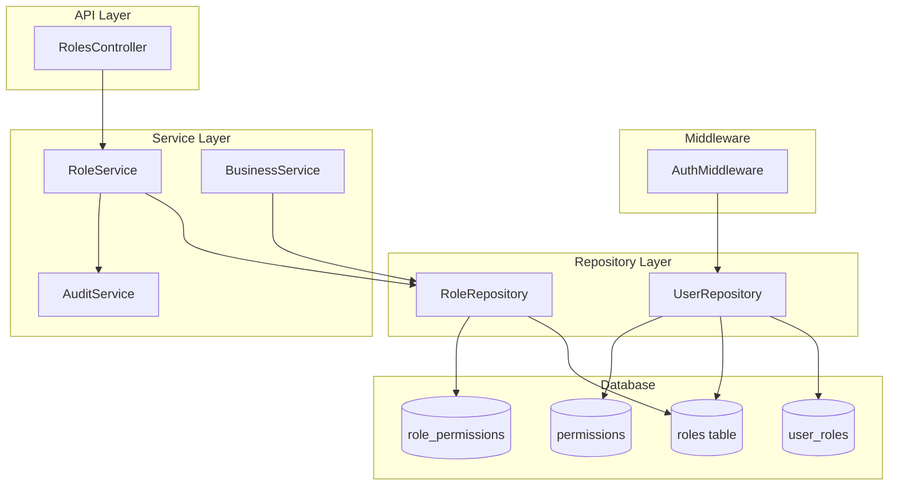

# Design Document: Business-Specific Roles

## Overview

This design transforms the roles system from tenant-scoped to business-scoped by introducing a `type` column (`SYSTEM_OWNER`, `CUSTOM`, `TEMPLATE`) and a `business_id` foreign key on the `roles` table. The current system identifies the "Business Owner" role via a hardcoded `role_id = 1` check in both `RoleRepository::findPermissionsByRoleId()` and `UserRepository::getPermissionsForRole()`. This is fragile and breaks in multi-business tenants where each business needs its own owner role.

The new design:
- Adds a `type` ENUM column to semantically identify role behavior
- Adds a `business_id` column to scope roles to individual businesses
- Auto-creates a `SYSTEM_OWNER` role per business during business creation
- Supports `TEMPLATE` roles at the tenant level that can be cloned into businesses
- Replaces all `role_id = 1` checks with type-based checks

**Dependency:** This feature depends on the "Business Types & Module Activation" spec, which introduces the `business_type_id` column on the `businesses` table and the `ModuleActivationService` for permission filtering.

## Architecture



### Key Architectural Decisions

1. **Type-based role identification over ID-based**: The `type` column replaces all `role_id = 1` checks. This is semantically correct and works across multiple businesses.

2. **Business scoping at the repository level**: All role queries include a `business_id` filter. The controller extracts `business_id` from `AuthContext` (set by `AuthMiddleware` from the `X-Business-Id` header).

3. **TEMPLATE roles remain tenant-scoped**: Templates have `business_id = NULL` and `tenant_id` set. They are visible to all businesses within the tenant but cannot be assigned directly — only cloned.

4. **Transactional SYSTEM_OWNER creation**: The `BusinessService::create()` method is extended to create the SYSTEM_OWNER role and assign it to the creating user within the same transaction.

5. **Clone-based template instantiation**: Cloning creates an independent CUSTOM copy. Changes to the template after cloning do not propagate.

## Components and Interfaces

### RoleRepository (Modified)

```php
class RoleRepository {
    // New/modified methods
    public function findAllByBusiness(int $businessId): array;
    public function findTemplatesByTenant(int $tenantId): array;
    public function findByIdAndBusiness(int $id, int $businessId): ?array;
    public function findByIdAndTenant(int $id, int $tenantId): ?array; // for templates
    public function existsByNameAndBusiness(string $name, int $businessId, ?int $excludeId = null): bool;
    public function existsTemplateByNameAndTenant(string $name, int $tenantId, ?int $excludeId = null): bool;
    public function insertWithType(int $tenantId, ?int $businessId, string $name, ?string $description, string $type): int;
    public function findRoleType(int $roleId): ?string;
    public function countSystemOwnerRoles(int $businessId): int;
    public function countUsersWithRoleInBusiness(int $roleId, int $businessId): int;

    // Retained methods (modified signatures)
    public function findAllPermissions(): array;
    public function findPermissionsByRoleId(int $roleId): array; // type-based, no hardcoded ID
    public function syncPermissions(int $roleId, array $permissionIds): void;
    public function updateRole(int $id, string $name, ?string $description): void;
    public function deleteRole(int $id): void;
}
```

### RoleService (Modified)

```php
class RoleService {
    // Modified methods
    public function getAllForBusiness(int $businessId, int $tenantId): array;
    public function getById(int $id, int $businessId): ?array;
    public function create(int $businessId, int $tenantId, string $name, ?string $description, array $permissionIds): int;
    public function update(int $id, int $businessId, string $name, ?string $description, array $permissionIds): void;
    public function delete(int $id, int $businessId): void;

    // New methods
    public function createSystemOwnerRole(int $businessId, int $tenantId): int;
    public function createTemplate(int $tenantId, string $name, ?string $description, array $permissionIds): int;
    public function updateTemplate(int $id, int $tenantId, string $name, ?string $description, array $permissionIds): void;
    public function deleteTemplate(int $id, int $tenantId): void;
    public function cloneTemplate(int $templateId, int $businessId, int $tenantId): int;
}
```

### RolesController (Modified)

```php
class RolesController extends BaseController {
    public function index(): void;        // GET /roles — scoped by business_id from AuthContext
    public function show(int $id): void;  // GET /roles/{id} — verify business ownership
    public function store(): void;        // POST /roles — create CUSTOM role in current business
    public function update(int $id): void; // PUT /roles/{id} — verify business + type check
    public function delete(int $id): void; // DELETE /roles/{id} — verify business + type check
    public function clone(int $templateId): void; // POST /roles/clone/{templateId} — new endpoint
    public function permissions(): void;  // GET /roles/permissions — unchanged
}
```

### BusinessService (Modified)

```php
class BusinessService {
    // Modified method
    public function create(int $editing_user_id, array $data): int;
    // Now also:
    //   1. Creates SYSTEM_OWNER role for the new business
    //   2. Assigns SYSTEM_OWNER role to the creating user via user_roles
    //   Both within the existing transaction
}
```

### UserRepository (Modified)

```php
class UserRepository {
    // Modified methods
    public function getPermissionsForRole(int $role_id): array;
    // Replaces `if ($role_id === 1)` with a type-based query:
    //   SELECT type FROM roles WHERE id = :role_id
    //   If type = 'SYSTEM_OWNER' → return all permissions
    //   Else → return role_permissions join

    public function fetchAuthContext($user_id): mixed;
    // Replaces `WHERE ur.role_id = 1` in the CTE with:
    //   WHERE r.type = 'SYSTEM_OWNER'
}
```

### AuthMiddleware (Modified)

The `handle()` method currently calls `$this->userS->getPermissionsForRole($role_id)`. The underlying `getPermissionsForRole` method will be updated to use type-based checks internally. No changes needed to the middleware itself — the fix is in `UserRepository`.

## Data Models

### Roles Table (Modified)

```sql
ALTER TABLE roles
  ADD COLUMN `type` ENUM('SYSTEM_OWNER', 'CUSTOM', 'TEMPLATE') NOT NULL DEFAULT 'CUSTOM' AFTER `description`,
  ADD COLUMN `business_id` INT NULL AFTER `type`,
  ADD CONSTRAINT `fk_roles_business` FOREIGN KEY (`business_id`) REFERENCES `businesses`(`id`) ON DELETE CASCADE,
  ADD CONSTRAINT `chk_roles_business_scope` CHECK (
    (type IN ('SYSTEM_OWNER', 'CUSTOM') AND business_id IS NOT NULL) OR
    (type = 'TEMPLATE' AND business_id IS NULL)
  );
```

**Final roles table schema:**

| Column      | Type                                          | Constraints                          |
|-------------|-----------------------------------------------|--------------------------------------|
| id          | INT AUTO_INCREMENT                            | PRIMARY KEY                          |
| tenant_id   | INT NOT NULL                                  | FK → tenants.id                      |
| business_id | INT NULL                                      | FK → businesses.id ON DELETE CASCADE |
| name        | VARCHAR(50) NOT NULL                          |                                      |
| description | VARCHAR(255) NULL                             |                                      |
| type        | ENUM('SYSTEM_OWNER','CUSTOM','TEMPLATE')      | NOT NULL DEFAULT 'CUSTOM'            |
| created_at  | DATETIME                                      | DEFAULT CURRENT_TIMESTAMP            |

**Indexes and Constraints:**

```sql
-- Unique role name per business
ALTER TABLE roles ADD UNIQUE INDEX `uq_roles_business_name` (business_id, name);

-- Unique template name per tenant (partial uniqueness via generated column or application-level)
-- MySQL doesn't support partial unique indexes, so enforce at application level
-- or use a unique index on (tenant_id, name, type) with a generated column

-- Enforce exactly one SYSTEM_OWNER per business (application-level + trigger or check)
```

### User Roles Table (Unchanged)

```sql
-- Existing structure preserved
CREATE TABLE user_roles (
    user_id     INT NOT NULL,
    business_id INT NOT NULL,
    role_id     INT NOT NULL,
    is_active   TINYINT(1) DEFAULT 1,
    PRIMARY KEY (user_id, business_id),
    FOREIGN KEY (user_id) REFERENCES users(id),
    FOREIGN KEY (business_id) REFERENCES businesses(id),
    FOREIGN KEY (role_id) REFERENCES roles(id)
);
```

### Role Permissions Table (Unchanged)

```sql
-- Existing structure preserved
CREATE TABLE role_permissions (
    role_id       INT NOT NULL,
    permission_id INT NOT NULL,
    PRIMARY KEY (role_id, permission_id),
    FOREIGN KEY (role_id) REFERENCES roles(id) ON DELETE CASCADE,
    FOREIGN KEY (permission_id) REFERENCES permissions(id)
);
```

### Migration Strategy

The migration must handle existing data:

1. Add `type` column with DEFAULT 'CUSTOM'
2. Add `business_id` column as nullable
3. Update role with `id = 1` to `type = 'SYSTEM_OWNER'`
4. Update all other roles to `type = 'CUSTOM'`
5. For each existing role, assign `business_id` based on the most common business in `user_roles`
6. For multi-business tenants: duplicate the SYSTEM_OWNER role into each business that has users referencing `role_id = 1`, update `user_roles` to point to the new per-business role
7. Add CHECK constraint and foreign key
8. Wrap in a single transaction

## Correctness Properties

*A property is a characteristic or behavior that should hold true across all valid executions of a system — essentially, a formal statement about what the system should do. Properties serve as the bridge between human-readable specifications and machine-verifiable correctness guarantees.*

### Property 1: Role type scoping invariant

*For any* role in the system, if its type is SYSTEM_OWNER or CUSTOM then its business_id must be non-null, and if its type is TEMPLATE then its business_id must be null and its tenant_id must be non-null.

**Validates: Requirements 1.3, 1.4**

### Property 2: SYSTEM_OWNER grants all permissions

*For any* user whose assigned role has type SYSTEM_OWNER, the resolved permission set must equal the complete set of all permission codes in the permissions table. Conversely, for any user whose assigned role has type CUSTOM, the resolved permission set must equal exactly the set of permission codes linked via the role_permissions junction table for that role.

**Validates: Requirements 2.1, 8.2, 8.3**

### Property 3: SYSTEM_OWNER immutability

*For any* update or delete request targeting a role with type SYSTEM_OWNER, the Role_Service must reject the operation and return the appropriate error message, leaving the role unchanged.

**Validates: Requirements 2.2, 2.3**

### Property 4: Exactly one SYSTEM_OWNER per business

*For any* business_id in the system, there exists exactly one role with type SYSTEM_OWNER and that business_id. No operation may create a second SYSTEM_OWNER role for the same business or remove the existing one.

**Validates: Requirements 2.5**

### Property 5: Business creation produces assigned SYSTEM_OWNER

*For any* successful business creation, the resulting database state must contain a role with name "Business Owner", type SYSTEM_OWNER, business_id equal to the new business ID, and tenant_id matching the business's tenant. Additionally, the creating user must have a user_roles entry linking them to this SYSTEM_OWNER role for the new business.

**Validates: Requirements 3.1, 3.2, 3.4**

### Property 6: Role name uniqueness within business

*For any* business_id and any role name string, at most one CUSTOM or SYSTEM_OWNER role with that name may exist within that business. Attempting to create a duplicate must be rejected with the error "A role with this name already exists in this business".

**Validates: Requirements 1.5, 4.3**

### Property 7: Template name uniqueness within tenant

*For any* tenant_id and any role name string, at most one TEMPLATE role with that name may exist within that tenant. Attempting to create a duplicate must be rejected with the error "A template role with this name already exists".

**Validates: Requirements 1.6, 5.3**

### Property 8: Role name validation

*For any* role creation or update (CUSTOM or TEMPLATE), the name must be between 2 and 50 characters after trimming. Names shorter than 2 or longer than 50 characters must be rejected. Descriptions exceeding 255 characters must be rejected.

**Validates: Requirements 4.1, 5.2**

### Property 9: Permission ID validation

*For any* array of permission IDs provided during role creation or update, if any ID does not exist in the permissions table, the operation must be rejected with an error and no changes must be persisted.

**Validates: Requirements 4.7**

### Property 10: Deletion blocked when users assigned

*For any* CUSTOM role that has one or more users assigned via user_roles, deletion must be rejected with a message indicating the count of assigned users.

**Validates: Requirements 4.5**

### Property 11: Deletion removes associated permissions

*For any* CUSTOM role that is successfully deleted, all associated records in the role_permissions table for that role_id must also be removed within the same transaction.

**Validates: Requirements 4.6**

### Property 12: Clone preserves template data

*For any* TEMPLATE role, cloning it into a business must produce a CUSTOM role with the same name (or suffixed name if conflict), same description, and the same set of permission IDs as the template. The clone must be an independent copy.

**Validates: Requirements 5.4, 5.6**

### Property 13: Clone name conflict resolution

*For any* TEMPLATE role being cloned into a business where a CUSTOM role with the same name already exists, the cloned role's name must have a numeric suffix appended (e.g., "Name (2)"). If "Name (2)" also exists, it must increment to "Name (3)", and so on.

**Validates: Requirements 5.5**

### Property 14: Role listing scoped to business and tenant templates

*For any* business context, listing roles must return exactly the set of roles where (business_id = current business) UNION (type = TEMPLATE AND tenant_id = current tenant). No roles from other businesses or other tenants' templates may appear.

**Validates: Requirements 6.1**

### Property 15: Cross-business role retrieval returns null

*For any* role_id that belongs to a different business_id than the current business context, retrieving that role must return null (as if it does not exist).

**Validates: Requirements 6.2, 6.3**

## Error Handling

### Service Layer Errors

| Scenario | Exception Type | HTTP Code | Message |
|----------|---------------|-----------|---------|
| Update/delete SYSTEM_OWNER role | RuntimeException | 403 | "Cannot modify the system owner role" / "Cannot delete the system owner role" |
| Duplicate role name in business | InvalidArgumentException | 422 | "A role with this name already exists in this business" |
| Duplicate template name in tenant | InvalidArgumentException | 422 | "A template role with this name already exists" |
| Name too short/long | InvalidArgumentException | 422 | "Role name must be between 2 and 50 characters" |
| Description too long | InvalidArgumentException | 422 | "Description must not exceed 255 characters" |
| Invalid permission IDs | InvalidArgumentException | 422 | "Invalid permission IDs provided" |
| Delete role with assigned users | InvalidArgumentException | 422 | "Cannot delete role: assigned to {N} user(s)" |
| Role not found / wrong business | — | 404 | "Role not found" |
| Clone non-template role | InvalidArgumentException | 422 | "Only template roles can be cloned" |
| Template not found | — | 404 | "Role not found" |

### Transaction Rollback Strategy

- **Business creation**: If SYSTEM_OWNER role creation or user assignment fails, the entire business creation (business record + default account + role + assignment) rolls back.
- **Role deletion**: Permission removal and role deletion happen in one transaction. Failure rolls back both.
- **Clone operation**: Template read + CUSTOM role insert + permission sync happen in one transaction.
- **Migration**: All migration steps execute in a single transaction. Any failure rolls back all schema and data changes.

### Error Propagation

```
Controller → catches exceptions → maps to HTTP response
  RuntimeException → 403 (forbidden operations)
  InvalidArgumentException → 422 (validation failures)
  Throwable → 500 (unexpected errors, generic message)
```

## Testing Strategy

### Unit Tests (PHPUnit)

Unit tests focus on specific examples and edge cases:

- **RoleService**: Test each method with concrete inputs covering happy path and error cases
- **RoleRepository**: Test query methods with known database state
- **Permission resolution**: Test `getPermissionsForRole` with SYSTEM_OWNER and CUSTOM roles
- **Clone logic**: Test suffix generation with various collision scenarios
- **Validation**: Test boundary values for name length (1, 2, 50, 51 characters)

### Property-Based Tests (PHPUnit with custom generators)

Property-based tests verify universal properties across randomized inputs. Use PHPUnit with a property-testing approach (custom data providers generating random inputs, minimum 100 iterations per property).

**Library**: PHPUnit with custom `DataProvider` generators (PHP lacks a mature PBT library, so we use parameterized tests with randomized data providers generating 100+ cases).

**Configuration**: Each property test runs minimum 100 iterations with randomized inputs.

**Tag format**: `Feature: business-specific-roles, Property {number}: {property_text}`

Properties to implement as property-based tests:
- Property 1: Role type scoping invariant
- Property 2: SYSTEM_OWNER grants all permissions
- Property 3: SYSTEM_OWNER immutability
- Property 5: Business creation produces assigned SYSTEM_OWNER
- Property 6: Role name uniqueness within business
- Property 8: Role name validation
- Property 9: Permission ID validation
- Property 12: Clone preserves template data
- Property 13: Clone name conflict resolution
- Property 14: Role listing scoped to business and tenant templates
- Property 15: Cross-business role retrieval returns null

### Integration Tests

Integration tests verify end-to-end API behavior:

- **API scoping**: GET/POST/PUT/DELETE /roles with different business contexts
- **Clone endpoint**: POST /roles/clone/{templateId}
- **Permission resolution**: Full AuthMiddleware flow with SYSTEM_OWNER vs CUSTOM roles
- **Migration**: Verify database state after migration execution

### Migration Testing

- Run migration on a test database with known seed data
- Verify all roles have correct type and business_id assignments
- Verify SYSTEM_OWNER duplication for multi-business tenants
- Verify user_roles references are updated correctly
- Test idempotency by running migration twice

