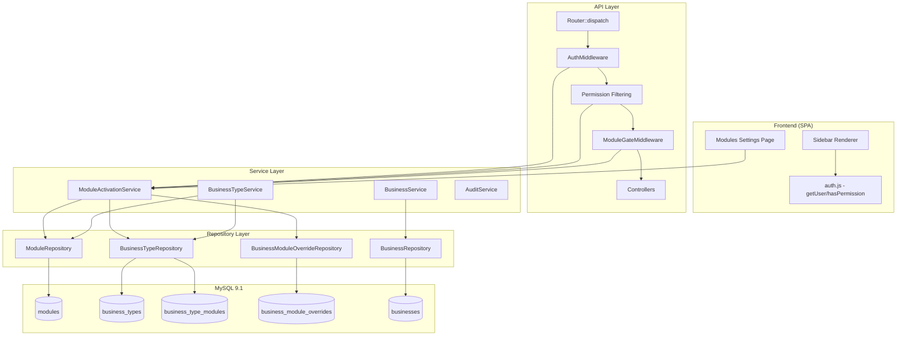
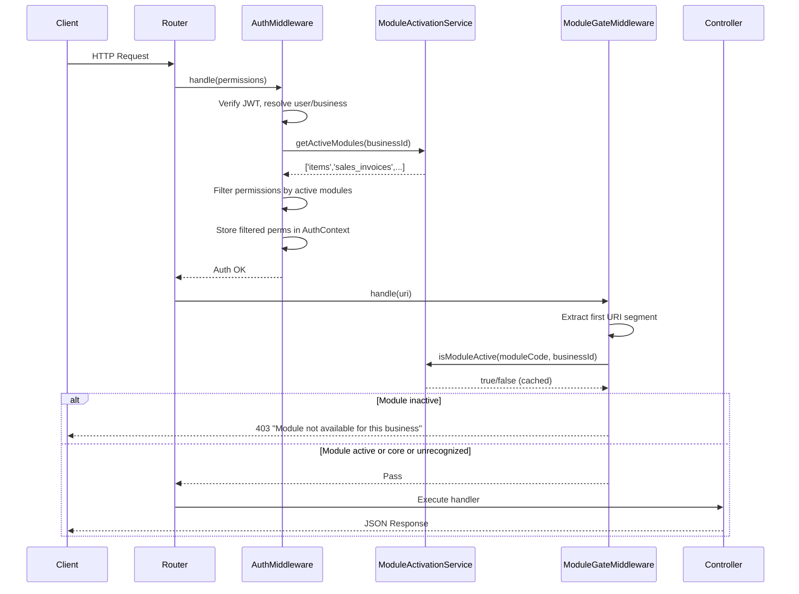

# Design Document: Business Types & Module Activation

## Overview

This design introduces a module activation system that controls which ERP features are accessible per business. Each business is assigned a type (General, Retail, Wholesale, Manufacturing, Service) that determines default module access. A resolution service combines type defaults with per-business overrides, and a middleware layer enforces module gates at the API level. The frontend sidebar and permissions are filtered accordingly.

### Key Design Decisions

1. **Module gate as middleware in Router dispatch** — The module check integrates into the existing `Router::dispatch()` flow after `AuthMiddleware` but before permission checking, avoiding changes to every controller.
2. **Per-request caching** — The resolved module list is cached in a static property for the duration of one HTTP request, eliminating repeated DB queries within the same request.
3. **Fail-open for unmapped routes/permissions** — Routes and permissions that don't match any module prefix pass through, ensuring backward compatibility.
4. **Override replacement semantics** — A new override for the same business+module replaces the existing one (UPSERT), keeping the table clean.
5. **Data preservation on deactivation** — Deactivating a module never deletes data; it only blocks API access via middleware.

## Architecture

### High-Level System Diagram



### Request Lifecycle Sequence



## Components and Interfaces

### New Classes

#### 1. `src/Repository/ModuleRepository.php`

```php
<?php
namespace App\Repository;

use PDO;

class ModuleRepository
{
    private PDO $db;

    public function __construct(PDO $db);

    /** Get all modules ordered by sort_order ASC */
    public function getAll(): array;

    /** Get a single module by its unique code, or null if not found */
    public function getByCode(string $code): ?array;

    /** Get a module by ID */
    public function getById(int $id): ?array;

    /** Get modules for a business type (via junction table) */
    public function getModulesForBusinessType(int $businessTypeId): array;

    /** Get the route_prefix → module_code mapping for all modules */
    public function getRoutePrefixMap(): array;

    /** Get all permission_prefixes grouped by module code */
    public function getPermissionPrefixMap(): array;
}
```

#### 2. `src/Repository/BusinessTypeRepository.php`

```php
<?php
namespace App\Repository;

use PDO;

class BusinessTypeRepository
{
    private PDO $db;

    public function __construct(PDO $db);

    /** Get all business types */
    public function getAll(): array;

    /** Get a business type by ID, or null */
    public function getById(int $id): ?array;

    /** Get a business type by code, or null */
    public function getByCode(string $code): ?array;

    /** Get the default business type (is_default = 1) */
    public function getDefault(): array;

    /** Get module codes for a business type */
    public function getModuleCodesForType(int $businessTypeId): array;
}
```

#### 3. `src/Repository/BusinessModuleOverrideRepository.php`

```php
<?php
namespace App\Repository;

use PDO;

class BusinessModuleOverrideRepository
{
    private PDO $db;

    public function __construct(PDO $db);

    /** Get all overrides for a business as [module_code => action] */
    public function getOverridesForBusiness(int $businessId): array;

    /** Upsert an override (replace if exists for same business+module) */
    public function upsert(int $businessId, int $moduleId, string $action, int $createdBy): void;

    /** Delete an override by business_id and module_id */
    public function delete(int $businessId, int $moduleId): void;

    /** Delete overrides that are redundant given a set of type-default module IDs */
    public function deleteRedundantOverrides(int $businessId, array $typeModuleIds): int;

    /** Check if an override exists for business+module */
    public function exists(int $businessId, int $moduleId): bool;
}
```

#### 4. `src/Services/ModuleActivationService.php`

```php
<?php
namespace App\Services;

use PDO;

class ModuleActivationService
{
    private PDO $db;
    private static array $cache = []; // Per-request cache keyed by businessId

    public function __construct(PDO $db);

    /**
     * Resolve active module codes for a business.
     * Algorithm: (type_defaults + activate_overrides) - deactivate_overrides
     * Cached per businessId for the request duration.
     */
    public function getActiveModules(int $businessId): array;

    /**
     * Check if a specific module is active for a business.
     * Returns false for non-existent businessId or moduleCode.
     */
    public function isModuleActive(string $moduleCode, int $businessId): bool;

    /**
     * Filter a permission array, keeping only permissions that belong
     * to active modules or that don't match any module prefix (fail-open).
     */
    public function filterPermissionsByActiveModules(array $permissions, int $businessId): array;

    /** Clear the per-request cache (useful for testing) */
    public static function clearCache(): void;
}
```

#### 5. `src/Services/BusinessTypeService.php`

```php
<?php
namespace App\Services;

use PDO;

class BusinessTypeService
{
    private PDO $db;

    public function __construct(PDO $db);

    /** Get all business types with their module codes */
    public function getAllTypes(): array;

    /** Validate that a business_type_id exists. Returns the type or null. */
    public function getTypeById(int $id): ?array;

    /**
     * Change a business's type.
     * If force=false and modules with data would be deactivated, returns warning.
     * If force=true, applies change + cleans redundant overrides + audits.
     * Executes in a single transaction.
     *
     * @return array ['success' => bool, 'warning' => ?array, 'message' => ?string]
     */
    public function changeBusinessType(
        int $businessId,
        int $newTypeId,
        bool $force,
        int $userId
    ): array;

    /**
     * Check which modules would be deactivated and have existing data.
     * Returns array of ['module_code' => string, 'record_count' => int]
     */
    public function getAffectedModulesOnTypeChange(
        int $businessId,
        int $newTypeId
    ): array;

    /**
     * Get the record count for a module's tables in a given business.
     * Uses the module's associated tables (mapped by convention: route_prefix).
     */
    public function getModuleRecordCount(string $moduleCode, int $businessId): int;
}
```

#### 6. `src/Middleware/ModuleGateMiddleware.php`

```php
<?php
namespace App\Middleware;

use App\Services\ModuleActivationService;
use App\Support\AuthContext;
use PDO;

class ModuleGateMiddleware
{
    private ModuleActivationService $moduleService;
    private array $routePrefixMap; // [route_prefix => module_code]
    private const CORE_MODULES = ['auth', 'users', 'businesses'];

    public function __construct(PDO $db);

    /**
     * Check if the current request's module is active.
     * Extracts first URI segment, maps to module code, checks activation.
     * Blocks with 403 if module is inactive.
     * Passes through for core modules and unrecognized prefixes.
     */
    public function handle(string $uri): void;

    /** Extract the first path segment from a URI (e.g., "/items/123" → "items") */
    private function extractRoutePrefix(string $uri): string;
}
```

#### 7. `src/Controllers/ModulesController.php`

```php
<?php
namespace App\Controllers;

class ModulesController extends BaseController
{
    /**
     * GET /settings/modules
     * Returns all modules with their activation status for the current business.
     * Permission: settings.modules
     */
    public function index(): void;

    /**
     * POST /settings/modules/override
     * Body: { module_code: string, action: "activate"|"deactivate", force?: bool }
     * Creates/replaces a module override for the current business.
     * Permission: settings.modules
     */
    public function toggleOverride(): void;

    /**
     * DELETE /settings/modules/override/{moduleCode}
     * Removes an override, reverting to type default.
     * Permission: settings.modules
     */
    public function removeOverride(string $moduleCode): void;
}
```

### Modified Classes

#### `src/Support/Router.php` — Changes

The `dispatch()` method is modified to invoke `ModuleGateMiddleware` after `AuthMiddleware`:

```php
// In dispatch(), after AuthMiddleware->handle():
if ($route['auth']) {
    $middleware = new AuthMiddleware($this->jwtSecret);
    $middleware->handle($route['permissions'] ?? null);

    // NEW: Module gate check
    $moduleGate = new ModuleGateMiddleware(Database::getConnection());
    $moduleGate->handle($uri);
}
```

#### `src/Middleware/AuthMiddleware.php` — Changes

After resolving permissions from the role, filter them through `ModuleActivationService`:

```php
// After: $permissions = $this->userS->getPermissionsForRole($role_id);
// NEW: Filter permissions by active modules
$moduleService = new ModuleActivationService($this->db);
$permissions = $moduleService->filterPermissionsByActiveModules($permissions, $businessId);
```

#### `src/Services/BusinessService.php` — Changes

The `create()` method accepts and validates `business_type_id`:

```php
public function create(int $editing_user_id, array $data): int {
    // NEW: Resolve business_type_id (default to "general" if not provided)
    $typeId = $data['business_type_id'] ?? null;
    if ($typeId === null) {
        $typeId = $this->businessTypeRepo->getDefault()['id'];
    } else {
        $type = $this->businessTypeRepo->getById($typeId);
        if (!$type) {
            throw new \InvalidArgumentException('Invalid business type');
        }
    }
    // ... existing creation logic with $typeId added to insert
}
```

The `update()` method delegates type changes to `BusinessTypeService`:

```php
// In update(), if 'business_type_id' is in $data:
if (isset($data['business_type_id'])) {
    $result = $this->businessTypeService->changeBusinessType(
        $business_id, $data['business_type_id'],
        $data['force'] ?? false, $editing_user_id
    );
    if (!$result['success']) {
        // Return warning or error without committing
    }
}
```

#### `src/Controllers/BusinessesController.php` — Changes

The `store()` and `update()` methods pass `business_type_id` and `force` from input.

#### `src/Controllers/AuthController.php` — Changes

The `/auth/me` response includes `active_modules`:

```php
// In the me() method response:
$moduleService = new ModuleActivationService($db);
$activeModules = $moduleService->getActiveModules($businessId);

$this->json(true, [
    // ...existing user data...
    'active_modules' => $activeModules
]);
```

### New API Routes

File: `public/api/routes/settings.php` (appended)

```php
// Module management routes
$router->get('/settings/modules',
    fn() => (new ModulesController())->index(),
    ['settings.modules']
);

$router->post('/settings/modules/override',
    fn() => (new ModulesController())->toggleOverride(),
    ['settings.modules']
);

$router->delete('/settings/modules/override/{code}',
    fn($code) => (new ModulesController())->removeOverride($code),
    ['settings.modules']
);

// Business types list (for business creation form)
$router->get('/business-types',
    fn() => (new BusinessTypesController())->index(),
    ['businesses.view']
);
```

### Frontend Components

#### `public/assets/js/services/ModuleService.js` (New)

```javascript
// services/ModuleService.js
import { apiFetch } from '../Auth/apiFetch.js';

let activeModulesCache = null;

/** Fetch active modules for current business from /auth/me or dedicated endpoint */
export async function fetchActiveModules() {
    const res = await apiFetch('api/settings/modules');
    const data = await res.json();
    if (data.success) {
        activeModulesCache = data.data.active_modules;
    }
    return activeModulesCache || [];
}

/** Get cached active modules (synchronous) */
export function getActiveModules() {
    return activeModulesCache || [];
}

/** Set active modules from /auth/me response */
export function setActiveModules(modules) {
    activeModulesCache = modules;
}

/** Check if a module code is active */
export function isModuleActive(moduleCode) {
    if (!moduleCode) return true; // No module association = always visible
    const modules = getActiveModules();
    return modules.includes(moduleCode);
}

/** Invalidate cache (triggers re-fetch on next access) */
export function invalidateModuleCache() {
    activeModulesCache = null;
}
```

#### `public/assets/js/Shells/appShell.config.js` — Changes

Add `module` field to menu items:

```javascript
// Each menu item gets a 'module' property:
{ id: 'goToProductionOrders', label: 'Production Orders', ..., module: 'manufacturing' },
{ id: 'goToInvoices', label: 'Invoices', ..., module: 'sales_invoices' },
// Items without a module field are always rendered
```

#### `public/assets/js/Shells/appShell.js` — Changes

The `renderMenu()` function filters by active modules:

```javascript
import { isModuleActive } from '../services/ModuleService.js';

function renderMenu() {
    MENU_CONFIG.forEach(entry => {
        if (entry.type === 'item') {
            if (!hasPermission(entry.permission)) return;
            if (!isModuleActive(entry.module)) return; // NEW
            // ...render item
        } else if (entry.type === 'group') {
            const visibleChildren = (entry.children || []).filter(child =>
                hasPermission(child.permission) && isModuleActive(child.module) // NEW
            );
            // ...render group
        }
    });
}
```

#### `public/assets/js/pages/Settings/modules.js` (New)

ES6 module following the render/mount/unmount pattern for the Modules Settings Page.

### Module-to-Route Prefix Mapping

The `modules.route_prefix` column maps API URI first segments to module codes:

| Module Code | Route Prefix | Example Routes |
|---|---|---|
| auth | auth | /auth/login, /auth/me |
| users | users | /users, /users/{id} |
| businesses | businesses | /businesses, /businesses/{id} |
| people | people | /people, /people/{id} |
| items | items | /items, /items/{id} |
| stock | stock | /stock, /stock/{id} |
| exchange_rates | exchange-rates | /exchange-rates |
| accounts | accounts | /accounts, /accounts/{id} |
| expenses | expenses | /expenses, /expenses/{id} |
| purchase_orders | purchase-orders | /purchase-orders, /purchase-orders/{id} |
| sales_invoices | invoices | /invoices, /invoices/{id} |
| payments | payments | /payments, /payments/{id} |
| collections | collections | /collections, /collections/{id} |
| salaries | salaries | /salaries, /salaries/{id} |
| dashboard | dashboard | /dashboard |
| activity_log | activity-log | /activity-log |
| settings | settings | /settings, /settings/modules |
| manufacturing | manufacturing | /manufacturing/recipes, /manufacturing/orders |
| notifications | notifications | /notifications, /notifications/{id} |
| roles | roles | /roles, /roles/{id} |

### Permission Prefix Mapping

The `modules.permission_prefixes` JSON column maps permission code prefixes to modules:

| Module Code | Permission Prefixes |
|---|---|
| auth | `["auth."]` |
| users | `["users."]` |
| businesses | `["businesses."]` |
| people | `["people."]` |
| items | `["items."]` |
| stock | `["stock."]` |
| exchange_rates | `["exchange-rates."]` |
| accounts | `["accounts."]` |
| expenses | `["expenses."]` |
| purchase_orders | `["po."]` |
| sales_invoices | `["invoices."]` |
| payments | `["payments."]` |
| collections | `["collections."]` |
| salaries | `["salaries."]` |
| dashboard | `["dashboard."]` |
| activity_log | `["activityLog."]` |
| settings | `["settings."]` |
| manufacturing | `["manufacturing."]` |
| notifications | `["notifications."]` |
| roles | `["roles."]` |

**Filtering Algorithm:**
```
for each permission in user_permissions:
    matched = false
    for each module in all_modules:
        for each prefix in module.permission_prefixes:
            if permission starts_with prefix:
                matched = true
                if module.code in active_modules:
                    include permission
                break
    if not matched:
        include permission  // fail-open for unmapped
```

## Data Models

### New Tables

#### `modules`

```sql
CREATE TABLE IF NOT EXISTS `modules` (
  `id` INT NOT NULL AUTO_INCREMENT,
  `code` VARCHAR(50) NOT NULL,
  `name` VARCHAR(150) NOT NULL,
  `icon` VARCHAR(100) DEFAULT NULL,
  `route_prefix` VARCHAR(100) NOT NULL,
  `permission_prefixes` JSON NOT NULL,
  `category` ENUM('core','operations','finance','other') NOT NULL DEFAULT 'other',
  `sort_order` INT NOT NULL DEFAULT 0,
  `created_at` DATETIME NOT NULL DEFAULT CURRENT_TIMESTAMP,
  PRIMARY KEY (`id`),
  UNIQUE KEY `uq_modules_code` (`code`),
  KEY `idx_modules_sort_order` (`sort_order`)
) ENGINE=InnoDB DEFAULT CHARSET=utf8mb4 COLLATE=utf8mb4_0900_ai_ci;
```

#### `business_types`

```sql
CREATE TABLE IF NOT EXISTS `business_types` (
  `id` INT NOT NULL AUTO_INCREMENT,
  `code` VARCHAR(50) NOT NULL,
  `name` VARCHAR(150) NOT NULL,
  `description` TEXT DEFAULT NULL,
  `is_default` TINYINT(1) NOT NULL DEFAULT 0,
  `created_at` DATETIME NOT NULL DEFAULT CURRENT_TIMESTAMP,
  PRIMARY KEY (`id`),
  UNIQUE KEY `uq_business_types_code` (`code`)
) ENGINE=InnoDB DEFAULT CHARSET=utf8mb4 COLLATE=utf8mb4_0900_ai_ci;
```

#### `business_type_modules`

```sql
CREATE TABLE IF NOT EXISTS `business_type_modules` (
  `id` INT NOT NULL AUTO_INCREMENT,
  `business_type_id` INT NOT NULL,
  `module_id` INT NOT NULL,
  `created_at` DATETIME NOT NULL DEFAULT CURRENT_TIMESTAMP,
  PRIMARY KEY (`id`),
  UNIQUE KEY `uq_bt_modules` (`business_type_id`, `module_id`),
  KEY `idx_btm_module` (`module_id`),
  CONSTRAINT `fk_btm_business_type` FOREIGN KEY (`business_type_id`)
    REFERENCES `business_types` (`id`) ON DELETE CASCADE,
  CONSTRAINT `fk_btm_module` FOREIGN KEY (`module_id`)
    REFERENCES `modules` (`id`) ON DELETE CASCADE
) ENGINE=InnoDB DEFAULT CHARSET=utf8mb4 COLLATE=utf8mb4_0900_ai_ci;
```

#### `business_module_overrides`

```sql
CREATE TABLE IF NOT EXISTS `business_module_overrides` (
  `id` INT NOT NULL AUTO_INCREMENT,
  `business_id` INT NOT NULL,
  `module_id` INT NOT NULL,
  `action` ENUM('activate','deactivate') NOT NULL,
  `created_at` DATETIME NOT NULL DEFAULT CURRENT_TIMESTAMP,
  `created_by` INT NOT NULL,
  PRIMARY KEY (`id`),
  UNIQUE KEY `uq_bmo_business_module` (`business_id`, `module_id`),
  KEY `idx_bmo_module` (`module_id`),
  KEY `idx_bmo_created_by` (`created_by`),
  CONSTRAINT `fk_bmo_business` FOREIGN KEY (`business_id`)
    REFERENCES `businesses` (`id`) ON DELETE CASCADE,
  CONSTRAINT `fk_bmo_module` FOREIGN KEY (`module_id`)
    REFERENCES `modules` (`id`) ON DELETE CASCADE,
  CONSTRAINT `fk_bmo_created_by` FOREIGN KEY (`created_by`)
    REFERENCES `users` (`id`)
) ENGINE=InnoDB DEFAULT CHARSET=utf8mb4 COLLATE=utf8mb4_0900_ai_ci;
```

### Modified Tables

#### `businesses` — Add `business_type_id` column

```sql
-- Add column with default pointing to "general" type
ALTER TABLE `businesses`
  ADD COLUMN `business_type_id` INT NOT NULL DEFAULT 1
  AFTER `currency`;

-- Add foreign key constraint
ALTER TABLE `businesses`
  ADD CONSTRAINT `fk_businesses_type`
  FOREIGN KEY (`business_type_id`) REFERENCES `business_types` (`id`);

-- Update all existing businesses to general type (id=1)
UPDATE `businesses` SET `business_type_id` = 1 WHERE `business_type_id` = 1;
```

### Seed Data

#### Module Definitions

```sql
INSERT IGNORE INTO `modules` (`code`, `name`, `icon`, `route_prefix`, `permission_prefixes`, `category`, `sort_order`) VALUES
('auth',            'Authentication',    'fas fa-key',              'auth',            '["auth."]',            'core',       1),
('users',           'Users',             'fas fa-users',            'users',           '["users."]',           'core',       2),
('businesses',      'Businesses',        'fas fa-briefcase',        'businesses',      '["businesses."]',      'core',       3),
('dashboard',       'Dashboard',         'fas fa-tachometer-alt',   'dashboard',       '["dashboard."]',       'other',      4),
('people',          'People',            'fas fa-address-book',     'people',          '["people."]',          'operations', 5),
('items',           'Items',             'fas fa-boxes',            'items',           '["items."]',           'operations', 6),
('stock',           'Stock',             'fas fa-warehouse',        'stock',           '["stock."]',           'operations', 7),
('purchase_orders', 'Purchase Orders',   'fas fa-shopping-cart',    'purchase-orders', '["po."]',              'operations', 8),
('sales_invoices',  'Sales Invoices',    'fas fa-file-invoice',     'invoices',        '["invoices."]',        'operations', 9),
('manufacturing',   'Manufacturing',     'fas fa-industry',         'manufacturing',   '["manufacturing."]',   'operations', 10),
('accounts',        'Accounts',          'fas fa-university',       'accounts',        '["accounts."]',        'finance',    11),
('expenses',        'Expenses',          'fas fa-receipt',          'expenses',        '["expenses."]',        'finance',    12),
('payments',        'Payments',          'fas fa-money-bill',       'payments',        '["payments."]',        'finance',    13),
('collections',     'Collections',       'fas fa-hand-holding-usd', 'collections',     '["collections."]',     'finance',    14),
('salaries',        'Salaries',          'fas fa-user-tie',         'salaries',        '["salaries."]',        'finance',    15),
('exchange_rates',  'Exchange Rates',    'fas fa-exchange-alt',     'exchange-rates',  '["exchange-rates."]',  'finance',    16),
('activity_log',    'Activity Log',      'fas fa-list',             'activity-log',    '["activityLog."]',     'other',      17),
('settings',        'Settings',          'fas fa-cogs',             'settings',        '["settings."]',        'other',      18),
('notifications',   'Notifications',     'fas fa-bell',             'notifications',   '["notifications."]',   'other',      19),
('roles',           'Roles',             'fas fa-user-shield',      'roles',           '["roles."]',           'other',      20);
```

#### Business Type Definitions

```sql
INSERT IGNORE INTO `business_types` (`id`, `code`, `name`, `description`, `is_default`) VALUES
(1, 'general',       'General',       'All modules active — suitable for any business', 1),
(2, 'retail',        'Retail',        'Retail trade — inventory, sales, purchases',      0),
(3, 'wholesale',     'Wholesale',     'Wholesale trade — bulk inventory and sales',      0),
(4, 'manufacturing', 'Manufacturing', 'Manufacturing — production orders and recipes',   0),
(5, 'service',       'Service',       'Service business — invoicing without inventory',  0);
```

#### Business Type Module Mappings

```sql
-- General: all 20 modules
INSERT IGNORE INTO `business_type_modules` (`business_type_id`, `module_id`)
SELECT 1, id FROM `modules`;

-- Retail: 18 modules (excludes manufacturing, salaries)
INSERT IGNORE INTO `business_type_modules` (`business_type_id`, `module_id`)
SELECT 2, id FROM `modules`
WHERE `code` IN ('auth','users','businesses','dashboard','people','items','stock',
  'purchase_orders','sales_invoices','accounts','expenses','payments','collections',
  'exchange_rates','activity_log','settings','notifications','roles');

-- Wholesale: same as retail
INSERT IGNORE INTO `business_type_modules` (`business_type_id`, `module_id`)
SELECT 3, id FROM `modules`
WHERE `code` IN ('auth','users','businesses','dashboard','people','items','stock',
  'purchase_orders','sales_invoices','accounts','expenses','payments','collections',
  'exchange_rates','activity_log','settings','notifications','roles');

-- Manufacturing: 19 modules (excludes salaries)
INSERT IGNORE INTO `business_type_modules` (`business_type_id`, `module_id`)
SELECT 4, id FROM `modules`
WHERE `code` IN ('auth','users','businesses','dashboard','people','items','stock',
  'purchase_orders','sales_invoices','manufacturing','accounts','expenses','payments',
  'collections','exchange_rates','activity_log','settings','notifications','roles');

-- Service: 15 modules (excludes items, stock, purchase_orders, manufacturing, salaries)
INSERT IGNORE INTO `business_type_modules` (`business_type_id`, `module_id`)
SELECT 5, id FROM `modules`
WHERE `code` IN ('auth','users','businesses','dashboard','people',
  'sales_invoices','accounts','expenses','payments','collections',
  'exchange_rates','activity_log','settings','notifications','roles');
```

#### New Permission Seed

```sql
INSERT IGNORE INTO `permissions` (`name`, `code`) VALUES
('modules settings view', 'settings.modules');

-- Assign to business_owner role (role_id = 1)
INSERT IGNORE INTO `role_permissions` (`role_id`, `permission_id`)
SELECT 1, p.`id` FROM `permissions` p
WHERE p.`code` = 'settings.modules'
  AND p.`id` NOT IN (SELECT rp.`permission_id` FROM `role_permissions` rp WHERE rp.`role_id` = 1);
```

### Module Resolution Algorithm (Low-Level)

```
function getActiveModules(businessId):
    if cache[businessId] exists:
        return cache[businessId]

    business = businessRepo.getById(businessId)
    if business is null:
        cache[businessId] = []
        return []

    // Step 1: Load type defaults
    typeModuleCodes = businessTypeRepo.getModuleCodesForType(business.business_type_id)
    activeSet = Set(typeModuleCodes)

    // Step 2: Load overrides
    overrides = overrideRepo.getOverridesForBusiness(businessId)
    // overrides = [{ module_code: string, action: 'activate'|'deactivate' }]

    // Step 3: Apply activate overrides (add to set)
    for override in overrides where override.action == 'activate':
        activeSet.add(override.module_code)

    // Step 4: Apply deactivate overrides (remove from set)
    for override in overrides where override.action == 'deactivate':
        activeSet.remove(override.module_code)

    result = activeSet.toArray()
    cache[businessId] = result
    return result
```

### Module Gate Algorithm (Low-Level)

```
function handle(uri):
    prefix = extractFirstSegment(uri)  // "/items/123" → "items"

    moduleCode = routePrefixMap[prefix]  // lookup from modules table

    if moduleCode is null:
        return  // unrecognized prefix → pass through

    if moduleCode in CORE_MODULES:
        return  // core modules always pass

    businessId = AuthContext::businessId()

    if not moduleActivationService.isModuleActive(moduleCode, businessId):
        respond 403 { success: false, message: "Module not available for this business" }
        exit
```

### Permission Filtering Algorithm (Low-Level)

```
function filterPermissionsByActiveModules(permissions, businessId):
    activeModules = getActiveModules(businessId)
    prefixMap = moduleRepo.getPermissionPrefixMap()
    // prefixMap = { 'module_code' => ['prefix1.', 'prefix2.'], ... }

    filtered = []
    for permission in permissions:
        ownerModule = null
        for moduleCode, prefixes in prefixMap:
            for prefix in prefixes:
                if permission starts_with prefix:
                    ownerModule = moduleCode
                    break
            if ownerModule:
                break

        if ownerModule is null:
            filtered.add(permission)  // fail-open: no module owns it
        else if ownerModule in activeModules:
            filtered.add(permission)  // module is active
        // else: permission belongs to inactive module → excluded

    return filtered
```

## Correctness Properties

*A property is a characteristic or behavior that should hold true across all valid executions of a system — essentially, a formal statement about what the system should do. Properties serve as the bridge between human-readable specifications and machine-verifiable correctness guarantees.*

### Property 1: Module Resolution Set Algebra

*For any* business with a type that maps to a set of default modules D, a set of activate overrides A, and a set of deactivate overrides R, the resolved active modules SHALL equal (D ∪ A) \ R.

**Validates: Requirements 6.1, 6.2, 5.2, 5.3**

### Property 2: Module Gate Middleware Correctness

*For any* API request with URI path P, the ModuleGateMiddleware SHALL allow the request if and only if: (a) the first segment of P does not match any module's route_prefix, OR (b) the matched module code is a core module (auth, users, businesses), OR (c) the matched module is active for the current business.

**Validates: Requirements 7.1, 7.2, 7.3, 7.4, 7.5**

### Property 3: Permission Filtering Completeness

*For any* set of user permissions and active module set, the filtered permission set SHALL contain exactly those permissions whose prefix matches an active module's permission_prefixes, plus all permissions that do not match any module's permission_prefixes (fail-open).

**Validates: Requirements 8.1, 8.2, 8.3**

### Property 4: Sidebar Filtering Consistency

*For any* menu item configuration and active module set, a menu item SHALL be rendered if and only if it has no `module` field OR its `module` value is present in the active modules set.

**Validates: Requirements 9.2, 9.3**

### Property 5: Default Type Assignment

*For any* business creation request that omits `business_type_id` or provides null, the created business SHALL have `business_type_id` set to the ID of the business type with `is_default = 1` (code "general").

**Validates: Requirements 2.4, 3.2, 3.3**

### Property 6: Type ID Validation

*For any* integer value that does not correspond to an existing `business_types.id`, a business creation or type change request using that value SHALL be rejected with an error response.

**Validates: Requirements 2.5, 3.4, 4.1, 4.2**

### Property 7: Core Module Protection

*For any* of the core modules (auth, users, businesses), a deactivation override request SHALL be rejected regardless of business type, override state, or force flag.

**Validates: Requirements 5.4**

### Property 8: Override Replacement (Idempotence)

*For any* business and module combination, creating a new override with action X SHALL result in exactly one override record for that combination with action X, regardless of whether a previous override existed.

**Validates: Requirements 5.7**

### Property 9: Redundant Override Cleanup on Type Change

*For any* business type change from type T1 to T2, after the change completes: (a) activate overrides for modules already in T2's defaults SHALL be removed, and (b) deactivate overrides for modules not in T2's defaults SHALL be removed.

**Validates: Requirements 4.5**

### Property 10: Data Preservation on Deactivation

*For any* module with N records in its associated tables, deactivating that module SHALL not change the record count — the count before and after deactivation SHALL be identical.

**Validates: Requirements 11.1, 11.3**

### Property 11: Data Warning Before Deactivation

*For any* module with N > 0 records, a deactivation request (override or type change) without force=true SHALL return a warning response containing the module code and record count N, without creating the override or applying the type change.

**Validates: Requirements 4.3, 5.5**

### Property 12: Module Registry Sort Order

*For any* set of modules in the registry, `getAll()` SHALL return them in ascending `sort_order` — that is, for consecutive elements at indices i and j where i < j, `modules[i].sort_order <= modules[j].sort_order`.

**Validates: Requirements 1.5**

### Property 13: Module Registry Uniqueness

*For any* module code that already exists in the registry, an attempt to insert another module with the same code SHALL fail with a duplicate error.

**Validates: Requirements 1.6**

### Property 14: Non-Existent Lookups Return Null/False

*For any* string that is not a valid module code in the registry, `getByCode()` SHALL return null and `isModuleActive()` SHALL return false, without throwing an exception.

**Validates: Requirements 1.4, 6.6, 6.7**

### Property 15: Type Change Audit Logging

*For any* successful business type change, the audit log SHALL contain an entry with event_type "BUSINESS_TYPE_CHANGE", the business_id, and both the previous and new business_type_id values.

**Validates: Requirements 4.7**

## Error Handling

### API Error Responses

All errors follow the existing response format: `{ success: false, data: null, message: string }`.

| Scenario | HTTP Status | Message |
|---|---|---|
| Module inactive for business | 403 | "Module not available for this business" |
| Invalid business_type_id on creation | 400 | "Invalid business type" |
| Invalid business_type_id on change | 400 | "Business type does not exist" |
| Core module deactivation attempt | 400 | "Core modules cannot be deactivated" |
| Invalid module_id in override | 400 | "Module does not exist" |
| Deactivation with data (no force) | 200 | Warning response with `data.warning` containing affected modules |
| Type change with data (no force) | 200 | Warning response with `data.warning` containing affected modules |
| Missing settings.modules permission | 403 | "Missing permission: settings.modules" |
| Transaction failure during type change | 500 | "Failed to update business type" |

### Warning Response Format

When a deactivation or type change would affect modules with data:

```json
{
  "success": false,
  "data": {
    "warning": true,
    "affected_modules": [
      { "module_code": "manufacturing", "record_count": 45 },
      { "module_code": "salaries", "record_count": 12 }
    ]
  },
  "message": "Modules with existing data will be deactivated. Set force=true to confirm."
}
```

### Transaction Boundaries

- **Business type change**: Single transaction wrapping type update + override cleanup + audit log. Rollback on any failure.
- **Module override creation**: Single operation (UPSERT), no explicit transaction needed (single statement).
- **Business creation with type**: Part of the existing business creation transaction.

### Edge Cases

1. **Business with no type record** (data corruption): `ModuleActivationService` returns empty array, effectively blocking all non-core routes. This is fail-safe.
2. **Module table empty** (migration not run): All routes pass through (no prefix matches), permissions unfiltered. Backward compatible.
3. **Concurrent type change**: Last-write-wins semantics. The per-request cache prevents stale reads within a single request.
4. **Override for module already matching type default**: Allowed but redundant. Will be cleaned up on next type change.

## Testing Strategy

### Dual Testing Approach

This feature uses both unit tests and property-based tests for comprehensive coverage:

- **Unit tests** (PHPUnit): Verify specific examples, edge cases, integration points, and error conditions
- **Property-based tests** (PHPUnit with custom generators): Verify universal properties across randomized inputs

### Property-Based Testing Configuration

- **Library**: PHPUnit with custom data providers generating randomized inputs (PHP 7.4 compatible approach using `@dataProvider` with randomized test data generators)
- **Minimum iterations**: 100 per property test
- **Tag format**: `/** @group Feature: business-types-module-activation, Property {N}: {title} */`

Each correctness property maps to a single property-based test:

| Property | Test Class | Method |
|---|---|---|
| 1: Module Resolution Set Algebra | `ModuleActivationServiceTest` | `testResolutionSetAlgebra` |
| 2: Module Gate Middleware | `ModuleGateMiddlewareTest` | `testGateCorrectnessProperty` |
| 3: Permission Filtering | `ModuleActivationServiceTest` | `testPermissionFilteringCompleteness` |
| 4: Sidebar Filtering | `SidebarFilterTest` (JS) | `testSidebarFilteringConsistency` |
| 5: Default Type Assignment | `BusinessCreationTest` | `testDefaultTypeAssignment` |
| 6: Type ID Validation | `BusinessTypeValidationTest` | `testInvalidTypeIdRejection` |
| 7: Core Module Protection | `ModuleOverrideTest` | `testCoreModuleProtection` |
| 8: Override Replacement | `ModuleOverrideTest` | `testOverrideReplacement` |
| 9: Redundant Override Cleanup | `BusinessTypeChangeTest` | `testRedundantOverrideCleanup` |
| 10: Data Preservation | `ModuleDeactivationTest` | `testDataPreservation` |
| 11: Data Warning | `ModuleDeactivationTest` | `testDataWarning` |
| 12: Registry Sort Order | `ModuleRepositoryTest` | `testSortOrderProperty` |
| 13: Registry Uniqueness | `ModuleRepositoryTest` | `testUniquenessProperty` |
| 14: Non-Existent Lookups | `ModuleRepositoryTest` | `testNonExistentLookups` |
| 15: Type Change Audit | `BusinessTypeChangeTest` | `testAuditLogging` |

### Unit Test Coverage

| Area | Test Focus |
|---|---|
| ModuleRepository | CRUD operations, getByCode, getAll ordering, permission prefix map |
| BusinessTypeRepository | getById, getDefault, getModuleCodesForType |
| BusinessModuleOverrideRepository | upsert, delete, getOverridesForBusiness |
| ModuleActivationService | Cache behavior, empty business, resolution with various override combos |
| ModuleGateMiddleware | URI parsing, core module bypass, unrecognized prefix passthrough |
| BusinessTypeService | Type change with/without force, affected modules calculation |
| BusinessService (modified) | Creation with/without type_id, validation |
| AuthMiddleware (modified) | Permission filtering integration |
| ModulesController | API endpoint responses, permission checks |

### Integration Tests

| Scenario | Verification |
|---|---|
| Full request lifecycle | Auth → Permission filter → Module gate → Controller |
| Business type change with data | Warning → Force → Override cleanup → Audit |
| Module reactivation | Deactivate → Verify blocked → Reactivate → Verify accessible |
| Migration idempotency | Run migration twice without errors |

### Frontend Tests (Manual / E2E)

| Scenario | Verification |
|---|---|
| Sidebar filtering | Menu items hidden for inactive modules |
| Module settings page | Toggle states, confirmation dialogs, error handling |
| Direct URL navigation | "Module not available" message for inactive modules |
| Business type change | Sidebar refresh within 2 seconds |

