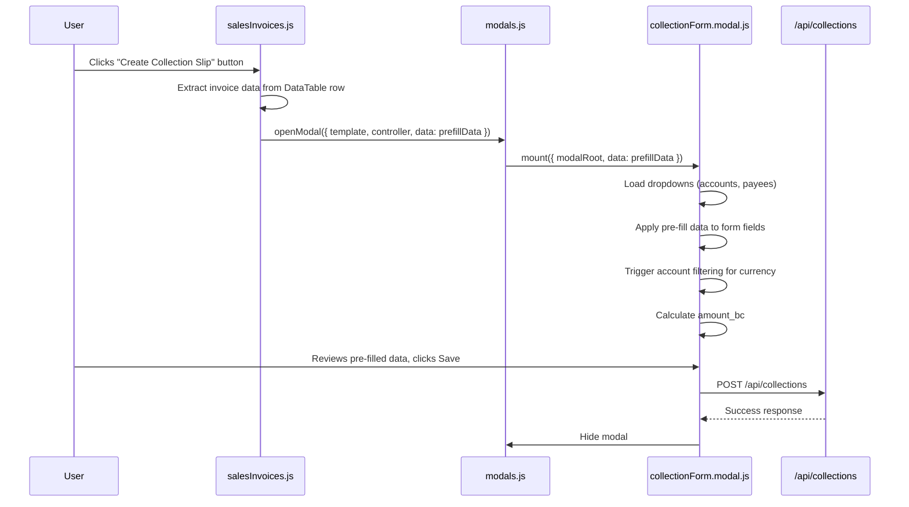

# Design Document: Invoice Collection Shortcut

## Overview

This feature adds a "Create Collection Slip" shortcut button to the Sales Invoices page. When a user clicks the button on a paid invoice row, the system opens the existing Collection Form modal with invoice data pre-filled (customer, reference, amount, currency, exchange rate). This eliminates manual data re-entry when creating collection slips for invoices that are already paid at the time of entry.

The implementation requires changes to two existing JavaScript modules and no backend changes, since the existing `/api/collections` POST endpoint and `/api/sales-invoices` GET endpoint already provide all necessary data.

## Architecture



The architecture leverages the existing modal system (`openModal`) which already supports passing arbitrary `data` to modal controllers. The collection form's `mount` function already receives a `data` parameter — we extend it to recognize pre-fill fields.

## Components and Interfaces

### 1. Sales Invoices Page (`salesInvoices.js`)

**Changes:**
- Add a new page action `invoice.collect` that extracts invoice data and opens the collection form modal
- Modify `renderTable()` to render the shortcut button for PAID invoices when the user has `collections.create` permission
- Listen for `collections.updated` event to refresh the invoice table after a collection is created

**New action handler:**
```javascript
'invoice.collect': async ({ el }) => {
    const tr = el.closest('tr');
    const rowData = invDataTable.row(tr).data();
    // rowData contains: [id, invoice_number, customer_name, date, status, totalFc, totalBc, actions]
    // We need full invoice data, so fetch it
    const invoiceId = rowData[0];
    const res = await apiFetch(`/api/sales-invoices/${invoiceId}`);
    const json = await res.json();
    if (!json.success) return;
    const inv = json.data.sales_invoice;

    await openModal({
        scope: MODAL_SCOPE.PAGE,
        template: 'html/Finance/collectionForm.html',
        controller: '../pages/Finance/collectionForm.modal.js',
        data: {
            prefill: {
                payee_id: inv.customer_payee_id,
                reference_type: 'CUSTOMER',
                reference_id: inv.invoice_number,
                currency: inv.currency,
                exchange_rate: inv.exchange_rate,
                amount_fc: inv.total_amount_fc,
            }
        },
        options: { backdrop: false, keyboard: true, focus: true }
    });
}
```

**Button rendering logic (in `renderTable`):**
```javascript
const canCollect = hasPermission('collections.create');

// Inside the forEach loop, after existing action buttons:
if (canCollect && inv.status === 'PAID') {
    actions += `<button data-action="invoice.collect" class="btn btn-secondary btn-circle btn-sm me-1" title="Create Collection Slip">
                    <i class="fas fa-receipt"></i></button>`;
}
```

### 2. Collection Form Modal (`collectionForm.modal.js`)

**Changes:**
- Extend the `mount` function to check for `data.prefill` and apply values after dropdowns are loaded
- Add a new `applyPrefill(prefill)` private function

**Pre-fill application logic:**
```javascript
async function applyPrefill(prefill) {
    if (!prefill) return;

    if (prefill.payee_id) {
        const payeeSelect = F.payee();
        const option = payeeSelect.querySelector(`option[value="${prefill.payee_id}"]`);
        if (option) {
            payeeSelect.value = prefill.payee_id;
        }
        // If option doesn't exist, leave unselected (Requirement 3.4)
    }

    if (prefill.reference_type) {
        F.referenceType().value = prefill.reference_type;
    }

    if (prefill.reference_id) {
        F.referenceId().value = prefill.reference_id;
    }

    if (prefill.currency) {
        F.currency().value = prefill.currency;
        // Trigger account filtering for the pre-filled currency
        await loadAccounts(prefill.currency);
    }

    if (prefill.exchange_rate) {
        F.exchangeRate().value = prefill.exchange_rate;
    }

    if (prefill.amount_fc) {
        F.amountFc().value = prefill.amount_fc;
        recalcBc(); // Calculate amount_bc from pre-filled values
    }
}
```

### 3. Data Flow Interface

**Pre-fill data object passed from salesInvoices.js to collectionForm.modal.js:**

```typescript
interface PrefillData {
    payee_id?: string | number;      // Customer's payee_id from the invoice
    reference_type?: string;          // Always "CUSTOMER" for this shortcut
    reference_id?: string;            // Invoice number (human-readable reference)
    currency?: string;                // Invoice currency code (e.g., "USD", "LBP")
    exchange_rate?: number | string;  // Invoice exchange rate
    amount_fc?: number | string;      // Invoice total in foreign currency
}
```

## Data Models

No new database tables or columns are required. The feature uses existing data:

**Sales Invoice (from GET /api/sales-invoices/{id}):**
| Field | Type | Usage |
|-------|------|-------|
| id | int | Internal ID |
| customer_id | int | FK to people table |
| customer_payee_id | int | Customer's payee_id for collection form |
| invoice_number | string | Used as reference_id in collection |
| currency | string | Pre-filled into collection form |
| exchange_rate | decimal | Pre-filled into collection form |
| total_amount_fc | decimal | Pre-filled as amount_fc |
| total_amount_bc | decimal | Not directly used (recalculated) |
| status | enum | Controls button visibility (PAID only) |

**Collection (POST /api/collections) — existing payload, unchanged:**
| Field | Type | Source |
|-------|------|--------|
| account_id | int | User selects manually |
| payee_id | int | Pre-filled from invoice.customer_payee_id |
| reference_type | string | Set to "CUSTOMER" |
| reference_id | string | Set to invoice_number |
| slip_number | string | User enters manually |
| slip_date | date | User enters manually |
| currency | string | Pre-filled from invoice.currency |
| exchange_rate | decimal | Pre-filled from invoice.exchange_rate |
| amount_fc | decimal | Pre-filled from invoice.total_amount_fc |
| method | string | User selects manually |
| notes | string | User enters manually (optional) |

**Note:** The `customer_payee_id` field needs to be included in the sales invoice API response. Currently the `GET /api/sales-invoices/{id}` endpoint returns `customer_id` (the people table ID). We need to also return the `payee_id` associated with that customer so the collection form can select the correct payee. This may require a minor backend adjustment to join the payee_id in the sales invoice detail response.

## Correctness Properties

*A property is a characteristic or behavior that should hold true across all valid executions of a system — essentially, a formal statement about what the system should do. Properties serve as the bridge between human-readable specifications and machine-verifiable correctness guarantees.*

### Property 1: Status-based button visibility

*For any* invoice rendered in the sales invoices table, the "Create Collection Slip" button SHALL appear in the actions column if and only if the invoice status is "PAID".

**Validates: Requirements 1.1, 1.2**

### Property 2: Permission-based button visibility

*For any* set of invoices rendered in the sales invoices table, if the current user lacks the `collections.create` permission, then no invoice row SHALL contain the "Create Collection Slip" button, regardless of invoice status.

**Validates: Requirements 1.4**

### Property 3: Pre-fill data mapping preserves invoice values

*For any* valid invoice object with customer_payee_id, invoice_number, currency, exchange_rate, and total_amount_fc, when the collection form is mounted with pre-fill data derived from that invoice, the form fields (payee, reference_id, currency, exchange_rate, amount_fc) SHALL contain values equal to the corresponding invoice fields.

**Validates: Requirements 2.2, 2.4, 2.5, 2.6, 2.7, 3.1, 3.2**

### Property 4: Amount BC calculation from pre-filled values

*For any* amount_fc and exchange_rate values pre-filled into the collection form, the displayed amount_bc SHALL equal `Math.round(amount_fc * exchange_rate * 100) / 100` (i.e., the result of `calcBc(amount_fc, exchange_rate)`).

**Validates: Requirements 2.8**

## Error Handling

| Scenario | Handling |
|----------|----------|
| Invoice fetch fails when clicking shortcut | Log error to console; do not open modal. Optionally show alert. |
| Payee from invoice not found in payee dropdown | Leave payee field unselected; user can manually select (Req 3.4) |
| No accounts available for the pre-filled currency | Account dropdown shows "No accounts for this currency" (existing behavior in `loadAccounts`) |
| Collection save fails (API error) | Existing error handling in collectionForm.modal.js displays error message in modal footer |
| User lacks `collections.create` permission | Button is not rendered; no action handler is reachable |

## Testing Strategy

### Unit Tests (Example-based)

1. **Button rendering**: Verify the shortcut button HTML is generated for a PAID invoice and not for DRAFT/APPROVED/CANCELLED invoices
2. **Permission check**: Verify the button is omitted when `hasPermission('collections.create')` returns false
3. **Pre-fill application with missing payee**: Verify the form handles a payee_id that doesn't exist in the dropdown gracefully
4. **Reference type constant**: Verify reference_type is always set to "CUSTOMER"
5. **Modal open integration**: Verify clicking the button calls `openModal` with correct template and controller paths
6. **Currency triggers account filter**: Verify that setting currency in pre-fill triggers `loadAccounts` with that currency

### Property-Based Tests

- **Library**: fast-check (JavaScript property-based testing library)
- **Minimum iterations**: 100 per property
- **Tag format**: `Feature: invoice-collection-shortcut, Property {N}: {title}`

| Property | What is generated | What is verified |
|----------|-------------------|------------------|
| 1: Status-based visibility | Random invoices with random statuses | Button present ↔ status === 'PAID' |
| 2: Permission-based visibility | Random PAID invoices + permission flag | Button absent when permission is false |
| 3: Pre-fill data mapping | Random invoice objects with valid field values | All form fields match invoice values after mount |
| 4: Amount BC calculation | Random amount_fc (0-999999) and exchange_rate (0.0001-9999) | amount_bc === calcBc(amount_fc, exchange_rate) |

### Integration Tests

1. End-to-end flow: Click shortcut → form opens with correct data → save → modal closes → page remains
2. Verify the `collections.updated` event triggers invoice list refresh
