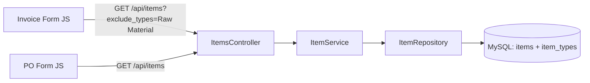

# Design Document: Invoice Item Filter

## Overview

This feature adds an optional `exclude_types` query parameter to the existing `/api/items` endpoint, enabling callers to filter out items by their type name. The Sales Invoice form will use this parameter to hide "Raw Material" items from the item selector dropdown, while the Purchase Order form continues to show all items unchanged.

The design prioritizes:
- **Backward compatibility**: No parameter = current behavior preserved
- **Configurability**: The exclusion list is passed as a parameter, not hardcoded in the backend
- **Minimal surface area**: A single query parameter on an existing endpoint, no new tables or endpoints

## Architecture

The change touches three layers:



1. **API Layer** (`ItemsController::index`) — reads `$_GET['exclude_types']`, parses it, passes to service
2. **Service Layer** (`ItemService::listForCurrentBusiness`) — accepts optional exclusion array, delegates to repository
3. **Repository Layer** (`ItemRepository::getAllForBusiness`) — builds SQL with optional `WHERE` clause excluding types
4. **Frontend** (`invoiceForm.modal.js`) — appends `?exclude_types=Raw Material` to the items fetch URL

The PO form (`poForm.modal.js`) remains unchanged — it calls `/api/items` without the parameter.

## Components and Interfaces

### Backend Changes

#### `ItemsController::index()`

```php
public function index(): void {
    try {
        $this->auth();
        $excludeTypes = $_GET['exclude_types'] ?? null;
        $items = $this->service->listForCurrentBusiness($excludeTypes);
        $this->json(true, ['items' => $items]);
    } catch (\Throwable $e) {
        $this->serverError('Failed to fetch items');
    }
}
```

#### `ItemService::listForCurrentBusiness()`

Signature change:
```php
public function listForCurrentBusiness(?string $excludeTypesParam = null): array
```

Responsibilities:
- Parse the comma-separated string into an array
- Trim whitespace from each segment
- Remove empty segments
- Pass the cleaned array to the repository

```php
public function listForCurrentBusiness(?string $excludeTypesParam = null): array {
    $ctx = AuthContext::get();
    $excludeTypes = $this->parseExcludeTypes($excludeTypesParam);
    return $this->repo->getAllForBusiness($ctx->tenant_id, $ctx->business_id, $excludeTypes);
}

private function parseExcludeTypes(?string $param): array {
    if ($param === null || trim($param) === '') {
        return [];
    }
    $types = explode(',', $param);
    $cleaned = [];
    foreach ($types as $type) {
        $trimmed = trim($type);
        if ($trimmed !== '') {
            $cleaned[] = $trimmed;
        }
    }
    return $cleaned;
}
```

#### `ItemRepository::getAllForBusiness()`

Signature change:
```php
public function getAllForBusiness(int $tenantId, int $businessId, array $excludeTypes = []): array
```

When `$excludeTypes` is non-empty, add a `WHERE` clause using `LOWER(TRIM(it.name)) NOT IN (...)` with parameterized placeholders. The comparison is case-insensitive by lowercasing both sides.

```php
public function getAllForBusiness(int $tenantId, int $businessId, array $excludeTypes = []): array {
    $params = ['tenant' => $tenantId, 'business1' => $businessId, 'business2' => $businessId];
    $excludeClause = '';

    if (!empty($excludeTypes)) {
        $placeholders = [];
        foreach ($excludeTypes as $i => $type) {
            $key = "excl_{$i}";
            $placeholders[] = ":{$key}";
            $params[$key] = strtolower(trim($type));
        }
        $excludeClause = "AND LOWER(TRIM(it.name)) NOT IN (" . implode(',', $placeholders) . ")";
    }

    $sql = "
        SELECT i.id, i.name, i.sku, i.unit,
               i.cost_price, i.sale_price, i.is_active, i.notes,
               i.business_id,
               it.name AS type_name,
               COALESCE(s.quantity, 0) AS stock_qty
        FROM items i
        JOIN item_types it ON it.id = i.item_type_id
        LEFT JOIN stock s ON s.item_id = i.id AND s.business_id = :business1
        WHERE i.tenant_id = :tenant
          AND (i.business_id = :business2 OR i.business_id IS NULL)
          AND i.is_active = 1
          {$excludeClause}
        ORDER BY i.name
    ";

    $stmt = $this->db->prepare($sql);
    $stmt->execute($params);
    return $stmt->fetchAll(PDO::FETCH_ASSOC);
}
```

### Frontend Changes

#### `invoiceForm.modal.js` — `loadItems()`

```javascript
async function loadItems() {
    try {
        const res  = await apiFetch('/api/items?exclude_types=Raw Material');
        const json = await res.json();
        itemsList  = json.success ? (json.data?.items ?? []) : [];
    } catch (err) {
        console.error('loadItems failed:', err);
        itemsList = [];
    }
}
```

#### `invoiceForm.modal.js` — `buildItemOptions()` (existing line items)

When loading an existing invoice, line items may reference items that are now excluded from the dropdown. The `fetchAndFill` function already calls `addLineRow` with a `prefill.item_id`. The `buildItemOptions` function builds `<option>` elements from `itemsList`. If the prefilled item is not in `itemsList` (because it was filtered out), we need to ensure it still appears as a selected option.

Strategy: When `addLineRow` is called with a `prefill.item_id` that doesn't exist in `itemsList`, inject a manual `<option>` for that item using the line item data from the invoice response. The invoice API already returns `item_name` for each line.

Update `fetchAndFill` to pass `item_name` to `addLineRow`:
```javascript
lines.forEach(line => {
    addLineRow({
        item_id:       line.item_id,
        item_name:     line.item_name,
        quantity:      line.quantity,
        unit_price_fc: line.unit_price_fc,
        unit_price_bc: line.unit_price_bc,
    });
});
```

Update `buildItemOptions` to accept an optional fallback:
```javascript
function buildItemOptions(selectedId, fallbackName) {
    let opts = '<option value="">— Select item —</option>';
    let found = false;
    itemsList.forEach(item => {
        const sel = String(item.id) === String(selectedId) ? ' selected' : '';
        if (sel) found = true;
        const salePrice = item.sale_price != null ? parseFloat(item.sale_price) : 0;
        opts += `<option value="${item.id}"${sel} data-sale-price="${salePrice}">${escHtml(item.name)}</option>`;
    });
    // If the selected item was filtered out, add it as a fallback option
    if (selectedId && !found && fallbackName) {
        opts += `<option value="${selectedId}" selected>${escHtml(fallbackName)}</option>`;
    }
    return opts;
}
```

#### `poForm.modal.js` — No changes

The PO form continues to call `/api/items` without any query parameters.

## Data Models

No schema changes are required. The feature uses existing tables:

```
┌─────────────┐       ┌──────────────┐       ┌───────┐
│ item_types  │       │    items     │       │ stock │
├─────────────┤       ├──────────────┤       ├───────┤
│ id (PK)     │◄──────│ item_type_id │       │ ...   │
│ tenant_id   │       │ tenant_id    │       └───────┘
│ business_id │       │ business_id  │
│ name        │       │ name         │
│ ...         │       │ is_active    │
└─────────────┘       │ ...          │
                      └──────────────┘
```

The filtering is performed at query time using the `item_types.name` column joined to `items.item_type_id`. No new columns, tables, or indexes are needed.

**Performance note**: The `LOWER(TRIM(it.name))` expression in the WHERE clause operates on the `item_types` table which is small (typically <20 rows per business). No index optimization is needed.

## Correctness Properties

*A property is a characteristic or behavior that should hold true across all valid executions of a system — essentially, a formal statement about what the system should do. Properties serve as the bridge between human-readable specifications and machine-verifiable correctness guarantees.*

### Property 1: Type exclusion filter correctness

*For any* set of active items with associated type names, and *for any* comma-separated `exclude_types` parameter string (with arbitrary casing and whitespace), the Items API SHALL return exactly those items whose type name — after trimming whitespace and lowercasing — does NOT match any non-empty, trimmed, lowercased entry in the exclusion list.

**Validates: Requirements 1.1, 1.3, 1.4, 4.1, 4.2, 4.3**

### Property 2: Empty exclusion preserves all items

*For any* set of active items, when the `exclude_types` parameter is absent, empty, or contains only whitespace/commas, the Items API SHALL return all active items for the business (identical to the unfiltered result set).

**Validates: Requirements 1.2, 1.5**

## Error Handling

| Scenario | Behavior |
|----------|----------|
| `exclude_types` contains non-existent type name | Ignored silently; valid items returned normally |
| `exclude_types` is empty string or only commas | Treated as no filter; all items returned |
| `exclude_types` contains SQL injection attempt | Parameterized queries prevent injection; treated as a literal type name that won't match anything |
| Items API fails | Existing error handling returns 500; frontend shows empty list with console error |
| Existing invoice references filtered-out item | Item name displayed via fallback option in the select element |

No new error codes or error responses are introduced. The feature degrades gracefully — if the parameter is malformed or contains garbage, it simply won't match any types and all items are returned.

## Testing Strategy

### Property-Based Tests (PHP, PHPUnit)

The project already uses PHPUnit with a `tests/Property` directory for property-based tests. We will use PHPUnit's data providers to generate randomized test inputs (following the existing pattern in `PriceUpdateCorrectnessPropertyTest.php`).

**Library**: PHPUnit 9.6 with `@dataProvider` for randomized iteration (existing project pattern)
**Minimum iterations**: 100+ per property

Each property test will:
- Generate random item sets with random type names
- Generate random `exclude_types` parameter strings with varied casing, whitespace, and empty segments
- Call the `parseExcludeTypes` method and/or the repository query logic
- Assert the correctness invariant holds

**Tag format**: `Feature: invoice-item-filter, Property {number}: {property_text}`

### Unit Tests

- `ItemService::parseExcludeTypes()` — specific examples:
  - `null` → empty array
  - `""` → empty array
  - `"Raw Material"` → `["Raw Material"]`
  - `"Raw Material,,Finished Goods"` → `["Raw Material", "Finished Goods"]`
  - `" Raw Material , "` → `["Raw Material"]`
- `ItemRepository::getAllForBusiness()` with exclude types — verify SQL excludes correct items
- `buildItemOptions()` fallback behavior — verify excluded items appear when pre-selected

### Integration Tests

- End-to-end API call with `exclude_types=Raw Material` returns filtered results
- End-to-end API call without parameter returns all items
- Invoice form loads with filtered items (manual/browser test)
- PO form loads with all items (manual/browser test)
- Existing invoice with raw material line items displays correctly (manual/browser test)

### Edge Cases (covered by property test generators)

- Type name that doesn't exist in the system
- Empty segments in comma-separated list
- Whitespace-only segments
- Mixed casing variations
- Single type vs. multiple types
- All items excluded (empty result set)
- No items match exclusion (all items returned)
