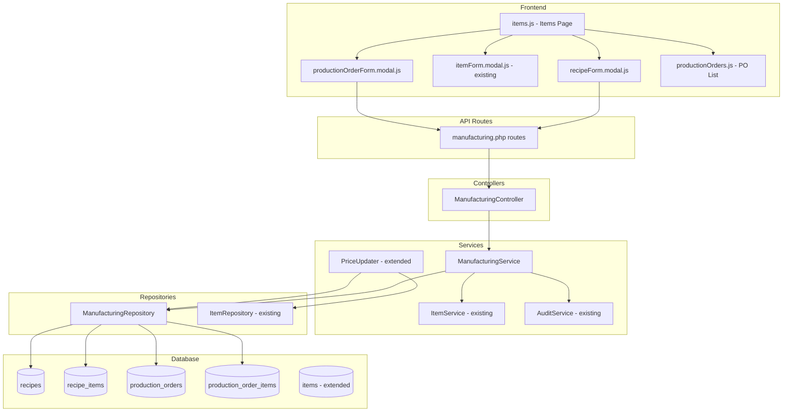
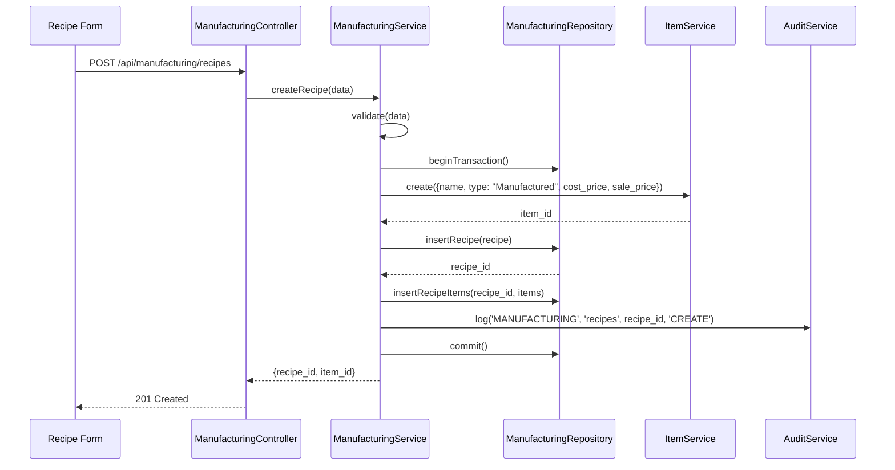
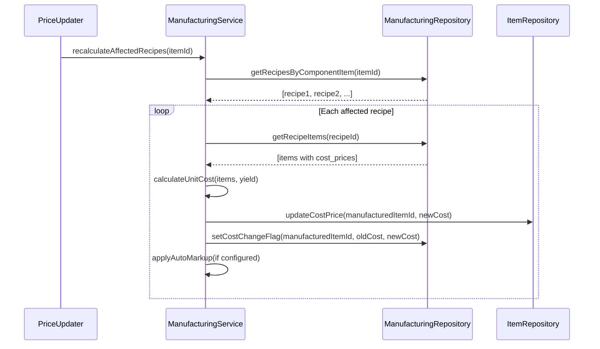
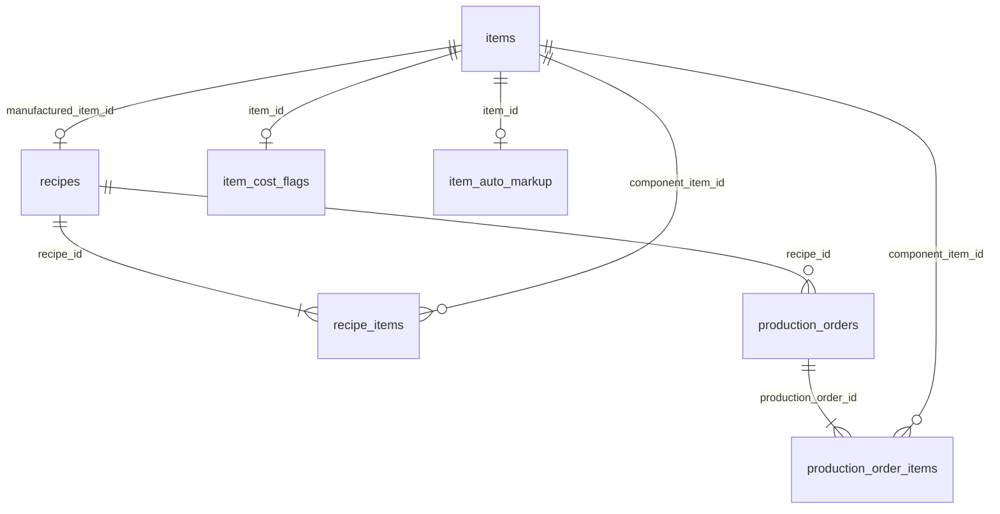

# Design Document: Manufacturing Module

## Overview

The Manufacturing Module extends the existing ERP system to support recipe-driven item creation, production order execution, and cascading cost management. The core design principle is that **the recipe form is the single entry point for creating manufactured items** — saving a recipe auto-creates an item with type "Manufactured", and editing a manufactured item routes back to the recipe form.

Key design decisions:
- **Recipe-as-factory**: A Recipe is the authoritative source for a Manufactured Item. Creating a recipe creates the item; deleting a recipe deactivates the item.
- **Yield-aware costing**: Recipes specify a yield quantity (units per batch), and cost-per-unit is calculated as total material cost divided by yield.
- **Cascading recalculation**: When a raw material's `cost_price` changes (via PO receive or manual edit), all recipes using that material are identified and their manufactured items' `cost_price` is recalculated automatically.
- **Cost change flagging**: Manufactured items affected by cascading recalculation are flagged so the user can review and adjust sale prices.
- **Optional auto-markup**: A configurable percentage markup can automatically adjust the sale price when cost changes.
- **Edit routing**: The items page intercepts the edit action for Manufactured items and opens the recipe form instead of the standard item form.
- **Atomic production**: Production orders execute all stock adjustments (deductions + additions) within a single database transaction.

The module follows the established patterns: Controller → Service → Repository, PDO with prepared statements, `AuthContext` for tenant/business scoping, `AuditService` for logging, and the Router's permission array for access control.

## Architecture



### Flow: Recipe Creation


### Flow: Cascading Recalculation


## Components and Interfaces

### Backend Components

#### ManufacturingController (`src/Controllers/ManufacturingController.php`)

Extends `BaseController`. Handles HTTP requests for recipes and production orders.

```php
class ManufacturingController extends BaseController {
    // Recipe endpoints
    public function indexRecipes(): void;          // GET /manufacturing/recipes
    public function viewRecipe(int $id): void;     // GET /manufacturing/recipes/{id}
    public function storeRecipe(): void;           // POST /manufacturing/recipes
    public function updateRecipe(int $id): void;   // PUT /manufacturing/recipes/{id}
    public function deleteRecipe(int $id): void;   // DELETE /manufacturing/recipes/{id}

    // Production Order endpoints
    public function indexOrders(): void;           // GET /manufacturing/orders
    public function viewOrder(int $id): void;      // GET /manufacturing/orders/{id}
    public function storeOrder(): void;            // POST /manufacturing/orders
    public function reverseOrder(int $id): void;   // POST /manufacturing/orders/{id}/reverse

    // Cost flag management
    public function dismissCostFlag(int $itemId): void; // POST /manufacturing/items/{id}/dismiss-cost-flag
}
```

#### ManufacturingService (`src/Services/ManufacturingService.php`)

Core business logic for recipes, production orders, and cost calculations.

```php
class ManufacturingService {
    public function __construct(PDO $db);

    // Recipe CRUD
    public function createRecipe(array $data): array;   // Returns ['recipe_id' => int, 'item_id' => int]
    public function updateRecipe(int $id, array $data): void;
    public function deleteRecipe(int $id): void;
    public function getRecipe(int $id): array;
    public function listRecipes(): array;
    public function getRecipeByItemId(int $itemId): ?array;

    // Production Orders
    public function createProductionOrder(array $data): int;
    public function reverseProductionOrder(int $id): void;
    public function getProductionOrder(int $id): array;
    public function listProductionOrders(?array $filters = null): array;

    // Cost Calculation
    public function calculateUnitCost(array $recipeItems, int $yieldQuantity): float;
    public function recalculateAffectedRecipes(int $componentItemId): void;
    public function dismissCostChangeFlag(int $itemId): void;
}
```

#### ManufacturingRepository (`src/Repository/ManufacturingRepository.php`)

Data access layer for manufacturing tables.

```php
class ManufacturingRepository {
    public function __construct(PDO $db);

    // Recipes
    public function insertRecipe(array $data): int;
    public function updateRecipe(int $id, int $tenantId, array $data): void;
    public function deleteRecipe(int $id, int $tenantId): void;
    public function getRecipeById(int $id, int $tenantId, int $businessId): ?array;
    public function getRecipeByItemId(int $itemId, int $tenantId, int $businessId): ?array;
    public function getAllRecipes(int $tenantId, int $businessId): array;
    public function getRecipesByComponentItem(int $itemId, int $tenantId): array;

    // Recipe Items
    public function insertRecipeItems(int $recipeId, array $items): void;
    public function deleteRecipeItems(int $recipeId): void;
    public function getRecipeItems(int $recipeId): array;

    // Production Orders
    public function insertProductionOrder(array $data): int;
    public function insertProductionOrderItems(int $orderId, array $items): void;
    public function getProductionOrderById(int $id, int $tenantId, int $businessId): ?array;
    public function getAllProductionOrders(int $tenantId, int $businessId, ?array $filters): array;
    public function updateProductionOrderStatus(int $id, string $status): void;
    public function countProductionOrdersForRecipe(int $recipeId): int;

    // Cost Flags
    public function setCostChangeFlag(int $itemId, float $oldCost, float $newCost): void;
    public function getCostChangeFlag(int $itemId): ?array;
    public function dismissCostChangeFlag(int $itemId): void;
    public function getAutoMarkupConfig(int $itemId): ?array;
    public function setAutoMarkupConfig(int $itemId, float $markupPercent): void;
}
```

#### PriceUpdater Extension (`src/Services/PriceUpdater.php`)

The existing `PriceUpdater::updatePricesFromPO()` will be extended to trigger cascading recalculation after updating a component item's cost price.

```php
// Added to PriceUpdater::updatePricesFromPO() after updating item cost:
$manufacturingService = new ManufacturingService($this->db);
$manufacturingService->recalculateAffectedRecipes((int) $itemId);
```

Similarly, `ItemService::update()` will trigger recalculation when `cost_price` changes on an item that is used as a component.

### Frontend Components

#### recipeForm.modal.js (`public/assets/js/pages/Items/recipeForm.modal.js`)

The recipe creation/edit form. Includes:
- Item name input field
- Component items table with add/remove rows
- Yield quantity input
- Sale price input (optional)
- Auto-markup percentage input (optional)
- **Real-time cost-per-unit display** that recalculates on every change
- Save/Cancel buttons

```javascript
// Key interface
export async function mount({ modalRoot, data });  // data: { recipe_id?: int }
export function unmount();

// Internal functions
function addComponentRow();
function removeComponentRow(index);
function recalculateCost();        // Called on every input change
function validateForm(): boolean;
function saveRecipe(): Promise;
```

#### productionOrderForm.modal.js (`public/assets/js/pages/Items/productionOrderForm.modal.js`)

Form for creating a production order. Includes:
- Recipe selector dropdown
- Production quantity input
- Calculated material requirements display
- Estimated cost display
- Execute button

#### items.js Modifications

The existing `items.js` will be modified to:
1. Add a "Create Recipe" button alongside the existing "Add Item" button
2. Intercept the `items.edit` action: check if the item's `type_name === 'Manufactured'`, and if so, open `recipeForm.modal.js` instead of `itemForm.modal.js`
3. Display a cost-change indicator badge on items with an active `cost_change_flag`
4. Add a "Produce" button for manufactured items (opens production order form)

### API Routes (`public/api/routes/manufacturing.php`)

```php
// Recipes
$router->get('/manufacturing/recipes', ...);                    // ['manufacturing.view']
$router->get('/manufacturing/recipes/{id}', ...);               // ['manufacturing.view']
$router->post('/manufacturing/recipes', ...);                   // ['manufacturing.create']
$router->put('/manufacturing/recipes/{id}', ...);               // ['manufacturing.edit']
$router->delete('/manufacturing/recipes/{id}', ...);            // ['manufacturing.delete']

// Production Orders
$router->get('/manufacturing/orders', ...);                     // ['manufacturing.view']
$router->get('/manufacturing/orders/{id}', ...);                // ['manufacturing.view']
$router->post('/manufacturing/orders', ...);                    // ['manufacturing.create']
$router->post('/manufacturing/orders/{id}/reverse', ...);       // ['manufacturing.create']

// Cost flag management
$router->post('/manufacturing/items/{id}/dismiss-cost-flag', ...); // ['manufacturing.edit']
$router->post('/manufacturing/items/{id}/auto-markup', ...);       // ['manufacturing.edit']
```

## Data Models

### New Tables

#### `recipes`
| Column | Type | Constraints | Description |
|--------|------|-------------|-------------|
| id | INT | PK, AUTO_INCREMENT | |
| tenant_id | INT | NOT NULL, FK → tenants.id | Tenant isolation |
| business_id | INT | NOT NULL, FK → businesses.id | Business isolation |
| manufactured_item_id | INT | NOT NULL, FK → items.id | The auto-created manufactured item |
| yield_quantity | INT | NOT NULL, DEFAULT 1 | Units produced per batch |
| notes | TEXT | NULL | Optional recipe notes |
| is_active | TINYINT(1) | NOT NULL, DEFAULT 1 | Soft-delete flag |
| created_by | INT | NOT NULL, FK → users.id | |
| created_at | DATETIME | NOT NULL | |
| updated_at | DATETIME | NULL | |

#### `recipe_items`
| Column | Type | Constraints | Description |
|--------|------|-------------|-------------|
| id | INT | PK, AUTO_INCREMENT | |
| recipe_id | INT | NOT NULL, FK → recipes.id ON DELETE CASCADE | |
| component_item_id | INT | NOT NULL, FK → items.id | The raw material/component |
| quantity | DECIMAL(12,4) | NOT NULL | Quantity needed per batch yield |

**Unique constraint**: `(recipe_id, component_item_id)` — a component can only appear once per recipe.

#### `production_orders`
| Column | Type | Constraints | Description |
|--------|------|-------------|-------------|
| id | INT | PK, AUTO_INCREMENT | |
| tenant_id | INT | NOT NULL, FK → tenants.id | |
| business_id | INT | NOT NULL, FK → businesses.id | |
| recipe_id | INT | NOT NULL, FK → recipes.id | |
| manufactured_item_id | INT | NOT NULL, FK → items.id | |
| production_quantity | DECIMAL(12,4) | NOT NULL | Units to produce |
| manufacturing_cost | DECIMAL(12,4) | NOT NULL | Total batch cost |
| unit_manufacturing_cost | DECIMAL(12,4) | NOT NULL | Cost per unit |
| status | ENUM('COMPLETED','REVERSED') | NOT NULL, DEFAULT 'COMPLETED' | |
| production_date | DATETIME | NOT NULL | |
| created_by | INT | NOT NULL, FK → users.id | |
| created_at | DATETIME | NOT NULL | |

#### `production_order_items`
| Column | Type | Constraints | Description |
|--------|------|-------------|-------------|
| id | INT | PK, AUTO_INCREMENT | |
| production_order_id | INT | NOT NULL, FK → production_orders.id ON DELETE CASCADE | |
| component_item_id | INT | NOT NULL, FK → items.id | |
| quantity_consumed | DECIMAL(12,4) | NOT NULL | Actual quantity deducted |
| unit_cost | DECIMAL(12,4) | NOT NULL | Component cost_price at time of production |

#### `item_cost_flags`
| Column | Type | Constraints | Description |
|--------|------|-------------|-------------|
| id | INT | PK, AUTO_INCREMENT | |
| item_id | INT | NOT NULL, FK → items.id, UNIQUE | One active flag per item |
| old_cost_price | DECIMAL(12,4) | NOT NULL | Previous cost |
| new_cost_price | DECIMAL(12,4) | NOT NULL | Updated cost |
| is_dismissed | TINYINT(1) | NOT NULL, DEFAULT 0 | User acknowledged |
| created_at | DATETIME | NOT NULL | |
| dismissed_at | DATETIME | NULL | |

#### `item_auto_markup`
| Column | Type | Constraints | Description |
|--------|------|-------------|-------------|
| id | INT | PK, AUTO_INCREMENT | |
| item_id | INT | NOT NULL, FK → items.id, UNIQUE | One config per item |
| markup_percent | DECIMAL(5,2) | NOT NULL | e.g., 30.00 for 30% |
| is_enabled | TINYINT(1) | NOT NULL, DEFAULT 1 | |
| created_at | DATETIME | NOT NULL | |
| updated_at | DATETIME | NULL | |

### Modified Tables

#### `items` — Additional Columns
| Column | Type | Constraints | Description |
|--------|------|-------------|-------------|
| has_cost_change_flag | TINYINT(1) | NOT NULL, DEFAULT 0 | Quick-check flag for UI display |

### Seed Data

A new item type "Manufactured" must exist in `item_types`:
```sql
INSERT INTO item_types (tenant_id, business_id, name, created_at)
SELECT tenant_id, business_id, 'Manufactured', NOW()
FROM businesses
WHERE NOT EXISTS (
    SELECT 1 FROM item_types WHERE name = 'Manufactured' AND tenant_id = businesses.tenant_id
);
```

### Key Relationships



## Correctness Properties

*A property is a characteristic or behavior that should hold true across all valid executions of a system — essentially, a formal statement about what the system should do. Properties serve as the bridge between human-readable specifications and machine-verifiable correctness guarantees.*

### Property 1: Unit cost calculation correctness

*For any* set of component items with positive cost prices, positive quantities, and any yield quantity greater than zero, the calculated unit manufacturing cost SHALL equal the sum of (each component's cost_price × its quantity) divided by the yield quantity.

**Validates: Requirements 1.3, 2.5, 6.1, 6.2, 6.4, 12.6**

### Property 2: Recipe creation produces a correctly-typed manufactured item

*For any* valid recipe data (non-empty name, at least one component with quantity > 0, yield > 0), saving the recipe SHALL create an item with type "Manufactured", the specified name, and a cost_price equal to the calculated unit manufacturing cost.

**Validates: Requirements 1.2, 1.3, 1.10**

### Property 3: Invalid recipe input rejection

*For any* recipe creation or update attempt where any of the following hold: (a) manufactured item name is empty/whitespace, (b) any component quantity is ≤ 0, (c) yield quantity is ≤ 0, or (d) a component item does not belong to the current tenant/business — the operation SHALL be rejected and no data SHALL be persisted.

**Validates: Requirements 1.4, 1.5, 1.6, 1.7, 2.2, 2.3, 8.3**

### Property 4: Production order required quantity calculation

*For any* recipe with component quantities and a yield quantity, and any production quantity > 0, the required quantity for each component SHALL equal (recipe_item_quantity / yield_quantity) × production_quantity.

**Validates: Requirements 5.2**

### Property 5: Production order stock conservation

*For any* successfully executed production order, the net stock change for each component item SHALL be a decrease of exactly its required quantity, and the net stock change for the manufactured item SHALL be an increase of exactly the production quantity.

**Validates: Requirements 5.5, 5.6**

### Property 6: Production order reversal is the inverse of execution

*For any* production order that is executed and then reversed, the net stock change for every involved item (components and manufactured item) SHALL be zero — i.e., stock levels return to their pre-execution state.

**Validates: Requirements 10.1, 10.2, 10.5**

### Property 7: Insufficient stock prevents production order execution

*For any* production order where at least one component item has current stock less than its required quantity, the production order SHALL be rejected, no stock adjustments SHALL occur, and the error SHALL identify each short item and its deficit.

**Validates: Requirements 5.3, 5.4**

### Property 8: Cascading recalculation updates all affected manufactured items

*For any* component item whose cost_price changes, every recipe that uses that component SHALL have its manufactured item's cost_price updated to the newly calculated unit manufacturing cost, and a cost change flag SHALL be set with the old and new cost values.

**Validates: Requirements 6.5, 6.6, 6.7, 6.8**

### Property 9: Auto-markup applies correct sale price on cascading recalculation

*For any* manufactured item with auto-markup enabled (markup_percent > 0), when a cascading recalculation updates its cost_price, the sale_price SHALL be updated to new_cost_price × (1 + markup_percent / 100).

**Validates: Requirements 11.5**

### Property 10: Recipe deletion deactivates manufactured item

*For any* recipe with no associated production orders, deleting the recipe SHALL remove the recipe and all its recipe items, AND set the associated manufactured item's is_active to false.

**Validates: Requirements 3.1, 3.3**

### Property 11: Recipe with production orders cannot be deleted

*For any* recipe that has one or more associated production orders, a deletion request SHALL be rejected and the recipe SHALL remain unchanged.

**Validates: Requirements 3.2**

### Property 12: Double reversal prevention

*For any* production order already in REVERSED status, a subsequent reversal request SHALL be rejected and no stock adjustments SHALL occur.

**Validates: Requirements 10.6**

### Property 13: Tenant and business data isolation

*For any* recipe or production order query, the results SHALL contain only records matching the requesting user's tenant_id and business_id — no records from other tenants or businesses SHALL be returned.

**Validates: Requirements 8.1, 8.2**

### Property 14: Production order list ordering

*For any* set of production orders for a business, the list endpoint SHALL return them ordered by production_date descending.

**Validates: Requirements 7.1**

### Property 15: Production order date and item filtering

*For any* date range filter applied to the production orders list, only orders with production_date within that range SHALL be returned. For any manufactured item filter, only orders for that item SHALL be returned.

**Validates: Requirements 7.3**

### Property 16: Cost change flag dismissal

*For any* manufactured item with an active cost change flag, dismissing the flag SHALL clear it so the item no longer shows as flagged, and the old/new cost values SHALL no longer be displayed.

**Validates: Requirements 11.2, 11.3**

### Property 17: Audit logging for manufacturing operations

*For any* manufacturing operation (recipe create/update/delete, production order create/reverse), an audit log entry SHALL be recorded with the correct event type, table, record ID, action, and before/after values where applicable.

**Validates: Requirements 1.9, 2.6, 3.4, 5.10, 10.7**

## Error Handling

### Validation Errors (HTTP 422)

| Scenario | Error Message |
|----------|--------------|
| Empty manufactured item name | "Manufactured item name is required" |
| No component items | "At least one component item is required" |
| Component quantity ≤ 0 | "Quantity for {item_name} must be greater than zero" |
| Yield quantity ≤ 0 | "Yield quantity must be greater than zero" |
| Component not found / wrong tenant | "Component item '{name}' not found or not accessible" |
| Self-referencing component | "A recipe cannot use its own manufactured item as a component" |
| Recipe deletion with production orders | "Cannot delete recipe: it has been used in {count} production order(s)" |
| Production quantity ≤ 0 | "Production quantity must be greater than zero" |
| Insufficient stock | "Insufficient stock for: {item1} (need {x}, have {y}), {item2} (need {a}, have {b})" |
| Already reversed | "Production order has already been reversed" |
| Recipe not found | "Recipe not found" |
| Production order not found | "Production order not found" |

### Permission Errors (HTTP 403)

All manufacturing endpoints check permissions via the Router middleware. If the user lacks the required permission, the `AuthMiddleware` returns a 403 response before the controller method is invoked.

### Server Errors (HTTP 500)

Unexpected exceptions are caught at the controller level and return a generic error message. The actual exception is logged server-side. Transaction rollback ensures no partial state on failure.

### Transaction Failure Recovery

- Production order execution: If any `adjustStock()` call throws (e.g., insufficient stock detected mid-transaction due to race condition), the entire transaction is rolled back. The `ItemService.adjustStock()` already supports being called within an existing transaction (checks `$this->db->inTransaction()`).
- Cascading recalculation: Runs within a transaction. If any update fails, all cost changes are rolled back.

## Testing Strategy

### Property-Based Testing

**Library**: [PHPUnit](https://phpunit.de/) with [Eris](https://github.com/giorgiosironi/eris) for property-based testing in PHP.

**Configuration**: Each property test runs a minimum of 100 iterations.

**Tag format**: Each test is annotated with a comment:
```php
// Feature: manufacturing-module, Property {N}: {property_text}
```

**Properties to implement as PBT**:
- Property 1: Unit cost calculation (pure function — ideal for PBT)
- Property 3: Invalid input rejection (generate invalid inputs, verify rejection)
- Property 4: Required quantity calculation (pure function)
- Property 5: Stock conservation (generate recipes + quantities, verify stock changes)
- Property 6: Reversal as inverse (round-trip property)
- Property 7: Insufficient stock rejection (generate scenarios with shortfalls)
- Property 8: Cascading recalculation (generate component price changes)
- Property 9: Auto-markup calculation (pure function)
- Property 12: Double reversal prevention (idempotence property)
- Property 14: List ordering (generate orders with random dates)
- Property 15: Filtering (generate orders, apply filters, verify results)

### Unit Tests (Example-Based)

- Recipe creation happy path with specific known values
- Recipe edit with specific modifications
- Recipe deletion with and without production orders
- Permission checks (9.1–9.5) — specific 403 scenarios
- Edit routing logic — manufactured vs non-manufactured items
- Cost change flag display in items list response
- UI form element presence tests

### Integration Tests

- Full production order flow: create recipe → execute production → verify stock
- Transaction rollback on simulated failure (5.7, 5.8, 10.3, 10.4)
- Cascading recalculation triggered by PriceUpdater (end-to-end from PO receive)
- Multi-tenant isolation (create data in tenant A, verify invisible from tenant B)

### Test File Structure

```
tests/
├── Unit/
│   ├── ManufacturingCostCalculationTest.php    (Properties 1, 4, 9)
│   ├── ManufacturingValidationTest.php         (Property 3)
│   ├── ManufacturingRecipeTest.php             (Properties 2, 10, 11)
│   └── ManufacturingProductionOrderTest.php    (Properties 5, 6, 7, 12)
├── Property/
│   ├── CostCalculationPropertyTest.php         (Properties 1, 4, 9)
│   ├── StockConservationPropertyTest.php       (Properties 5, 6)
│   ├── ValidationRejectionPropertyTest.php     (Property 3)
│   ├── CascadingRecalculationPropertyTest.php  (Property 8)
│   ├── ProductionOrderFilterPropertyTest.php   (Properties 14, 15)
│   └── IdempotencePropertyTest.php             (Property 12)
└── Integration/
    ├── ProductionOrderFlowTest.php
    ├── CascadingRecalculationFlowTest.php
    └── TenantIsolationTest.php
```

