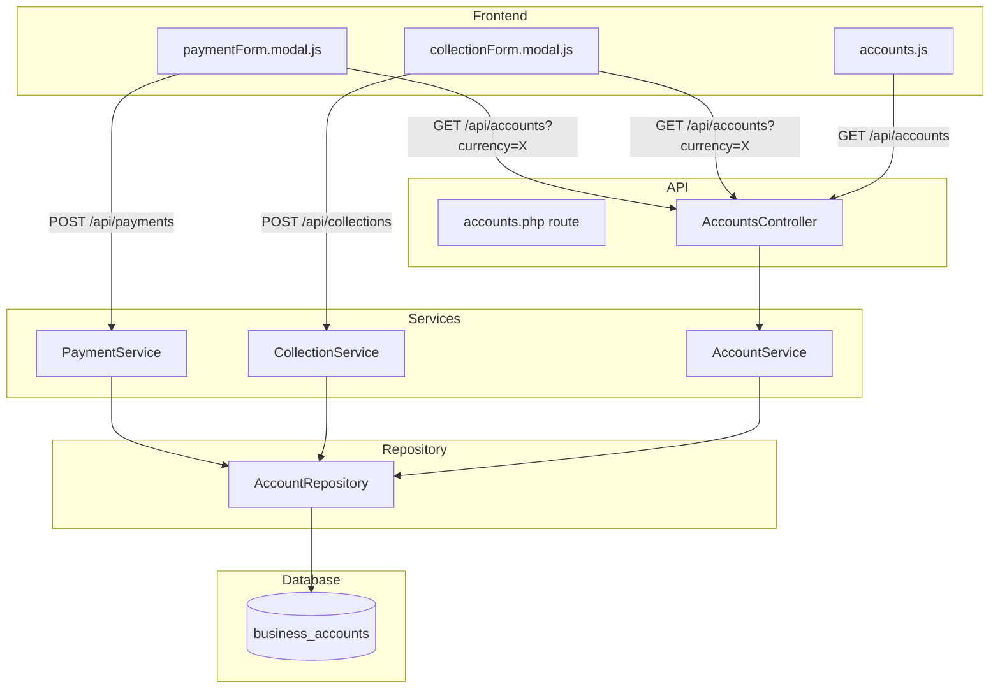
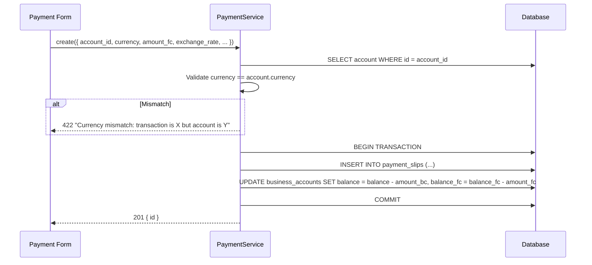

# Design Document: Multi-Currency Accounts

## Overview

This feature adds currency-aware account management to the ERP system. Currently, accounts carry a `currency` field and payments/collections reference an account, but nothing enforces that the transaction currency matches the account currency. Account balances are tracked only in business currency (`balance` / `amount_bc`), which obscures the true native-currency position.

The design introduces four capabilities:

1. **Server-side currency validation** — PaymentService and CollectionService reject slip creation when the transaction currency doesn't match the account's currency.
2. **Native balance tracking** — A new `balance_fc` column on `business_accounts` tracks the running balance in the account's own currency, updated atomically alongside the existing `balance` (BC) column.
3. **API and UI currency filtering** — The accounts list endpoint accepts an optional `?currency=` query parameter. The payment and collection form modals use this to show only accounts matching the selected currency.
4. **Consolidated account view** — The accounts page displays both native and BC balances, groups accounts by currency, and shows a BC total.

All changes are additive. Existing transactions remain accessible and deletable regardless of currency match. The `balance_fc` column initializes to `0` for existing accounts (no retroactive recalculation).

## Architecture

The feature touches three layers of the existing stack:



**Key design decisions:**

- **Validation in service layer, not repository** — Currency match validation lives in `PaymentService::create()` and `CollectionService::create()` because it's a business rule, not a data-access concern. The service already fetches the account to verify ownership; we add a currency comparison to the same lookup.
- **No new classes** — The existing `AccountRepository`, `AccountService`, `PaymentService`, and `CollectionService` are extended in-place. The codebase doesn't use a separate validator pattern; adding one would be inconsistent.
- **Single migration file** — One SQL migration adds the `balance_fc` column with a `DEFAULT 0` and `NOT NULL` constraint, which handles both new and existing rows.
- **Frontend filtering via API** — Rather than fetching all accounts and filtering client-side, the frontend passes `?currency=X` to the API. This keeps the filtering logic server-side and avoids sending unnecessary data.

## Components and Interfaces

### 1. AccountRepository (modified)

**File:** `src/Repository/AccountRepository.php`

New/changed methods:

| Method | Change | Description |
|--------|--------|-------------|
| `findAllForBusiness(int $businessId, ?string $currency = null): array` | Modified | Accepts optional `$currency` parameter. When provided, adds `AND LOWER(currency) = LOWER(:currency)` to the WHERE clause. SELECT now includes `balance_fc`. |
| `findById(int $id, int $businessId): ?array` | Modified | SELECT now includes `balance_fc`. |
| `create(array $data): int` | Modified | INSERT now includes `balance_fc` column, initialized to `0`. |
| `updateBalance(int $accountId, float $deltaBc, PDO $db, float $deltaFc = 0.0): void` | Modified | Adds `balance_fc = balance_fc + :delta_fc` to the UPDATE statement. The `$deltaFc` parameter defaults to `0.0` for backward compatibility. |

### 2. AccountService (modified)

**File:** `src/Services/AccountService.php`

| Method | Change | Description |
|--------|--------|-------------|
| `list(?string $currency = null): array` | Modified | Passes `$currency` to `AccountRepository::findAllForBusiness()`. |
| `update(int $id, array $data): void` | Modified | Before updating, checks if `$data` contains a `currency` key that differs from the existing account's currency. If so, throws `\InvalidArgumentException('Account currency cannot be changed')`. |

### 3. AccountsController (modified)

**File:** `src/Controllers/AccountsController.php`

| Method | Change | Description |
|--------|--------|-------------|
| `index(): void` | Modified | Reads `$_GET['currency']` and passes it to `AccountService::list()`. |

### 4. PaymentService (modified)

**File:** `src/Services/PaymentService.php`

| Method | Change | Description |
|--------|--------|-------------|
| `create(array $data): int` | Modified | After existing validation and before `$this->db->beginTransaction()`, fetches the account via `$this->accountRepo->findById($accountId, $ctx->business_id)` and compares `strtolower($account['currency'])` with `strtolower(trim($data['currency']))`. On mismatch, throws `\InvalidArgumentException`. Calls `updateBalance()` with both `$deltaBc = -$amountBc` and `$deltaFc = -$amountFc`. |
| `delete(int $id): void` | Modified | Reads `amount_fc` from the existing payment record. Calls `updateBalance()` with `$deltaBc = +$amountBc` and `$deltaFc = +$amountFc`. |

### 5. CollectionService (modified)

**File:** `src/Services/CollectionService.php`

| Method | Change | Description |
|--------|--------|-------------|
| `create(array $data): int` | Modified | Same currency validation as PaymentService. Calls `updateBalance()` with `$deltaBc = +$amountBc` and `$deltaFc = +$amountFc`. |
| `delete(int $id): void` | Modified | Reads `amount_fc` from the existing collection record. Calls `updateBalance()` with `$deltaBc = -$amountBc` and `$deltaFc = -$amountFc`. |

### 6. Frontend — paymentForm.modal.js (modified)

**File:** `public/assets/js/pages/Finance/paymentForm.modal.js`

Changes:
- `loadAccounts()` accepts an optional `currency` parameter and calls `/api/accounts?currency=X` when provided.
- A `change` event listener on the currency `<select>` calls `loadAccounts(selectedCurrency)` and resets the account dropdown selection.
- When no currency is selected, `loadAccounts()` is called without a parameter (returns all accounts).
- When the filtered list is empty, the account dropdown shows a single disabled option: "No accounts for this currency".

### 7. Frontend — collectionForm.modal.js (modified)

**File:** `public/assets/js/pages/Finance/collectionForm.modal.js`

Same changes as paymentForm.modal.js, adapted for collection form element IDs.

### 8. Frontend — accounts.js (modified)

**File:** `public/assets/js/pages/Finance/accounts.js`

Changes to `renderTable()`:
- Adds a "Balance (FC)" column between "Currency" and the existing "Balance" column (renamed to "Balance (BC)").
- Groups rows visually by currency using DataTables `rowGroup` extension or a simple currency header row.
- Adds a summary footer row showing the total BC balance across all accounts.

### 9. Frontend — accounts.html (modified)

**File:** `public/html/Finance/accounts.html`

- Table header updated: `ID | Name | Currency | Balance (FC) | Balance (BC) | Actions`
- Footer row added for total BC balance.

## Data Models

### business_accounts table

Current schema:
```sql
CREATE TABLE business_accounts (
    id          INT AUTO_INCREMENT PRIMARY KEY,
    business_id INT NOT NULL,
    name        VARCHAR(255) NOT NULL,
    currency    VARCHAR(10) NOT NULL,
    balance     DECIMAL(15,2) NOT NULL DEFAULT 0,  -- business-currency balance
    created_at  DATETIME NOT NULL,
    updated_at  DATETIME NOT NULL
);
```

After migration:
```sql
ALTER TABLE business_accounts
    ADD COLUMN balance_fc DECIMAL(15,2) NOT NULL DEFAULT 0 AFTER balance;
```

The `balance_fc` column stores the native-currency running balance. For existing rows, it initializes to `0` (no retroactive recalculation per Requirement 10.3).

### Data flow for payment creation



### Data flow for collection creation

Identical to payment creation, except:
- `balance = balance + amount_bc` (positive delta)
- `balance_fc = balance_fc + amount_fc` (positive delta)

### Data flow for slip deletion

Both payment and collection deletion reverse the balance changes:
- Payment delete: `balance += amount_bc`, `balance_fc += amount_fc`
- Collection delete: `balance -= amount_bc`, `balance_fc -= amount_fc`

No currency validation is performed on deletion (Requirement 10).

## Correctness Properties

*A property is a characteristic or behavior that should hold true across all valid executions of a system — essentially, a formal statement about what the system should do. Properties serve as the bridge between human-readable specifications and machine-verifiable correctness guarantees.*

### Property 1: Currency match validation

*For any* payment or collection creation request, the operation SHALL succeed if and only if the transaction currency (case-insensitive) equals the account's currency. When they differ, the service SHALL throw an `InvalidArgumentException` with a message containing both the transaction currency and the account currency, and no database changes SHALL occur.

**Validates: Requirements 1.1, 1.2, 1.3, 2.1, 2.2, 2.3**

### Property 2: Account filtering by currency

*For any* set of business accounts and any currency filter string, the accounts list endpoint SHALL return exactly those accounts whose currency matches the filter (case-insensitive). When no filter is provided, all accounts SHALL be returned.

**Validates: Requirements 3.1, 4.1, 9.1, 9.2, 9.3**

### Property 3: Dual balance update on slip creation

*For any* valid payment creation with amount_fc and exchange_rate, the account's `balance` SHALL decrease by exactly `round(amount_fc * exchange_rate, 2)` and `balance_fc` SHALL decrease by exactly `amount_fc`. *For any* valid collection creation, `balance` SHALL increase by `round(amount_fc * exchange_rate, 2)` and `balance_fc` SHALL increase by `amount_fc`.

**Validates: Requirements 5.2, 5.4, 6.1, 6.3**

### Property 4: Dual balance round-trip on slip create/delete

*For any* payment or collection, creating and then deleting the slip SHALL restore both `balance` and `balance_fc` to their original values.

**Validates: Requirements 5.3, 5.5, 6.2, 6.4**

### Property 5: Currency immutability on account update

*For any* existing account and any update request containing a `currency` value different from the account's current currency, the update SHALL be rejected with an error. The account's currency SHALL remain unchanged.

**Validates: Requirements 8.2, 8.3**

### Property 6: Total BC balance is sum of individual balances

*For any* set of business accounts, the consolidated view's total balance SHALL equal the sum of all individual account `balance` (BC) values.

**Validates: Requirements 7.4**

## Error Handling

| Scenario | Layer | Response |
|----------|-------|----------|
| Transaction currency ≠ account currency on payment/collection create | Service | `InvalidArgumentException` → 422 with message `"Currency mismatch: transaction currency is '{txCurrency}' but account currency is '{acctCurrency}'"` |
| Attempt to change account currency on update | Service | `InvalidArgumentException` → 422 with message `"Account currency cannot be changed"` |
| Account not found during currency validation | Service | `RuntimeException` → 422 with message `"Account not found"` |
| Invalid/empty currency on account creation | Service | `InvalidArgumentException` → 422 with message `"Currency is required"` (existing behavior) |
| No accounts match currency filter | API | 200 with `{ success: true, data: { accounts: [] } }` — empty array, not an error |
| Database transaction failure during balance update | Service | Transaction rolled back, exception re-thrown → 500 |

Frontend error handling:
- Payment/collection form: API error messages are displayed in the modal footer via `showFormError()` (existing pattern).
- Account dropdown empty state: Shows disabled option "No accounts for this currency" when the filtered list is empty.

## Testing Strategy

### Property-Based Tests (PHPUnit + custom generators)

The project uses PHPUnit. Since PHP lacks a mainstream PBT library comparable to QuickCheck, we will implement lightweight property-based testing using PHPUnit data providers that generate randomized inputs across 100+ iterations.

Each property test will:
- Use a data provider that generates 100 random test cases
- Reference the design property in a doc comment
- Test the service layer directly with a real PDO connection to an in-memory or test database

| Property | Test Class | Iterations |
|----------|-----------|------------|
| P1: Currency match validation | `CurrencyValidationPropertyTest` | 100 |
| P2: Account filtering by currency | `AccountFilteringPropertyTest` | 100 |
| P3: Dual balance update on creation | `BalanceUpdatePropertyTest` | 100 |
| P4: Dual balance round-trip | `BalanceRoundTripPropertyTest` | 100 |
| P5: Currency immutability | `CurrencyImmutabilityPropertyTest` | 100 |
| P6: Total BC balance sum | `TotalBalancePropertyTest` | 100 |

**Tag format:** `Feature: multi-currency-accounts, Property {N}: {title}`

### Unit Tests (example-based)

| Test | What it verifies |
|------|-----------------|
| Payment creation with matching currency succeeds | Happy path for Req 1 |
| Collection creation with matching currency succeeds | Happy path for Req 2 |
| Account creation requires currency | Req 8.1 |
| Account update without currency field succeeds | Req 8 — name-only update still works |
| Deleting slip with mismatched currency succeeds | Req 10.1, 10.2 |
| Account list with no filter returns all | Req 9.2 |
| Account list with unknown currency returns empty | Req 3.4, 4.4 |

### Integration / Smoke Tests

| Test | What it verifies |
|------|-----------------|
| Migration adds `balance_fc` column with default 0 | Req 10.3 |
| Existing accounts have `balance_fc = 0` after migration | Req 10.3 |
| Full payment create → verify both balances → delete → verify restoration | End-to-end Req 5 + 6 |

### Frontend Tests (manual)

| Scenario | What to verify |
|----------|---------------|
| Select currency in payment form | Account dropdown filters to matching accounts |
| Change currency in payment form | Account selection resets, list re-filters |
| Select currency with no matching accounts | Dropdown shows "No accounts for this currency" |
| Accounts page | Shows Balance (FC) and Balance (BC) columns, total row |
