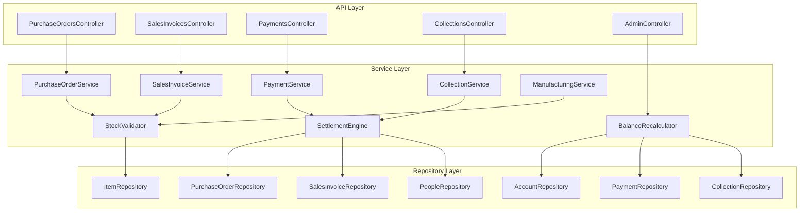

# Design Document: Operations & Financial Integrity

## Overview

This design addresses systemic integrity issues across the ERP's Purchase Order, Sales Invoice, Production, and Payment/Collection modules. The changes fall into three categories:

1. **Lifecycle Simplification** — Remove redundant statuses (PO CLOSED, Invoice APPROVED/PAID) and align document states with physical reality (goods received, goods delivered).
2. **Computed Financial Status** — Derive payment status from actual payment/collection slips rather than manual status changes, enabling account-level settlement.
3. **Data Integrity Enforcement** — Add stock validation guards, cancellation guards, reference validation, and fix the balance_fc data bug.

The architecture follows the existing Controller → Service → Repository pattern with PDO transactions. New cross-cutting concerns (settlement, balance recalculation) are implemented as dedicated service classes that compose with existing services within shared transactions.

## Architecture

### High-Level Component Interaction



### Design Decisions

1. **SettlementEngine as a separate service** — Settlement logic is triggered from both PaymentService and CollectionService. Extracting it avoids duplication and keeps each service focused on its own domain.

2. **Computed Payment Status via SQL query (not stored column)** — Payment status is derived at read time by summing linked slips. This avoids stale data and eliminates the need for triggers or event-driven updates. The computation is cheap (indexed SUM query) and cached in the API response.

3. **StockValidator as a shared utility** — Both SalesInvoiceService (line item validation) and ManufacturingService (material check) need stock sufficiency checks. A shared validator avoids duplicating the pattern.

4. **BalanceRecalculator as a standalone service** — Serves both the one-time migration and the on-demand API endpoint. Accepts optional account_id for targeted recalculation.

5. **Transaction boundaries owned by the caller** — The existing pattern (services check `$db->inTransaction()`) is preserved. Settlement and stock validation participate in the caller's transaction.

## Components and Interfaces

### 1. SettlementEngine (New Service)

```php
namespace App\Services;

class SettlementEngine {
    public function __construct(PDO $db);

    /**
     * Evaluate supplier settlement after a payment slip is created.
     * Called within PaymentService's transaction.
     * If supplier balance >= 0, marks all RECEIVED POs as settled.
     */
    public function evaluateSupplierSettlement(int $payeeId, int $businessId): array;

    /**
     * Evaluate customer settlement after a collection slip is created.
     * Called within CollectionService's transaction.
     * If customer balance <= 0, marks all DELIVERED invoices as settled.
     */
    public function evaluateCustomerSettlement(int $payeeId, int $businessId): array;
}
```

### 2. BalanceRecalculator (New Service)

```php
namespace App\Services;

class BalanceRecalculator {
    public function __construct(PDO $db);

    /**
     * Recalculate balance and balance_fc for one or all accounts.
     * Returns report of changes.
     *
     * @param int|null $accountId  Specific account, or null for all
     * @return array  [{account_id, prev_balance, new_balance, prev_balance_fc, new_balance_fc}, ...]
     */
    public function recalculate(?int $accountId = null): array;
}
```

### 3. StockValidator (New Utility)

```php
namespace App\Services;

class StockValidator {
    public function __construct(PDO $db);

    /**
     * Check if requested quantity is available for an item.
     * @throws \RuntimeException with formatted error if insufficient
     */
    public function assertAvailable(int $itemId, float $requestedQty, int $businessId): void;

    /**
     * Batch check multiple items. Returns array of shortfall messages.
     * Empty array means all items have sufficient stock.
     */
    public function checkBatch(array $requirements, int $businessId): array;
}
```

### 4. PurchaseOrderService (Modified)

Changes:
- `updateStatus()`: Remove CLOSED from allowed transitions. RECEIVED becomes terminal (only CANCELLED allowed from RECEIVED). Add cancellation guard checking payment status.
- `computePaymentStatus(int $poId)`: New method computing UNPAID/PARTIALLY_PAID/PAID from payment slips.
- `getPaymentShortcutData(int $poId)`: New method returning pre-filled payment slip data.
- `delete()`: Ensure line items are deleted atomically within the same transaction.

### 5. SalesInvoiceService (Modified)

Changes:
- `updateStatus()`: Replace APPROVED→PAID flow with DRAFT→DELIVERED. Stock OUT moves to DELIVERED transition. Remove manual PAID transition.
- `addLine()` / `updateLine()`: Add stock validation before allowing line item changes.
- `computePaymentStatus(int $invoiceId)`: New method computing status from collection slips.
- `delete()`: Ensure line items are deleted atomically within the same transaction.

### 6. CollectionService (Modified)

Changes:
- `create()`: Add invoice reference validation (exists, belongs to business, is DELIVERED, not already fully paid). After creation, invoke SettlementEngine for customer settlement.

### 7. PaymentService (Modified)

Changes:
- `create()`: Add PO reference validation (exists, belongs to business, is RECEIVED). After creation, invoke SettlementEngine for supplier settlement.

### 8. ManufacturingService (Modified)

Changes:
- `createProductionOrder()`: Already has stock check (confirmed in code review). Ensure the check uses StockValidator for consistency and the transaction is atomic.

### 9. API Routes (New/Modified)

| Method | Route | Description |
|--------|-------|-------------|
| GET | `/purchase-orders/{id}/payment-status` | Computed payment status |
| GET | `/purchase-orders/{id}/payment-shortcut` | Pre-filled payment data |
| GET | `/sales-invoices/{id}/payment-status` | Computed payment status |
| POST | `/admin/recalculate-balances` | Trigger balance recalculation |
| POST | `/admin/recalculate-balances/{accountId}` | Single account recalculation |

## Data Models

### Existing Tables (Relevant Columns)

**purchase_orders**
- id, business_id, supplier_id, po_number, po_date, status, currency, exchange_rate, total_amount_fc, total_amount_bc, created_by

**po_details**
- id, po_id, item_id, quantity, unit_price, total_price

**sales_invoices**
- id, business_id, customer_id, invoice_number, invoice_date, status, currency, exchange_rate, total_amount_fc, total_amount_bc, created_by

**si_details**
- id, invoice_id, item_id, quantity, unit_price, total_price

**payment_slips**
- id, business_id, account_id, payee_id, reference_type, reference_id, payment_number, payment_date, currency, exchange_rate, amount_fc, amount_bc, method, notes, created_by

**collection_slips**
- id, business_id, account_id, payee_id, reference_type, reference_id, slip_number, slip_date, currency, exchange_rate, amount_fc, amount_bc, method, notes, created_by

**business_accounts**
- id, business_id, name, currency, balance, balance_fc

**people** (payees)
- id, business_id, name, balance (payee balance)

**stock** (item stock levels)
- item_id, business_id, quantity

### Status Enumerations (After Changes)

**Purchase Order Status**: `DRAFT` → `APPROVED` → `RECEIVED` → (terminal). `CANCELLED` from DRAFT, APPROVED, or RECEIVED (with guards).

**Sales Invoice Status**: `DRAFT` → `DELIVERED` → (terminal). `CANCELLED` from DRAFT or DELIVERED (with guards).

**Payment Status (Computed, not stored)**: `UNPAID` | `PARTIALLY_PAID` | `PAID`

### Computed Payment Status Queries

**PO Payment Status:**
```sql
SELECT
    CASE
        WHEN COALESCE(SUM(ps.amount_bc), 0) = 0 THEN 'UNPAID'
        WHEN COALESCE(SUM(ps.amount_bc), 0) >= po.total_amount_bc THEN 'PAID'
        ELSE 'PARTIALLY_PAID'
    END AS payment_status
FROM purchase_orders po
LEFT JOIN payment_slips ps ON ps.payee_id = po.supplier_id
    AND ps.business_id = po.business_id
    AND ps.reference_type = 'PURCHASE_ORDER'
    AND ps.reference_id = po.id
WHERE po.id = :poId AND po.business_id = :businessId
```

**Invoice Payment Status:**
```sql
SELECT
    CASE
        WHEN COALESCE(SUM(cs.amount_bc), 0) = 0 THEN 'UNPAID'
        WHEN COALESCE(SUM(cs.amount_bc), 0) >= si.total_amount_bc THEN 'PAID'
        ELSE 'PARTIALLY_PAID'
    END AS payment_status
FROM sales_invoices si
LEFT JOIN collection_slips cs ON cs.reference_type = 'SALES_INVOICE'
    AND cs.reference_id = si.id
    AND cs.business_id = si.business_id
WHERE si.id = :invoiceId AND si.business_id = :businessId
```

### Settlement Detection Queries

**Supplier settlement (after payment):**
```sql
SELECT balance FROM people WHERE id = :payeeId AND business_id = :businessId
-- If balance >= 0, supplier is settled
```

**Customer settlement (after collection):**
```sql
SELECT balance FROM people WHERE id = :payeeId AND business_id = :businessId
-- If balance <= 0, customer is settled
```

### Balance Recalculation Logic

```sql
-- Step 1: Reset
UPDATE business_accounts SET balance = 0, balance_fc = 0 WHERE business_id = :businessId;

-- Step 2: Replay payments (subtract)
UPDATE business_accounts ba
SET ba.balance = ba.balance - sub.total_bc,
    ba.balance_fc = ba.balance_fc - sub.total_fc
FROM (
    SELECT account_id, SUM(amount_bc) as total_bc, SUM(amount_fc) as total_fc
    FROM payment_slips WHERE business_id = :businessId
    GROUP BY account_id
) sub
WHERE ba.id = sub.account_id;

-- Step 3: Replay collections (add)
UPDATE business_accounts ba
SET ba.balance = ba.balance + sub.total_bc,
    ba.balance_fc = ba.balance_fc + sub.total_fc
FROM (
    SELECT account_id, SUM(amount_bc) as total_bc, SUM(amount_fc) as total_fc
    FROM collection_slips WHERE business_id = :businessId
    GROUP BY account_id
) sub
WHERE ba.id = sub.account_id;
```

### Database Migration Required

**Migration: Add `reference_type` column to collection_slips (if not present)**

The collection_slips table already has `reference_type` and `reference_id` columns based on the existing CollectionService code. No schema migration is needed for the reference tracking.

**No new tables are required.** All changes operate on existing tables with computed values or behavioral changes in the service layer.


## Correctness Properties

*A property is a characteristic or behavior that should hold true across all valid executions of a system — essentially, a formal statement about what the system should do. Properties serve as the bridge between human-readable specifications and machine-verifiable correctness guarantees.*

### Property 1: PO State Machine Validity

*For any* purchase order in any status and *for any* target status, the transition succeeds if and only if the target is in the allowed set for that source status (DRAFT→{APPROVED,CANCELLED}, APPROVED→{RECEIVED,CANCELLED}, RECEIVED→{CANCELLED}), and all other transitions are rejected.

**Validates: Requirements 1.1, 1.2, 1.4, 1.5**

### Property 2: PO RECEIVED Transition Side Effects

*For any* purchase order with any set of line items, when the status transitions to RECEIVED, the stock for each line item increases by exactly the line's quantity, and the supplier's payee balance decreases by exactly the PO's total_amount_bc.

**Validates: Requirements 1.3**

### Property 3: PO Payment Status Computation

*For any* RECEIVED purchase order and *for any* set of payment slips referencing that PO (with reference_type "PURCHASE_ORDER" and reference_id matching the PO ID), the computed Payment_Status equals PAID when sum(amount_bc) >= total_amount_bc, PARTIALLY_PAID when 0 < sum(amount_bc) < total_amount_bc, and UNPAID when sum(amount_bc) = 0.

**Validates: Requirements 2.1, 2.2, 2.3, 2.4**

### Property 4: PO Payment Shortcut Data Correctness

*For any* RECEIVED purchase order, the payment shortcut data contains the PO's supplier_id as payee, total_amount_bc as amount, po_number as reference, reference_type as "PURCHASE_ORDER", and reference_id as the PO ID.

**Validates: Requirements 3.1, 3.2**

### Property 5: Production Order Stock Sufficiency Gate

*For any* production order with a valid recipe and production quantity, the order is accepted if and only if every component item has current stock >= (recipe_quantity / yield_quantity) × production_quantity. When rejected, the error message lists every deficient component in the format "Insufficient stock for: [item_name] (need [required], have [available])".

**Validates: Requirements 4.1, 4.2, 4.4**

### Property 6: Invoice Line Item Stock Validation

*For any* sales invoice line item addition or quantity edit, the operation succeeds if and only if the requested quantity is less than or equal to the current available stock for that item. When rejected, the error message follows the format "Insufficient stock for [item_name]: available [available_qty], requested [requested_qty]".

**Validates: Requirements 5.1, 5.2, 5.3**

### Property 7: Invoice State Machine Validity

*For any* sales invoice in any status and *for any* target status, the transition succeeds if and only if the target is in the allowed set for that source status (DRAFT→{DELIVERED,CANCELLED}, DELIVERED→{CANCELLED with guards}), and transitions to APPROVED or PAID are always rejected.

**Validates: Requirements 6.1, 6.4, 6.5**

### Property 8: Invoice DELIVERED Transition Side Effects

*For any* sales invoice with any set of line items, when the status transitions to DELIVERED, the stock for each line item decreases by exactly the line's quantity, and the customer's payee balance increases by exactly the invoice's total_amount_bc.

**Validates: Requirements 6.2, 6.3**

### Property 9: Invoice Payment Status Computation

*For any* DELIVERED sales invoice and *for any* set of collection slips where reference_type is "SALES_INVOICE" and reference_id matches the invoice ID, the computed Payment_Status equals PAID when sum(amount_bc) >= total_amount_bc, PARTIALLY_PAID when 0 < sum(amount_bc) < total_amount_bc, and UNPAID when sum(amount_bc) = 0.

**Validates: Requirements 7.1, 7.2, 7.3, 7.4**

### Property 10: Fully Paid Invoice Rejects Additional Collections

*For any* sales invoice where the sum of existing collection slip amounts (amount_bc) equals or exceeds the invoice total_amount_bc, creating a new collection slip referencing that invoice is rejected with the error "Invoice is already fully paid."

**Validates: Requirements 7.6**

### Property 11: Collection Slip Invoice Reference Validation

*For any* collection slip with reference_type "SALES_INVOICE", the creation succeeds if and only if the referenced invoice exists, belongs to the same business, is in DELIVERED status, and is not already fully paid. Partial amounts (less than invoice total) are accepted, and multiple slips may reference the same invoice until fully paid.

**Validates: Requirements 8.1, 8.2, 8.4, 8.5**

### Property 12: Customer Settlement on Zero Balance

*For any* customer whose payee balance reaches zero or below after a collection slip is created, all DELIVERED invoices for that customer with Payment_Status UNPAID or PARTIALLY_PAID are marked as settled (PAID).

**Validates: Requirements 9.2, 9.3**

### Property 13: Supplier Settlement on Zero Balance

*For any* supplier whose payee balance reaches zero or above after a payment slip is created, all RECEIVED purchase orders for that supplier with Payment_Status UNPAID or PARTIALLY_PAID are marked as settled (PAID).

**Validates: Requirements 10.2, 10.3**

### Property 14: Balance Recalculation Correctness

*For any* set of accounts with any history of payment and collection slips, after recalculation, each account's balance equals sum(collection_slips.amount_bc) - sum(payment_slips.amount_bc) and balance_fc equals sum(collection_slips.amount_fc) - sum(payment_slips.amount_fc) for slips linked to that account.

**Validates: Requirements 11.1, 11.2, 11.3**

### Property 15: Balance Recalculation Idempotence

*For any* state of accounts and transaction history, running the balance recalculation multiple times produces the same final balance and balance_fc values as running it once.

**Validates: Requirements 12.6**

### Property 16: Single-Account Recalculation Isolation

*For any* set of accounts, when recalculation is invoked for a single account_id, only that account's balance and balance_fc are modified; all other accounts remain unchanged.

**Validates: Requirements 12.2, 12.3**

### Property 17: Cancellation Guard for Paid Documents

*For any* RECEIVED purchase order with Payment_Status PARTIALLY_PAID or PAID, cancellation is rejected. *For any* DELIVERED sales invoice with Payment_Status PARTIALLY_PAID or PAID, cancellation is rejected.

**Validates: Requirements 13.1, 13.2**

### Property 18: Cancellation Reversal of Unpaid Documents

*For any* RECEIVED purchase order with Payment_Status UNPAID, cancellation reverses stock IN (decreases stock by line quantities) and reverses the supplier's payee balance change. *For any* DELIVERED sales invoice with Payment_Status UNPAID, cancellation reverses stock OUT (increases stock by line quantities) and reverses the customer's payee balance change.

**Validates: Requirements 13.3, 13.4**

### Property 19: Payment Slip PO Reference Validation

*For any* payment slip with reference_type "PURCHASE_ORDER", the creation succeeds if and only if the referenced PO exists, belongs to the same business, and is in RECEIVED status. Multiple payment slips may reference the same PO.

**Validates: Requirements 14.1, 14.4**

### Property 20: DRAFT Document Deletion with Cleanup

*For any* purchase order or sales invoice, deletion succeeds if and only if the document is in DRAFT status. When deletion succeeds, all associated line items (po_details or si_details) are also removed, leaving no orphaned records.

**Validates: Requirements 15.1, 15.2, 15.3, 15.4**

## Error Handling

### Error Response Format

All errors follow the existing pattern: exceptions thrown in the service layer are caught by the controller and returned as JSON responses with appropriate HTTP status codes.

```php
// 400 Bad Request — validation failures
throw new \InvalidArgumentException('Insufficient stock for: Sugar (need 50, have 30)');

// 409 Conflict — business rule violations
throw new \RuntimeException('Cannot cancel: purchase order has associated payments. Reverse payments first.');

// 404 Not Found — missing resources
throw new \RuntimeException('Purchase order not found');
```

### Error Categories

| Category | HTTP Code | Examples |
|----------|-----------|----------|
| Validation | 400 | Insufficient stock, empty fields, invalid amounts |
| State Violation | 409 | Invalid transition, cancellation of paid document, deletion of non-DRAFT |
| Not Found | 404 | Referenced PO/invoice doesn't exist |
| Authorization | 403 | Non-admin calling balance recalculation |
| Server Error | 500 | Transaction rollback failures |

### Specific Error Messages (from Requirements)

- PO RECEIVED→CLOSED: "CLOSED status is no longer valid; RECEIVED is the terminal state."
- Invoice manual PAID: "Payment status is computed from collection slips and cannot be set manually."
- Cancel paid PO: "Cannot cancel: purchase order has associated payments. Reverse payments first."
- Cancel paid invoice: "Cannot cancel: invoice has associated collections. Reverse collections first."
- Delete non-DRAFT PO: "Only DRAFT purchase orders can be deleted."
- Delete non-DRAFT invoice: "Only DRAFT sales invoices can be deleted."
- Insufficient stock (invoice): "Insufficient stock for [item_name]: available [available_qty], requested [requested_qty]"
- Insufficient stock (production): "Insufficient stock for: [item_name] (need [required], have [available])"
- Fully paid invoice: "Invoice is already fully paid."

### Transaction Rollback Strategy

All multi-step operations use the existing pattern:
1. Begin transaction (or participate in caller's transaction via `$db->inTransaction()` check)
2. Execute all steps
3. Commit on success, rollback on any `\Throwable`

The SettlementEngine and StockValidator participate in the caller's transaction — they do not manage their own transaction boundaries.

## Testing Strategy

### Property-Based Testing

This feature is well-suited for property-based testing because it involves:
- State machines with clear transition rules
- Computed values derived from variable input sets
- Invariants (balance equations, stock levels)
- Idempotence (recalculation)

**Library**: [PHPUnit](https://phpunit.de/) with [Eris](https://github.com/giorgiosironi/eris) for property-based testing in PHP.

**Configuration**:
- Minimum 100 iterations per property test
- Each property test tagged with: `Feature: operations-financial-integrity, Property {N}: {title}`

### Test Organization

```
tests/
├── Property/
│   ├── POStateMachineTest.php          (Properties 1, 2)
│   ├── POPaymentStatusTest.php         (Properties 3, 4)
│   ├── StockValidationTest.php         (Properties 5, 6)
│   ├── InvoiceStateMachineTest.php     (Properties 7, 8)
│   ├── InvoicePaymentStatusTest.php    (Properties 9, 10, 11)
│   ├── SettlementTest.php              (Properties 12, 13)
│   ├── BalanceRecalculationTest.php    (Properties 14, 15, 16)
│   ├── CancellationGuardsTest.php      (Properties 17, 18)
│   ├── PaymentReferenceTest.php        (Property 19)
│   └── DraftDeletionTest.php           (Property 20)
├── Unit/
│   ├── PurchaseOrderServiceTest.php
│   ├── SalesInvoiceServiceTest.php
│   ├── CollectionServiceTest.php
│   ├── PaymentServiceTest.php
│   ├── SettlementEngineTest.php
│   ├── BalanceRecalculatorTest.php
│   └── StockValidatorTest.php
└── Integration/
    ├── POLifecycleIntegrationTest.php
    ├── InvoiceLifecycleIntegrationTest.php
    ├── SettlementIntegrationTest.php
    └── BalanceRecalculationIntegrationTest.php
```

### Unit Tests (Example-Based)

Focus on:
- Specific error messages (Requirements 1.6, 6.6)
- API response shape (Requirements 2.5, 7.5)
- Permission checks (Requirement 12.5)
- Audit logging calls (Requirements 9.5, 10.5, 11.6)
- Edge cases: zero amounts, null payee_id, missing reference_id

### Integration Tests

Focus on:
- Transaction atomicity (Requirements 4.3, 11.4, 15.5)
- Race condition prevention (Requirement 4.3)
- Full lifecycle flows (DRAFT → RECEIVED → settlement)
- Balance recalculation with real database state

### Test Data Generation Strategy

For property tests, generators produce:
- Random PO/invoice amounts (positive decimals, various magnitudes)
- Random line item sets (1-20 items with random quantities)
- Random payment/collection slip sets (0-10 slips with random amounts)
- Random stock levels (0 to 10000)
- Random status values from the full enum set (to test rejection of invalid transitions)
