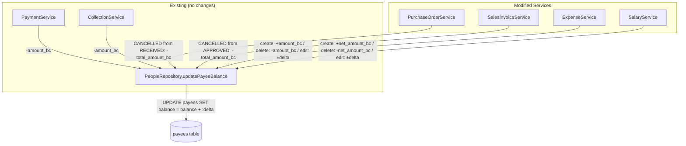

# Design Document: People Balance Tracking

## Overview

This design extends the existing payee balance tracking system so that **all** financial document types update the payee balance consistently. Currently, only `PaymentService` and `CollectionService` adjust the payee balance. This feature adds balance tracking to:

- **PurchaseOrderService** — reverse balance on cancellation from RECEIVED (the RECEIVED increase already exists)
- **SalesInvoiceService** — reverse balance on cancellation from APPROVED (the APPROVED increase already exists)
- **ExpenseService** — increase balance on create, adjust on edit (amount or payee change), decrease on delete
- **SalaryService** — increase balance on create, adjust on edit (amount or payee change), decrease on delete

The approach is **inline service-layer modifications** — each service already owns a PDO transaction for its operations, so balance updates are added inside those existing transactions. No new classes, tables, or event systems are introduced.

### Design Rationale

An event-driven or observer pattern was considered but rejected because:
1. The codebase uses a simple Controller → Service → Repository pattern with no event bus
2. Each service already manages its own transaction boundaries
3. Adding an event system would increase complexity without proportional benefit for 4 targeted service changes
4. Inline balance calls match the existing pattern used by `PaymentService` and `CollectionService`

## Architecture



### Transaction Flow

All balance updates happen inside the existing `beginTransaction/commit/rollBack` blocks in each service. The sequence for each operation:

1. Service validates input and loads the existing record (for edits/deletes)
2. Service performs the primary operation (insert/update/delete/status change)
3. Service calls `PeopleRepository::updatePayeeBalance(payeeId, delta)` if a payee is assigned
4. Service logs the audit entry via `AuditService::log()`
5. Service commits the transaction (or rolls back on any exception)

## Components and Interfaces

### Modified Components

#### 1. PurchaseOrderService::updateStatus()

**Current behavior**: On RECEIVED, increases supplier balance by `total_amount_bc`. On CANCELLED, does nothing to balance.

**New behavior**: On CANCELLED, if the previous status was RECEIVED, decreases supplier balance by `total_amount_bc`.

```php
// Inside the CANCELLED branch of updateStatus():
if ($newStatus === 'CANCELLED' && $current === 'RECEIVED') {
    $supplierId = $po['supplier_id'] ?? null;
    if ($supplierId) {
        $totalBc = (float) ($po['total_amount_bc'] ?? 0);
        if ($totalBc > 0) {
            $this->peopleRepo->updatePayeeBalance((int) $supplierId, -$totalBc);
        }
    }
}
```

#### 2. SalesInvoiceService::updateStatus()

**Current behavior**: On APPROVED, increases customer balance. On PAID, decreases via collection slip. On CANCELLED, does nothing to balance.

**New behavior**: On CANCELLED, if the previous status was APPROVED, decreases customer balance by `total_amount_bc`.

```php
// Inside the CANCELLED branch of updateStatus():
if ($newStatus === 'CANCELLED' && $current === 'APPROVED') {
    $customerId = $invoice['customer_id'] ?? null;
    if ($customerId) {
        $totalBc = (float) ($invoice['total_amount_bc'] ?? 0);
        if ($totalBc > 0) {
            $this->peopleRepo->updatePayeeBalance((int) $customerId, -$totalBc);
        }
    }
}
```

#### 3. ExpenseService (create / update / delete)

**Dependencies to add**: `PeopleRepository` (injected via constructor, same pattern as PaymentService).

**create()**: After inserting the expense, if `payee_id` is set, increase payee balance by `amount_bc`.

**update()**: Compare old and new records:
- If `payee_id` unchanged and `amount_bc` changed → adjust by delta (`new_amount_bc - old_amount_bc`)
- If `payee_id` changed → decrease old payee by old `amount_bc`, increase new payee by new `amount_bc`
- If `payee_id` removed (was set, now null) → decrease old payee by old `amount_bc`
- If `payee_id` added (was null, now set) → increase new payee by new `amount_bc`

**delete()**: If `payee_id` is set, decrease payee balance by `amount_bc`.

#### 4. SalaryService (create / update / delete)

**Dependencies to add**: `PeopleRepository` (injected via constructor).

Same pattern as ExpenseService but uses `net_amount_bc` instead of `amount_bc`.

**create()**: If `payee_id` is set, increase payee balance by `net_amount_bc`.

**update()**: Compare old and new records:
- If `payee_id` unchanged and `net_amount_bc` changed → adjust by delta
- If `payee_id` changed → decrease old payee by old `net_amount_bc`, increase new payee by new `net_amount_bc`

**delete()**: If `payee_id` is set, decrease payee balance by `net_amount_bc`.

### Existing Components (unchanged)

| Component | Balance Behavior | Status |
|---|---|---|
| `PaymentService.create()` | Decreases payee balance by `amount_bc` | ✅ Already correct |
| `PaymentService.delete()` | Increases payee balance by `amount_bc` | ✅ Already correct |
| `CollectionService.create()` | Decreases payee balance by `amount_bc` | ✅ Already correct |
| `CollectionService.delete()` | Increases payee balance by `amount_bc` | ✅ Already correct |
| `PurchaseOrderService.updateStatus()` → RECEIVED | Increases supplier balance by `total_amount_bc` | ✅ Already correct |
| `SalesInvoiceService.updateStatus()` → APPROVED | Increases customer balance by `total_amount_bc` | ✅ Already correct |
| `SalesInvoiceService.updateStatus()` → PAID | Decreases customer balance via collection slip | ✅ Already correct |

### Interface: PeopleRepository::updatePayeeBalance()

```php
/**
 * Atomically adjust the payee balance by delta (positive or negative).
 * Already exists — no changes needed.
 *
 * @param int   $payeeId  The payee record ID
 * @param float $delta    Signed amount (positive = increase, negative = decrease)
 */
public function updatePayeeBalance(int $payeeId, float $delta): void
```

This method uses `balance = balance + :delta` which is atomic and safe for concurrent updates within a transaction.

## Data Models

### Existing Tables (no schema changes required)

#### payees
| Column | Type | Description |
|---|---|---|
| id | int | Primary key |
| business_id | int | FK to businesses |
| people_id | int | FK to people |
| balance | decimal(12,2) | Running balance (system-managed) |
| notes | text | Optional notes |
| created_at | datetime | |
| updated_at | datetime | |

#### Balance Delta Rules by Document Type

| Document | Event | Delta | Field Used |
|---|---|---|---|
| Payment Slip | CREATE | `-amount_bc` | amount_bc |
| Payment Slip | DELETE | `+amount_bc` | amount_bc |
| Collection Slip | CREATE | `-amount_bc` | amount_bc |
| Collection Slip | DELETE | `+amount_bc` | amount_bc |
| Purchase Order | → RECEIVED | `+total_amount_bc` | total_amount_bc |
| Purchase Order | RECEIVED → CANCELLED | `-total_amount_bc` | total_amount_bc |
| Sales Invoice | → APPROVED | `+total_amount_bc` | total_amount_bc |
| Sales Invoice | APPROVED → CANCELLED | `-total_amount_bc` | total_amount_bc |
| Sales Invoice | → PAID (collection) | `-total_amount_bc` | total_amount_bc |
| Expense | CREATE | `+amount_bc` | amount_bc |
| Expense | UPDATE (amount change) | `+(new - old)` | amount_bc |
| Expense | UPDATE (payee change) | old: `-old_amount_bc`, new: `+new_amount_bc` | amount_bc |
| Expense | DELETE | `-amount_bc` | amount_bc |
| Salary | CREATE | `+net_amount_bc` | net_amount_bc |
| Salary | UPDATE (amount change) | `+(new - old)` | net_amount_bc |
| Salary | UPDATE (payee change) | old: `-old_net_amount_bc`, new: `+new_net_amount_bc` | net_amount_bc |
| Salary | DELETE | `-net_amount_bc` | net_amount_bc |

### Business Currency Calculation

All balance updates use the business currency amount (`_bc` suffix fields). The conversion formula already exists in each service:

```
amount_bc = round(amount_fc × exchange_rate, 2)
```

For salaries specifically:
```
net_amount_bc = round(gross_amount_bc - tax_bc, 2)
```


## Correctness Properties

*A property is a characteristic or behavior that should hold true across all valid executions of a system — essentially, a formal statement about what the system should do. Properties serve as the bridge between human-readable specifications and machine-verifiable correctness guarantees.*

### Property 1: Purchase Order receive-then-cancel round-trip

*For any* Purchase Order with a supplier and a positive `total_amount_bc`, transitioning to RECEIVED and then to CANCELLED should return the supplier's payee balance to its original value.

**Validates: Requirements 1.1, 1.2, 8.1**

### Property 2: Sales Invoice approve-then-cancel round-trip

*For any* Sales Invoice with a customer and a positive `total_amount_bc`, transitioning to APPROVED and then to CANCELLED should return the customer's payee balance to its original value.

**Validates: Requirements 2.1, 2.2, 8.2**

### Property 3: Expense create-then-delete round-trip

*For any* Expense with a payee and a positive `amount_bc`, creating and then deleting the expense should return the payee balance to its original value.

**Validates: Requirements 3.1, 3.4**

### Property 4: Salary create-then-delete round-trip

*For any* Salary with a payee and a positive `net_amount_bc`, creating and then deleting the salary should return the payee balance to its original value.

**Validates: Requirements 4.1, 4.4**

### Property 5: Expense amount edit adjusts balance by exact delta

*For any* Expense with a payee, when the `amount_bc` changes from `old` to `new`, the payee balance should change by exactly `(new - old)`.

**Validates: Requirements 3.2, 9.1**

### Property 6: Expense payee change transfers balance

*For any* Expense with a payee, when the `payee_id` changes from payee A to payee B, payee A's balance should decrease by the old `amount_bc` and payee B's balance should increase by the new `amount_bc`.

**Validates: Requirements 3.3**

### Property 7: Salary amount edit adjusts balance by exact delta

*For any* Salary with a payee, when the `net_amount_bc` changes from `old` to `new`, the payee balance should change by exactly `(new - old)`.

**Validates: Requirements 4.2, 9.2**

### Property 8: Salary payee change transfers balance

*For any* Salary with a payee, when the `payee_id` changes from payee A to payee B, payee A's balance should decrease by the old `net_amount_bc` and payee B's balance should increase by the new `net_amount_bc`.

**Validates: Requirements 4.3**

### Property 9: Non-balance-impacting cancellation is a no-op

*For any* Purchase Order cancelled from APPROVED status, or any Sales Invoice cancelled from DRAFT status, the supplier/customer payee balance should remain unchanged.

**Validates: Requirements 1.3, 8.3**

### Property 10: Business currency amount computation

*For any* `amount_fc` and `exchange_rate` (both positive), the computed `amount_bc` should equal `round(amount_fc × exchange_rate, 2)`.

**Validates: Requirements 7.2**

### Property 11: Payment create-then-delete round-trip (regression)

*For any* Payment Slip with a payee and a positive `amount_bc`, creating and then deleting the payment should return the payee balance to its original value.

**Validates: Requirements 6.1, 6.2**

### Property 12: Collection create-then-delete round-trip (regression)

*For any* Collection Slip with a payee and a positive `amount_bc`, creating and then deleting the collection should return the payee balance to its original value.

**Validates: Requirements 6.3, 6.4**

## Error Handling

### Transaction Rollback

All balance updates are inside existing `try/catch` blocks with `beginTransaction/commit/rollBack`. If `updatePayeeBalance()` throws (e.g., database connection lost, deadlock), the entire operation rolls back — the document change and the balance update are both reverted.

### Null Payee Guard

Every balance update is wrapped in a null check:

```php
$payeeId = $record['payee_id'] ?? null;
if ($payeeId) {
    $this->peopleRepo->updatePayeeBalance((int) $payeeId, $delta);
}
```

This ensures documents without an assigned payee skip balance updates silently, matching requirements 1.4, 2.4, 3.5, and 4.5.

### Zero Amount Guard

Balance updates for PO and SI status changes include a `$totalBc > 0` guard to avoid unnecessary database writes for zero-amount documents. Expense and Salary services do not need this guard because their validation already requires positive amounts.

### Concurrent Update Safety

`PeopleRepository::updatePayeeBalance()` uses `balance = balance + :delta` which is atomic at the SQL level. Combined with the transaction isolation, this prevents lost updates from concurrent operations on the same payee.

## Testing Strategy

### Property-Based Tests (PHPUnit + custom generators)

Since the project uses PHP with no existing PBT library, property tests will be implemented using PHPUnit with data providers that generate randomized inputs. Each test method will run with at minimum 100 generated input sets.

**Library**: PHPUnit data providers with random generation helpers (no external PBT library needed — PHP ecosystem lacks a mature PBT library, so we use PHPUnit's `@dataProvider` with a generator that produces 100+ random cases).

**Configuration**: Each property test runs 100 iterations minimum via data provider.

**Tag format**: Each test includes a comment referencing the design property:
```php
// Feature: people-balance-tracking, Property 1: PO receive-then-cancel round-trip
```

Property tests focus on the balance delta logic by mocking the database layer and verifying that `updatePayeeBalance()` is called with the correct delta values.

### Unit Tests (example-based)

- **Edge cases**: Null payee_id on all document types (Requirements 1.4, 2.4, 3.5, 4.5)
- **Guard conditions**: Zero-amount documents, cancellation from non-impacting statuses
- **Validation**: Invalid status transitions still rejected after changes
- **Regression**: Payment and Collection balance behavior unchanged (Requirements 6.1–6.6)

### Integration Tests

- **Transaction atomicity**: Verify rollback when balance update fails mid-transaction (Requirements 5.1, 5.2)
- **Audit logging**: Verify audit entries contain document type, id, and delta (Requirements 10.1, 10.2)
- **End-to-end flows**: Full lifecycle tests (create PO → approve → receive → cancel) verifying final balance state

### Test Organization

```
tests/
├── Unit/
│   ├── PurchaseOrderBalanceTest.php
│   ├── SalesInvoiceBalanceTest.php
│   ├── ExpenseBalanceTest.php
│   ├── SalaryBalanceTest.php
│   └── BalanceCurrencyTest.php
├── Property/
│   ├── PurchaseOrderBalancePropertyTest.php
│   ├── SalesInvoiceBalancePropertyTest.php
│   ├── ExpenseBalancePropertyTest.php
│   ├── SalaryBalancePropertyTest.php
│   ├── PaymentBalanceRegressionPropertyTest.php
│   └── CollectionBalanceRegressionPropertyTest.php
└── Integration/
    ├── BalanceTransactionTest.php
    └── BalanceAuditTest.php
```
