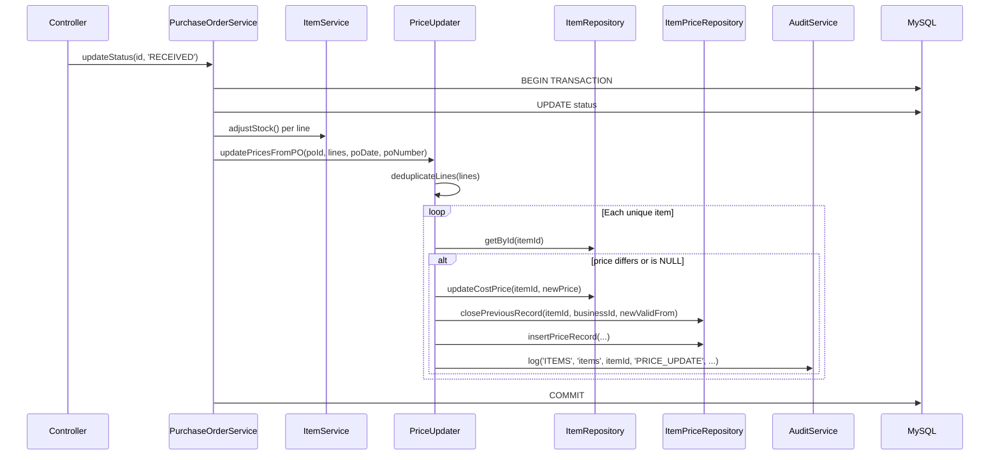

# Design Document: PO Price Update

## Overview

When a Purchase Order transitions from APPROVED to RECEIVED, the system automatically updates item cost prices based on PO line unit prices (in base currency) and records price changes in the `item_prices` history table. This feature integrates into the existing `PurchaseOrderService::updateStatus()` transaction, adding price update logic after stock adjustments and before the audit log.

The design introduces a `PriceUpdater` service class responsible for:
1. Deduplicating PO lines by item_id (last line wins)
2. Comparing PO line prices against current item cost prices
3. Updating `items.cost_price` when prices differ
4. Inserting history records into `item_prices` and closing previous open records
5. Logging audit entries for each price change

## Architecture



### Design Decisions

1. **Separate PriceUpdater class** rather than inlining in PurchaseOrderService — keeps the PO service focused on orchestration and makes price logic independently testable.
2. **Separate ItemPriceRepository** for `item_prices` table operations — follows existing pattern where each table has its own repository.
3. **No nested transactions** — PriceUpdater assumes it runs within an existing transaction (same pattern as `ItemService::adjustStock()`).
4. **Last-line-wins deduplication** — simple, deterministic rule when a PO has multiple lines for the same item. Processed in line order (by `po_details.id`).
5. **No price revert on cancellation** — prices represent chronological facts. The existing cancellation logic in `updateStatus()` already handles stock and balance reversal; prices are intentionally excluded.

## Components and Interfaces

### PriceUpdater (New Service)

**File:** `src/Services/PriceUpdater.php`

```php
<?php
namespace App\Services;

use App\Repository\ItemRepository;
use App\Repository\ItemPriceRepository;
use App\Support\AuthContext;
use PDO;

class PriceUpdater {
    private ItemRepository      $itemRepo;
    private ItemPriceRepository $priceRepo;
    private AuditService        $audit;
    private PDO                 $db;

    public function __construct(PDO $db) {
        $this->db        = $db;
        $this->itemRepo  = new ItemRepository($db);
        $this->priceRepo = new ItemPriceRepository($db);
        $this->audit     = new AuditService($db);
    }

    /**
     * Process price updates for all lines of a received PO.
     * MUST be called within an existing transaction.
     *
     * @param array  $lines    PO lines from PurchaseOrderRepository::getLines()
     * @param string $poDate   The PO date (used as valid_from for price records)
     * @param int    $poId     Purchase order ID (for audit reference)
     * @param string $poNumber Purchase order number (for audit reference)
     */
    public function updatePricesFromPO(array $lines, string $poDate, int $poId, string $poNumber): void;

    /**
     * Deduplicate lines by item_id, keeping the last occurrence.
     * Returns associative array: item_id => line data
     *
     * @param array $lines PO lines ordered by id ASC
     * @return array<int, array> Map of item_id => last line for that item
     */
    public function deduplicateLines(array $lines): array;
}
```

### ItemPriceRepository (New Repository)

**File:** `src/Repository/ItemPriceRepository.php`

```php
<?php
namespace App\Repository;

use PDO;

class ItemPriceRepository {
    private PDO $db;

    public function __construct(PDO $db) {
        $this->db = $db;
    }

    /**
     * Insert a new price history record.
     *
     * @return int The new record ID
     */
    public function insert(array $data): int;

    /**
     * Close the current open record for an item/business by setting valid_to.
     * Only updates records where valid_to IS NULL.
     *
     * @param int    $itemId
     * @param int    $businessId
     * @param string $newValidFrom The new record's valid_from date
     */
    public function closePreviousRecord(int $itemId, int $businessId, string $newValidFrom): void;
}
```

### Modified: ItemRepository

Add a targeted cost price update method:

```php
/**
 * Update only the cost_price and updated_at for an item.
 *
 * @param int   $itemId
 * @param int   $tenantId
 * @param float $costPrice
 */
public function updateCostPrice(int $itemId, int $tenantId, float $costPrice): void;
```

### Modified: PurchaseOrderService::updateStatus()

Integration point — add call to PriceUpdater after stock adjustments in the RECEIVED block:

```php
// After stock adjustments, before supplier balance update:
$priceUpdater = new PriceUpdater($this->db);
$priceUpdater->updatePricesFromPO($lines, $po['po_date'], $id, $po['po_number']);
```

## Data Models

### items table (existing, modified column usage)

| Column | Type | Usage |
|--------|------|-------|
| cost_price | DECIMAL(15,2) NULL | Updated by PriceUpdater when PO line price differs |
| sale_price | DECIMAL(15,2) NULL | Read-only (copied to item_prices record for snapshot) |
| updated_at | DATETIME | Set to NOW() on cost_price update |

### item_prices table (existing, now utilized)

| Column | Type | Description |
|--------|------|-------------|
| id | INT AUTO_INCREMENT | Primary key |
| item_id | INT NOT NULL | FK to items.id |
| business_id | INT NOT NULL | FK to businesses.id |
| currency | VARCHAR(3) NOT NULL | Business base currency |
| cost_price | DECIMAL(15,2) NOT NULL | The new cost price applied |
| sale_price | DECIMAL(15,2) NULL | Item's sale_price at time of change (snapshot) |
| valid_from | DATE NOT NULL | PO date (when this price became effective) |
| valid_to | DATE NULL | NULL = current; set when superseded |
| created_at | DATETIME NOT NULL | Record creation timestamp |

### SQL Operations

**Update item cost price:**
```sql
UPDATE items
SET cost_price = :cost_price, updated_at = NOW()
WHERE id = :id AND tenant_id = :tenant_id
```

**Close previous price record:**
```sql
UPDATE item_prices
SET valid_to = CASE
    WHEN valid_from >= :new_valid_from THEN :new_valid_from
    ELSE DATE_SUB(:new_valid_from, INTERVAL 1 DAY)
END
WHERE item_id = :item_id
  AND business_id = :business_id
  AND valid_to IS NULL
```

**Insert new price record:**
```sql
INSERT INTO item_prices (item_id, business_id, currency, cost_price, sale_price, valid_from, created_at)
VALUES (:item_id, :business_id, :currency, :cost_price, :sale_price, :valid_from, NOW())
```

## Correctness Properties

*A property is a characteristic or behavior that should hold true across all valid executions of a system — essentially, a formal statement about what the system should do. Properties serve as the bridge between human-readable specifications and machine-verifiable correctness guarantees.*

### Property 1: Price update correctness

*For any* set of PO lines and corresponding items, after processing by PriceUpdater, each item's cost_price SHALL equal the PO line's unit_price_bc if it was different from (or NULL compared to) the original cost_price, and SHALL remain unchanged if the PO line price equaled the original cost_price.

**Validates: Requirements 1.2, 1.3, 1.4**

### Property 2: Deduplication — last line wins

*For any* array of PO lines where multiple lines reference the same item_id, the `deduplicateLines` function SHALL return a map where each item_id maps to the line data of the last occurrence (by array order, which corresponds to `po_details.id` ASC).

**Validates: Requirements 4.2**

### Property 3: History record correctness

*For any* PO receipt that causes at least one price change, exactly one `item_prices` record SHALL be inserted per unique item_id that had a price change, containing the correct item_id, business_id, currency, cost_price (new price), sale_price (item's current sale_price), and valid_from (PO date).

**Validates: Requirements 2.1, 2.2, 4.3**

### Property 4: Previous record closure

*For any* item that has an existing `item_prices` record with NULL valid_to, when a new price record is inserted with valid_from = V, the previous record's valid_to SHALL be set to (V - 1 day) if the previous record's valid_from < V, or to V if the previous record's valid_from >= V.

**Validates: Requirements 2.3, 2.4**

### Property 5: Audit entry correctness

*For any* PO receipt, an audit entry with action "PRICE_UPDATE" SHALL be created for each item whose cost_price changed (containing old price, new price, po_id, and po_number), and zero audit entries SHALL be created when no prices change.

**Validates: Requirements 5.1, 5.2, 5.3**

## Error Handling

| Scenario | Behavior |
|----------|----------|
| Item not found (deleted between PO creation and receipt) | Skip that line silently — item may have been deactivated. Log a warning but do not fail the transaction. |
| Database constraint violation on item_prices insert | Exception propagates up, entire PO receipt transaction rolls back (Requirement 3.2). |
| NULL unit_price_bc on a PO line | Skip that line — cannot determine a valid price. |
| PO with zero lines | PriceUpdater returns immediately with no operations. |
| Concurrent PO receipts for same item | Last transaction to commit wins (standard MySQL row-level locking within transaction). |

The PriceUpdater does NOT manage its own transaction. It relies on the caller (PurchaseOrderService) to have already begun a transaction. If any exception is thrown, it propagates to the caller's catch block which performs the rollback.

## Testing Strategy

### Unit Tests (Example-Based)

- **Price comparison logic**: Verify update when price differs, skip when equal, handle NULL current price.
- **Deduplication**: Verify last-line-wins with various line orderings and duplicate counts.
- **History record closure**: Verify date arithmetic for normal case (valid_to = valid_from - 1 day) and edge case (same-day closure).
- **Cancellation non-reversion**: Verify that cancelling a RECEIVED PO does not modify prices or history records.
- **Edge cases**: Empty lines array, single line, item with no existing price record.

### Property-Based Tests

Property-based testing is appropriate here because the core logic (deduplication, price comparison, history record management) involves pure data transformations with a large input space (varying numbers of lines, item_ids, prices, dates).

**Library:** PHPUnit with `phpunit/phpunit` + a PHP PBT library (e.g., `eris/eris` or inline random generation with PHPUnit data providers generating 100+ cases).

**Configuration:**
- Minimum 100 iterations per property test
- Each test tagged with: `Feature: po-price-update, Property {N}: {title}`

**Properties to implement:**
1. Price update correctness — generate random line sets and item states, verify final prices
2. Deduplication last-line-wins — generate random line arrays with duplicates, verify map output
3. History record correctness — generate random price updates, verify record count and contents
4. Previous record closure — generate random date scenarios, verify valid_to calculation
5. Audit entry correctness — generate random PO scenarios, verify audit entry count and contents

### Integration Tests

- Full PO receipt flow: create PO → approve → receive → verify items table, item_prices table, and audit_log entries.
- Transaction rollback: force a failure in price update, verify entire PO receipt is rolled back.
- Multi-line PO with duplicates: end-to-end verification of deduplication behavior.
