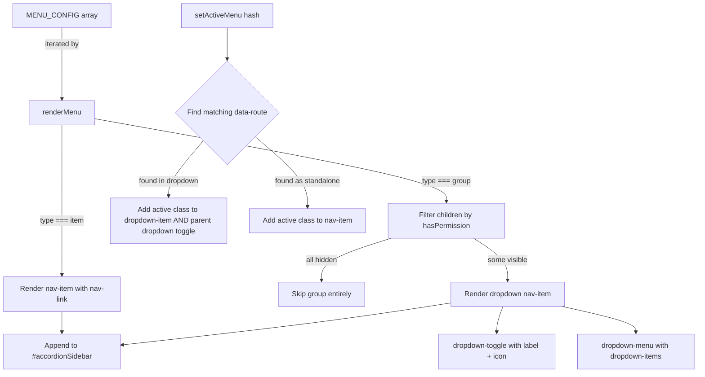

# Design Document: Sidebar Grouped Menu

## Overview

This feature restructures the ERP application's horizontal navbar menu from a flat list of 13 items into logically grouped Bootstrap 5 dropdown menus. The navbar (`#appMenu`) currently renders all menu items as sibling `<li class="nav-item">` elements inside a `<ul class="navbar-nav">`. The redesign introduces dropdown groups (Core Data, Operations, Finance) while keeping standalone items (Dashboard) as direct nav-items.

**Key design decisions:**

1. **Bootstrap 5 dropdowns, not accordion/collapse** — The HTML structure is a horizontal `<nav class="navbar">`, so the standard grouping pattern is `dropdown-toggle` + `dropdown-menu`, not the vertical sidebar collapse pattern described in the requirements. The requirements were written assuming a vertical sidebar, but the actual DOM is a horizontal navbar.
2. **Backward-compatible config format** — `MENU_CONFIG` entries gain an optional `type` field. Entries with `type: 'group'` contain a `children` array; entries with `type: 'item'` (or no type, for backward compatibility) remain standalone.
3. **No external dependencies** — All dropdown behavior is handled by Bootstrap 5's built-in `data-bs-toggle="dropdown"` JS, which is already loaded in the app.

### Proposed Grouping

| Position | Type | Label | Children |
|----------|------|-------|----------|
| 1 | item | Dashboard | — |
| 2 | group | Core Data | Businesses, Users, People, Items |
| 3 | group | Operations | Purchase Orders, Invoices, Expenses, Salaries |
| 4 | group | Finance | Accounts, Exchange Rates, Payments, Collections |

## Architecture



### Data Flow

1. **Config → Render**: `renderMenu()` reads `MENU_CONFIG`, iterates entries, checks permissions, and builds DOM.
2. **Route → Active State**: `setActiveMenu(hash)` queries all `[data-route]` elements, clears previous active states, and applies the `active` class to the matching item. If the item is inside a dropdown, the parent dropdown toggle also gets an `active` class.
3. **User Interaction → Dropdown**: Bootstrap 5 handles all dropdown open/close behavior via `data-bs-toggle="dropdown"`. No custom JS event handlers needed.

## Components and Interfaces

### 1. `appShell.config.js` — MENU_CONFIG Structure

The config array changes from a flat list to a mixed array of standalone items and group objects.

**Standalone item (unchanged shape, explicit type):**
```js
{
  type: 'item',
  id: 'goToDashboard',
  label: 'Dashboard',
  icon: 'fas fa-fw fa-tachometer-alt',
  hash: '#/dashboard',
  permission: 'dashboard.view'
}
```

**Group entry (new shape):**
```js
{
  type: 'group',
  id: 'coreDataGroup',
  label: 'Core Data',
  icon: 'fas fa-fw fa-database',
  children: [
    { id: 'goToBusinesses', label: 'Businesses', icon: 'fas fa-fw fa-briefcase', hash: '#/businesses', permission: 'businesses.view' },
    { id: 'goToUsers',      label: 'Users',      icon: 'fas fa-fw fa-users',     hash: '#/users',      permission: 'users.view' },
    // ...
  ]
}
```

Groups do NOT have a `permission` field. Visibility is derived from children: if zero children pass `hasPermission()`, the group is hidden.

### 2. `appShell.js` — renderMenu()

**Current behavior:** Iterates flat array, creates `<li class="nav-item">` for each permitted item.

**New behavior:**

```
for each entry in MENU_CONFIG:
  if entry.type === 'item':
    if hasPermission(entry.permission):
      render standalone <li class="nav-item">
  if entry.type === 'group':
    visibleChildren = entry.children.filter(c => hasPermission(c.permission))
    if visibleChildren.length === 0: skip
    render <li class="nav-item dropdown">
      render <a class="nav-link dropdown-toggle" data-bs-toggle="dropdown" ...>
      render <ul class="dropdown-menu">
        for each child in visibleChildren:
          render <li><a class="dropdown-item" ...></a></li>
```

**DOM output for a group:**
```html
<li class="nav-item dropdown" id="coreDataGroup">
  <a class="nav-link dropdown-toggle" href="#" role="button"
     data-bs-toggle="dropdown" aria-expanded="false"
     id="coreDataGroupToggle">
    <i class="fas fa-fw fa-database"></i>
    <span>Core Data</span>
  </a>
  <ul class="dropdown-menu" aria-labelledby="coreDataGroupToggle">
    <li><a class="dropdown-item" href="#/businesses" data-route="#/businesses">
      <i class="fas fa-fw fa-briefcase"></i> Businesses
    </a></li>
    <li><a class="dropdown-item" href="#/users" data-route="#/users">
      <i class="fas fa-fw fa-users"></i> Users
    </a></li>
    <!-- ... -->
  </ul>
</li>
```

**DOM output for a standalone item (unchanged):**
```html
<li class="nav-item" id="goToDashboard" data-route="#/dashboard">
  <a class="nav-link" href="#/dashboard">
    <i class="fas fa-fw fa-tachometer-alt"></i>
    <span>Dashboard</span>
  </a>
</li>
```

### 3. `appShell.js` — setActiveMenu()

**Current behavior:** Queries `.nav-item[data-route]`, removes `active` from all, adds `active` to the match.

**New behavior:**

1. Remove `active` class from all `.nav-item` elements and all `.dropdown-item` elements.
2. Remove `active` class from all `.nav-link.dropdown-toggle` elements (group headers).
3. Try to find a standalone `.nav-item[data-route="<hash>"]` — if found, add `active` to it.
4. Otherwise, find a `.dropdown-item[data-route="<hash>"]` — if found:
   - Add `active` to that `.dropdown-item`.
   - Add `active` to the parent `<li class="nav-item dropdown">`.
   - Add `active` to the parent's `.dropdown-toggle` anchor (so the group header is visually highlighted).

```js
export function setActiveMenu(hash) {
    // Clear all active states
    document.querySelectorAll('#accordionSidebar .nav-item')
        .forEach(el => el.classList.remove('active'));
    document.querySelectorAll('#accordionSidebar .dropdown-item')
        .forEach(el => el.classList.remove('active'));
    document.querySelectorAll('#accordionSidebar .dropdown-toggle')
        .forEach(el => el.classList.remove('active'));

    // Check standalone items first
    const standaloneItem = document.querySelector(
        `#accordionSidebar > .nav-item:not(.dropdown)[data-route="${hash}"]`
    );
    if (standaloneItem) {
        standaloneItem.classList.add('active');
        return;
    }

    // Check dropdown items
    const dropdownItem = document.querySelector(
        `#accordionSidebar .dropdown-item[data-route="${hash}"]`
    );
    if (dropdownItem) {
        dropdownItem.classList.add('active');
        const parentDropdown = dropdownItem.closest('.nav-item.dropdown');
        if (parentDropdown) {
            parentDropdown.classList.add('active');
            const toggle = parentDropdown.querySelector('.dropdown-toggle');
            if (toggle) toggle.classList.add('active');
        }
    }
}
```

### 4. `main.css` — Dropdown Styling

Custom CSS needed to style the dropdowns within the primary gradient navbar:

```css
/* Dropdown menu on the primary navbar */
#appMenu .dropdown-menu {
    background-color: #4e73df;
    border: none;
    border-radius: 0.375rem;
    margin-top: 0;
    box-shadow: 0 0.15rem 1.75rem 0 rgba(58, 59, 69, 0.15);
}

/* Dropdown items */
#appMenu .dropdown-item {
    color: rgba(255, 255, 255, 0.85);
    padding: 0.5rem 1rem;
    font-weight: 500;
}

#appMenu .dropdown-item:hover,
#appMenu .dropdown-item:focus {
    color: #fff;
    background-color: rgba(255, 255, 255, 0.15);
}

#appMenu .dropdown-item.active {
    color: #fff;
    background-color: rgba(255, 255, 255, 0.25);
}

/* Active dropdown toggle (group contains active route) */
#appMenu .dropdown-toggle.active {
    color: #fff;
    background-color: rgba(255, 255, 255, 0.15);
    border-radius: 0.375rem;
}
```

## Data Models

### MENU_CONFIG Entry Types

```typescript
// Type definitions for documentation (actual code is plain JS)

interface MenuItemEntry {
  type: 'item';
  id: string;           // DOM element id
  label: string;        // Display text
  icon: string;         // FontAwesome class string
  hash: string;         // Hash route (e.g., '#/dashboard')
  permission: string;   // Permission code for hasPermission()
}

interface MenuGroupEntry {
  type: 'group';
  id: string;           // DOM element id for the <li> wrapper
  label: string;        // Dropdown toggle display text
  icon: string;         // FontAwesome class string for toggle
  children: MenuItemEntry[];  // Ordered array of child items (each has own permission)
}

type MenuConfigEntry = MenuItemEntry | MenuGroupEntry;
type MenuConfig = MenuConfigEntry[];
```

**Invariants:**
- A `MenuGroupEntry` has no `permission` field — its visibility is derived from its children.
- A `MenuGroupEntry.children` array is never empty in the config (empty groups are a config error, not a runtime state).
- Each child within a group retains all `MenuItemEntry` fields.
- The `type` field on children inside a group is optional (they are always items).

### Rendered DOM Model

```
#accordionSidebar (ul.navbar-nav)
├── li.nav-item[data-route]                    ← standalone item
│   └── a.nav-link
├── li.nav-item.dropdown#groupId               ← group
│   ├── a.nav-link.dropdown-toggle#groupIdToggle
│   └── ul.dropdown-menu[aria-labelledby]
│       ├── li > a.dropdown-item[data-route]   ← child item
│       ├── li > a.dropdown-item[data-route]
│       └── ...
├── li.nav-item.dropdown#groupId2              ← another group
│   └── ...
```

## Correctness Properties

*A property is a characteristic or behavior that should hold true across all valid executions of a system — essentially, a formal statement about what the system should do. Properties serve as the bridge between human-readable specifications and machine-verifiable correctness guarantees.*

### Property 1: Config structure preservation

*For any* valid `MENU_CONFIG` array containing a mix of standalone items and group entries, every standalone item SHALL retain all required fields (`id`, `label`, `icon`, `hash`, `permission`), and every group entry SHALL retain its `label`, `icon`, and a non-empty `children` array where each child retains all required item fields.

**Validates: Requirements 1.1, 1.2, 1.4**

### Property 2: Group rendering produces correct dropdown DOM

*For any* group entry with at least one permitted child, the rendered DOM SHALL contain a `<li>` with class `nav-item dropdown`, a child `<a>` with class `dropdown-toggle` displaying the group's label and icon, and a `<ul>` with class `dropdown-menu` containing one `<li><a class="dropdown-item">` per permitted child.

**Validates: Requirements 1.3, 2.1, 2.2**

### Property 3: Render order matches config order

*For any* `MENU_CONFIG` array, the rendered direct children of `#accordionSidebar` SHALL appear in the same order as the entries in the config array, with standalone items rendered as `nav-item` elements and groups rendered as `nav-item dropdown` elements, preserving the interleaving defined in the config.

**Validates: Requirements 3.1, 3.2**

### Property 4: Permission gating filters items and hides empty groups

*For any* `MENU_CONFIG` array and any permission set, the rendered menu SHALL include only standalone items whose permission passes `hasPermission()`, and only groups that have at least one child whose permission passes `hasPermission()`. Within each rendered group, only permitted children SHALL appear.

**Validates: Requirements 4.1, 4.2, 4.3**

### Property 5: Active route highlights correct item and parent group

*For any* rendered menu and any hash value, calling `setActiveMenu(hash)` SHALL result in exactly one element with the `active` class matching that hash. If the matching element is a dropdown-item, its parent dropdown's toggle SHALL also have the `active` class. If the matching element is a standalone nav-item, no dropdown toggles SHALL have the `active` class.

**Validates: Requirements 5.1, 5.2, 5.3, 5.4**

## Error Handling

### Invalid Config Entries

- If a `MENU_CONFIG` entry has `type: 'group'` but no `children` array or an empty `children` array, `renderMenu()` should skip it silently (defensive coding, not expected in practice).
- If a `MENU_CONFIG` entry has an unrecognized `type`, skip it and log a console warning.

### Permission Failures

- `hasPermission()` already returns `false` for missing/invalid tokens. No additional error handling needed in the menu renderer.
- If `getUser()` returns `null`, all permission checks fail and the menu renders empty. This is correct behavior — the app shell should not be active without a logged-in user.

### Missing DOM Container

- If `document.getElementById('accordionSidebar')` returns `null`, `renderMenu()` returns early (existing guard).

### Hash Mismatch in setActiveMenu

- If `setActiveMenu(hash)` finds no matching `data-route`, no element gets the `active` class. This is acceptable — it means the current route has no corresponding menu entry (e.g., profile page, settings).

## Testing Strategy

### Unit Tests (Example-Based)

Unit tests should cover specific scenarios with concrete data:

1. **Bootstrap 5 class correctness** — Render a known group config and verify the output contains `dropdown`, `dropdown-toggle`, `data-bs-toggle="dropdown"`, `dropdown-menu`, `dropdown-item` classes/attributes.
2. **Accessibility attributes** — Verify `aria-expanded="false"` on dropdown toggles and `aria-labelledby` on dropdown menus referencing the correct toggle id.
3. **Divider rendering** — Verify visual separators appear between groups when configured.
4. **Empty hash in setActiveMenu** — Verify no elements get `active` class when hash is empty or doesn't match any route.

### Property-Based Tests

Property-based tests verify universal properties across randomly generated inputs. Use **fast-check** as the PBT library (JavaScript, already compatible with the project's vanilla JS approach via a test runner like Vitest or Jest).

**Configuration:**
- Minimum 100 iterations per property test
- Each test tagged with: `Feature: sidebar-grouped-menu, Property {N}: {title}`

**Properties to implement:**

1. **Feature: sidebar-grouped-menu, Property 1: Config structure preservation** — Generate random MENU_CONFIG arrays with arbitrary mixes of items and groups. Verify structural invariants hold.
2. **Feature: sidebar-grouped-menu, Property 2: Group rendering produces correct dropdown DOM** — Generate random group entries with random children, mock `hasPermission` to allow at least one child, verify DOM structure.
3. **Feature: sidebar-grouped-menu, Property 3: Render order matches config order** — Generate random MENU_CONFIG arrays, render, verify DOM child order matches config order.
4. **Feature: sidebar-grouped-menu, Property 4: Permission gating filters items and hides empty groups** — Generate random configs and random permission sets, verify only permitted items/groups appear.
5. **Feature: sidebar-grouped-menu, Property 5: Active route highlights correct item and parent group** — Generate random rendered menus and random hashes, verify exactly one active element and correct parent highlighting.

### Integration Tests

- **Mobile collapse behavior** — Manual verification that dropdowns work correctly inside the collapsed navbar on mobile viewports (Bootstrap 5 handles this natively).
- **Keyboard navigation** — Manual verification that Tab, Enter, and Space work with dropdown toggles (Bootstrap 5 handles this natively).
- **Route change cycle** — Navigate between routes across different groups and verify active state updates correctly.
