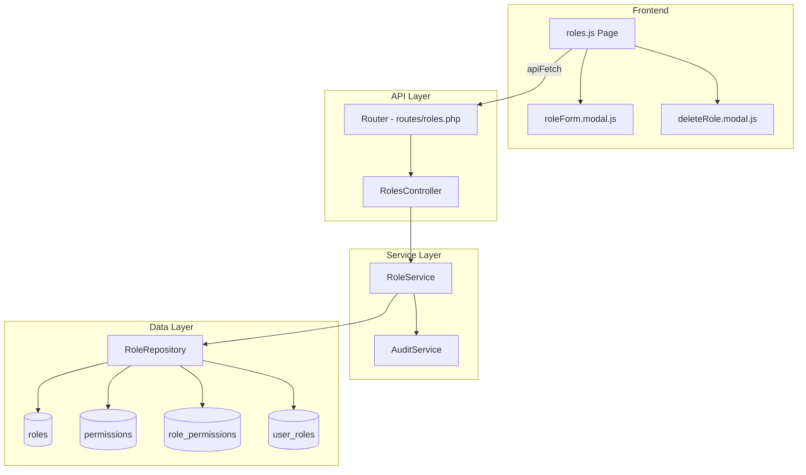

# Design Document: User Roles & Permissions Management

## Overview

This feature extends the existing roles infrastructure into a full CRUD management interface. Currently, the system only supports listing roles via `GET /roles`. This design adds endpoints and UI for viewing role permissions, creating roles, editing roles, and deleting roles — all scoped to the current tenant and gated behind dedicated `roles.*` permissions.

The Business Owner role (role_id = 1) is treated as immutable: it always holds all permissions and cannot be edited or deleted through the API.

### Key Design Decisions

1. **Business Owner detection by ID**: The system identifies the Business Owner role by `id = 1` rather than by name, since the name could theoretically be localized in the future.
2. **Permission grouping is frontend-driven**: The API returns a flat list of permissions; the frontend groups them by module prefix (text before the dot). A static label map translates prefixes to human-readable names.
3. **Sync-replace for permission assignments**: When updating a role's permissions, the API deletes all existing `role_permissions` rows and inserts the new set in a transaction. This avoids diff logic and is simpler for the current scale.
4. **Business Owner gets all permissions via query**: Rather than maintaining `role_permissions` rows for Business Owner, the `getPermissionsForRole` endpoint returns ALL permissions when `role_id = 1`. This guarantees new permissions are automatically included.

## Architecture



The architecture follows the existing project pattern: Route → Controller → Service → Repository. The controller handles HTTP concerns (input parsing, response formatting), the service handles business logic (validation, protection checks, audit logging), and the repository handles database queries.

## Components and Interfaces

### API Endpoints

| Method | Path | Permission | Description |
|--------|------|------------|-------------|
| GET | `/roles` | `roles.view` | List all roles for tenant |
| GET | `/roles/{id}` | `roles.view` | Get role with its permissions |
| GET | `/roles/permissions` | `roles.view` | Get all available permissions |
| POST | `/roles` | `roles.create` | Create a new role |
| PUT | `/roles/{id}` | `roles.edit` | Update role name, description, permissions |
| DELETE | `/roles/{id}` | `roles.delete` | Delete a role |

### RolesController (Extended)

```php
class RolesController extends BaseController {
    public function index(): void;          // GET /roles
    public function show(int $id): void;    // GET /roles/{id}
    public function permissions(): void;    // GET /roles/permissions
    public function store(): void;          // POST /roles
    public function update(int $id): void;  // PUT /roles/{id}
    public function delete(int $id): void;  // DELETE /roles/{id}
}
```

### RoleService (Extended)

```php
class RoleService {
    public function getAllForTenant(int $tenantId): array;
    public function getById(int $id, int $tenantId): ?array;
    public function getAllPermissions(): array;
    public function create(int $tenantId, string $name, ?string $description, array $permissionIds): int;
    public function update(int $id, int $tenantId, string $name, ?string $description, array $permissionIds): void;
    public function delete(int $id, int $tenantId): void;
}
```

**Business logic in the service layer:**
- Validates name length (2–50 chars) and description length (≤255 chars)
- Checks for duplicate names within the tenant
- Rejects edit/delete on Business Owner role (id = 1) with a thrown exception
- Checks user_roles for in-use protection before deletion
- Logs create/update/delete actions via AuditService

### RoleRepository (Extended)

```php
class RoleRepository {
    public function findAllByTenant(int $tenantId): array;
    public function findByIdAndTenant(int $id, int $tenantId): ?array;
    public function findAllPermissions(): array;
    public function findPermissionsByRoleId(int $roleId): array;
    public function existsByNameAndTenant(string $name, int $tenantId, ?int $excludeId = null): bool;
    public function countUsersWithRole(int $roleId): int;
    public function insert(int $tenantId, string $name, ?string $description): int;
    public function updateRole(int $id, string $name, ?string $description): void;
    public function deleteRole(int $id): void;
    public function syncPermissions(int $roleId, array $permissionIds): void;
}
```

### Frontend Components

| File | Purpose |
|------|---------|
| `public/assets/js/pages/Roles/roles.js` | Page controller: mount, render, fetch roles, render table |
| `public/assets/js/pages/Roles/roleForm.modal.js` | Modal for create/edit: loads permissions, handles form submission |
| `public/html/Roles/roles.html` | HTML template for the roles list page |
| `public/html/Roles/roleForm.html` | HTML template for the create/edit modal |

### API Response Formats

**GET /roles**
```json
{
  "success": true,
  "data": {
    "roles": [
      { "id": 1, "name": "Business Owner", "description": "Full access", "is_system": true },
      { "id": 5, "name": "Accountant", "description": "Finance access", "is_system": false }
    ]
  }
}
```

**GET /roles/{id}**
```json
{
  "success": true,
  "data": {
    "role": {
      "id": 5,
      "name": "Accountant",
      "description": "Finance access",
      "permissions": [
        { "id": 3, "code": "expenses.view", "name": "expenses view" },
        { "id": 4, "code": "expenses.create", "name": "expenses create" }
      ]
    }
  }
}
```

**GET /roles/permissions**
```json
{
  "success": true,
  "data": {
    "permissions": [
      { "id": 1, "code": "po.view", "name": "po view" },
      { "id": 2, "code": "po.create", "name": "po create" }
    ]
  }
}
```

**POST /roles** (request body)
```json
{
  "name": "Sales Rep",
  "description": "Can manage invoices",
  "permission_ids": [7, 8, 9]
}
```

**PUT /roles/{id}** (request body)
```json
{
  "name": "Sales Rep",
  "description": "Updated description",
  "permission_ids": [7, 8, 9, 10]
}
```

## Data Models

### Existing Tables (No Schema Changes)

```sql
-- roles
CREATE TABLE roles (
    id INT AUTO_INCREMENT PRIMARY KEY,
    name VARCHAR(50) NOT NULL,
    description VARCHAR(255),
    tenant_id INT NOT NULL,
    created_at TIMESTAMP DEFAULT CURRENT_TIMESTAMP
);

-- permissions
CREATE TABLE permissions (
    id INT AUTO_INCREMENT PRIMARY KEY,
    code VARCHAR(100) NOT NULL UNIQUE,
    name VARCHAR(100) NOT NULL,
    created_at TIMESTAMP DEFAULT CURRENT_TIMESTAMP
);

-- role_permissions (junction)
CREATE TABLE role_permissions (
    role_id INT NOT NULL,
    permission_id INT NOT NULL,
    PRIMARY KEY (role_id, permission_id)
);

-- user_roles (for in-use check)
CREATE TABLE user_roles (
    user_id INT NOT NULL,
    business_id INT NOT NULL,
    role_id INT NOT NULL,
    is_active TINYINT(1) DEFAULT 1
);
```

### New Permissions to Seed

```sql
INSERT IGNORE INTO permissions (name, code) VALUES
  ('roles view',   'roles.view'),
  ('roles create', 'roles.create'),
  ('roles edit',   'roles.edit'),
  ('roles delete', 'roles.delete');

-- Grant to Business Owner
INSERT IGNORE INTO role_permissions (role_id, permission_id)
SELECT 1, id FROM permissions WHERE code LIKE 'roles.%';
```

### Business Owner Permission Resolution

For the Business Owner role (id = 1), permissions are resolved by returning ALL rows from the `permissions` table rather than joining through `role_permissions`. This ensures new permissions are automatically included without migration steps.

```php
public function findPermissionsByRoleId(int $roleId): array {
    if ($roleId === 1) {
        // Business Owner always has ALL permissions
        $stmt = $this->db->prepare("SELECT id, code, name FROM permissions ORDER BY code");
        $stmt->execute();
        return $stmt->fetchAll(PDO::FETCH_ASSOC);
    }
    // Normal roles: join through role_permissions
    $stmt = $this->db->prepare("
        SELECT p.id, p.code, p.name
        FROM role_permissions rp
        JOIN permissions p ON p.id = rp.permission_id
        WHERE rp.role_id = :role_id
        ORDER BY p.code
    ");
    $stmt->execute(['role_id' => $roleId]);
    return $stmt->fetchAll(PDO::FETCH_ASSOC);
}
```

## Correctness Properties

*A property is a characteristic or behavior that should hold true across all valid executions of a system — essentially, a formal statement about what the system should do. Properties serve as the bridge between human-readable specifications and machine-verifiable correctness guarantees.*

### Property 1: Tenant Isolation

*For any* tenant ID, the roles list endpoint SHALL return only roles whose `tenant_id` matches the requesting tenant, and no roles belonging to other tenants.

**Validates: Requirements 1.1**

### Property 2: Permission Grouping by Module Prefix

*For any* set of permissions with dot-notation codes, grouping by the substring before the first dot SHALL produce groups where every permission within a group shares the same prefix, and no permission appears in more than one group.

**Validates: Requirements 2.1, 7.1**

### Property 3: Business Owner Permission Completeness

*For any* state of the permissions table, querying the Business Owner role's permissions SHALL return a set equal to the complete set of all permissions in the system.

**Validates: Requirements 2.3, 6.3**

### Property 4: Role Data Round-Trip

*For any* valid role name (2–50 chars), optional description (≤255 chars), and set of valid permission IDs, creating or updating a role and then reading it back SHALL return the same name, description, and permission set.

**Validates: Requirements 3.1, 4.1, 4.2**

### Property 5: Name and Description Validation

*For any* string, the role creation/update SHALL accept the string as a name if and only if its trimmed length is between 2 and 50 characters inclusive; and SHALL accept a description if and only if its length is at most 255 characters.

**Validates: Requirements 3.2, 3.3**

### Property 6: Name Uniqueness Within Tenant

*For any* tenant and any two roles within that tenant, attempting to create or update a role to have the same name as an existing role in that tenant SHALL be rejected with a duplicate name error.

**Validates: Requirements 3.6, 4.4**

### Property 7: Business Owner Immutability

*For any* update or delete payload, attempting to modify or delete the Business Owner role (id = 1) SHALL return a 403 status code and leave the role unchanged.

**Validates: Requirements 4.3, 5.2, 6.1, 6.2, 6.4**

### Property 8: Deletion Cascade

*For any* deletable role (not Business Owner, not in use), after deletion the role SHALL not appear in the roles list and its entries in `role_permissions` SHALL be removed.

**Validates: Requirements 5.1**

### Property 9: In-Use Deletion Protection

*For any* role that is assigned to N users (where N > 0), attempting to delete that role SHALL be rejected and the error message SHALL indicate the number of affected users.

**Validates: Requirements 5.3**

### Property 10: Permission Enforcement

*For any* user lacking the required `roles.*` permission, attempting the corresponding roles management action SHALL return a 403 status code.

**Validates: Requirements 8.1, 8.2, 8.3, 8.4, 8.5**

## Error Handling

| Scenario | HTTP Status | Error Message |
|----------|-------------|---------------|
| Missing/invalid JWT | 401 | "Invalid or expired token" |
| Missing required permission | 403 | "Missing permission: roles.{action}" |
| Edit/delete Business Owner | 403 | "Cannot modify the Business Owner role" |
| Role not found | 404 | "Role not found" |
| Role not in tenant | 404 | "Role not found" (prevents tenant enumeration) |
| Duplicate role name | 422 | "A role with this name already exists" |
| Name too short/long | 422 | "Role name must be between 2 and 50 characters" |
| Description too long | 422 | "Description must not exceed 255 characters" |
| Role in use (delete) | 422 | "Cannot delete role: assigned to {N} user(s)" |
| Invalid permission IDs | 422 | "Invalid permission IDs provided" |
| Database/server error | 500 | "Internal server error" |

**Error response format** (consistent with existing API):
```json
{
  "success": false,
  "data": null,
  "message": "Error description"
}
```

### Validation Order

The service layer validates in this order:
1. Business Owner protection check (fast-fail with 403)
2. Name length validation
3. Description length validation
4. Duplicate name check
5. Permission IDs validity check (all IDs exist in permissions table)
6. In-use check (delete only)

## Testing Strategy

### Property-Based Tests (PHPUnit with custom generators)

The project uses PHPUnit. Since PHP 7.4 lacks a mature PBT library, property-based tests will be implemented using a lightweight custom generator approach within PHPUnit — generating random inputs in a loop (minimum 100 iterations) and asserting properties hold for all generated values.

**Library**: PHPUnit with custom random generators (no external PBT dependency needed for PHP 7.4)

**Configuration**: Each property test runs minimum 100 iterations.

**Tag format**: `Feature: user-roles-permissions, Property {N}: {title}`

Properties to implement as PBT:
- Property 1: Tenant isolation (generate random tenant IDs, verify scoping)
- Property 2: Permission grouping (generate random permission codes, verify grouping)
- Property 3: Business Owner completeness (generate random permission sets, verify all included)
- Property 4: Role data round-trip (generate random valid role data, verify persistence)
- Property 5: Name/description validation (generate random strings, verify acceptance criteria)
- Property 6: Name uniqueness (generate random names, verify duplicate rejection)
- Property 7: Business Owner immutability (generate random payloads, verify 403)
- Property 8: Deletion cascade (generate roles with permissions, verify cleanup)
- Property 9: In-use protection (generate roles with user assignments, verify rejection)
- Property 10: Permission enforcement (generate users with/without permissions, verify 403)

### Unit Tests (Example-Based)

- Role creation with zero permissions succeeds
- Role list response includes `is_system` flag for Business Owner
- Permission response includes both `name` and `code` fields
- Human-readable label mapping covers all known module prefixes
- Success responses include correct HTTP status codes (200, 201)

### Integration Tests

- Full CRUD flow: create → read → update → read → delete → verify gone
- Concurrent duplicate name creation (race condition)
- Permission seeding migration runs without errors
- Audit log entries are created for create/update/delete actions

### Frontend Tests (Manual)

- Select-all toggle selects/deselects all permissions in a group
- Business Owner role shows disabled edit/delete buttons
- Confirmation dialog appears before deletion
- Form validation prevents submission of invalid names
- Success/error messages display correctly
