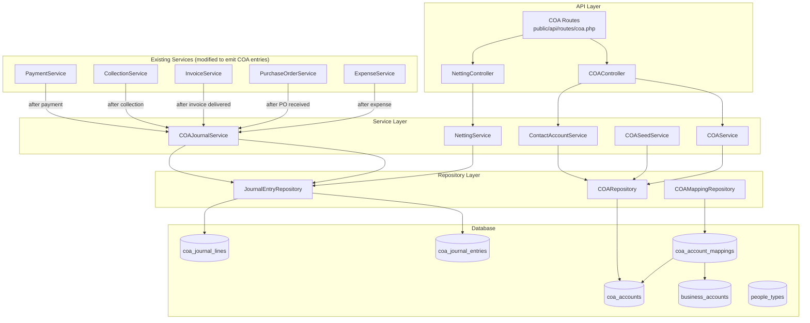
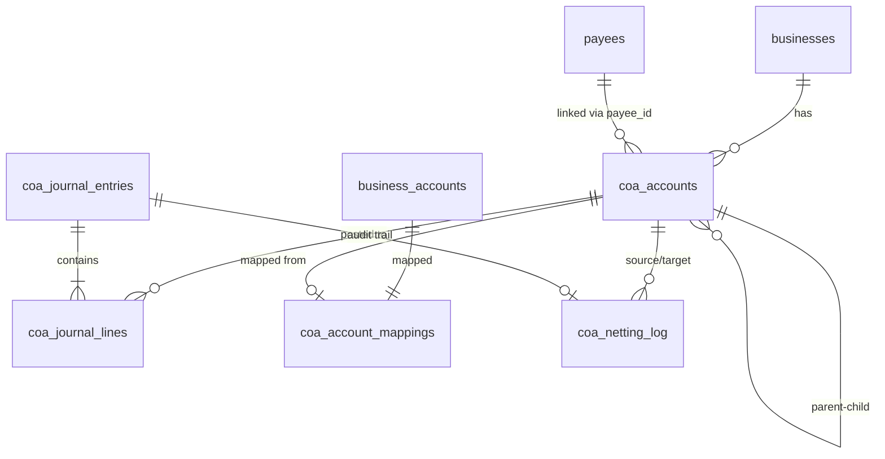

# Design Document: Chart of Accounts (COA)

## Overview

This design introduces a structured Chart of Accounts (COA) system that replaces the flat `business_accounts` table model with a numbered, hierarchical accounting structure following standard classifications (Assets, Liabilities, Equity, Revenue, Expenses). The system integrates with existing financial operations (payments, collections, invoices, purchase orders, expenses) via double-entry journal entries while maintaining full backward compatibility with the existing `business_accounts` table.

Key design decisions:
- **Additive approach**: New `coa_accounts` and `coa_journal_entries` tables are added alongside existing tables rather than modifying them, ensuring zero downtime and backward compatibility.
- **Mapping layer**: A `coa_account_mappings` table links existing `business_accounts` rows to their corresponding COA accounts, allowing existing payment/collection flows to continue unchanged while the COA engine records proper double-entry entries.
- **Event-driven integration**: Financial operations trigger COA journal entries via a `COAJournalService` that observes transaction lifecycle events rather than modifying the transaction services themselves.
- **Per-contact sub-accounts**: Automatically created when a person is assigned a payee type, using `{control_code}-{seq}` numbering scoped per control account per business.

## Architecture



### Component Responsibilities

| Component | Responsibility |
|-----------|---------------|
| `COAController` | CRUD for COA accounts, listing, filtering, trial balance |
| `NettingController` | Cross-type netting operations |
| `COAService` | Account lifecycle: create, update, deactivate, delete, validate codes |
| `COASeedService` | Seeds default system accounts on business creation |
| `ContactAccountService` | Auto-creates/deactivates per-contact sub-accounts |
| `COAJournalService` | Records double-entry journal entries from financial operations |
| `NettingService` | Validates and executes cross-type netting between sub-accounts |
| `COARepository` | CRUD operations on `coa_accounts` table |
| `JournalEntryRepository` | Inserts/queries `coa_journal_entries` + `coa_journal_lines` |
| `COAMappingRepository` | Manages `coa_account_mappings` linking business_accounts → COA |

## Components and Interfaces

### COAService

```php
class COAService {
    // List all accounts for current business, grouped by classification
    public function list(array $filters = []): array;
    
    // Get single account by ID (scoped to business)
    public function getById(int $id): array;
    
    // Create a user-defined account
    public function create(array $data): int;
    
    // Update account (name, guide, is_control_account)
    public function update(int $id, array $data): void;
    
    // Deactivate an account (sets is_active = false)
    public function deactivate(int $id, bool $confirmed = false): void;
    
    // Reactivate an account
    public function reactivate(int $id): void;
    
    // Delete a user-defined account (only if no transactions)
    public function delete(int $id): void;
    
    // Get trial balance (all accounts with debit/credit balances)
    public function trialBalance(): array;
    
    // Search accounts by code, name, or contact name
    public function search(string $term): array;
    
    // Validate account code is in correct range for classification
    public static function validateCodeRange(int $code, string $classification): bool;
}
```

### COASeedService

```php
class COASeedService {
    // Seed all default system accounts for a new business (atomic)
    public function seedForBusiness(int $businessId): void;
    
    // Get the default accounts definition array
    public static function getDefaultAccounts(): array;
}
```

### ContactAccountService

```php
class ContactAccountService {
    // Create a sub-account when a person gets a payee type
    public function createForPayeeType(int $personId, int $payeeTypeId, int $businessId): int;
    
    // Deactivate or delete sub-account when payee type is removed
    public function removeForPayeeType(int $personId, int $payeeTypeId, int $businessId): void;
    
    // Get the next sequential number for a control account
    public function getNextSequence(int $controlAccountId, int $businessId): int;
    
    // Find a contact's sub-account under a specific control account
    public function findByPayee(int $payeeId, int $controlAccountId): ?array;
    
    // Auto-create contact account if missing (called during transactions)
    public function ensureExists(int $payeeId, string $payeeTypeCode, int $businessId): int;
}
```

### COAJournalService

```php
class COAJournalService {
    // Record a double-entry journal entry
    public function record(array $entry): int;
    
    // Record collection: Debit Cash/Bank, Credit AR sub-account
    public function recordCollection(int $collectionSlipId, int $accountId, int $payeeId, float $amount, string $currency, ?float $exchangeRate): void;
    
    // Record payment: Debit AP sub-account, Credit Cash/Bank
    public function recordPayment(int $paymentSlipId, int $accountId, int $payeeId, float $amount, string $currency, ?float $exchangeRate): void;
    
    // Record invoice delivery: Debit AR, Credit Revenue
    public function recordInvoiceDelivery(int $invoiceId, int $payeeId, float $amount, string $currency): void;
    
    // Record PO receipt: Debit Inventory/Expense, Credit AP
    public function recordPurchaseOrderReceipt(int $poId, int $payeeId, array $lines, string $currency): void;
    
    // Record expense: Debit Expense account, Credit AP
    public function recordExpense(int $expenseId, int $payeeId, int $expenseCategoryCoaId, float $amount, string $currency): void;
    
    // Validate debit == credit for an entry
    public static function validateBalance(array $lines): bool;
}
```

### NettingService

```php
class NettingService {
    // Execute a netting operation between two sub-accounts of the same person
    public function execute(array $data): int;
    
    // Validate netting prerequisites (same person, different accounts, sufficient balance)
    public function validate(array $data): array; // returns errors array
}
```

### API Endpoints

| Method | Path | Controller Method | Permission |
|--------|------|-------------------|------------|
| GET | `/coa` | `COAController::index` | `coa.view` |
| GET | `/coa/{id}` | `COAController::show` | `coa.view` |
| POST | `/coa` | `COAController::store` | `coa.create` |
| PUT | `/coa/{id}` | `COAController::update` | `coa.edit` |
| DELETE | `/coa/{id}` | `COAController::destroy` | `coa.delete` |
| POST | `/coa/{id}/deactivate` | `COAController::deactivate` | `coa.edit` |
| POST | `/coa/{id}/reactivate` | `COAController::reactivate` | `coa.edit` |
| GET | `/coa/trial-balance` | `COAController::trialBalance` | `coa.view` |
| GET | `/coa/search` | `COAController::search` | `coa.view` |
| POST | `/coa/netting` | `NettingController::store` | `coa.netting` |

## Data Models

### coa_accounts

```sql
CREATE TABLE IF NOT EXISTS `coa_accounts` (
  `id` int NOT NULL AUTO_INCREMENT,
  `business_id` int NOT NULL,
  `account_code` int NOT NULL,
  `account_name` varchar(100) NOT NULL,
  `classification` enum('ASSETS','LIABILITIES','EQUITY','REVENUE','EXPENSES') NOT NULL,
  `account_guide` varchar(500) NOT NULL,
  `is_system` tinyint(1) NOT NULL DEFAULT 0,
  `is_control_account` tinyint(1) NOT NULL DEFAULT 0,
  `is_active` tinyint(1) NOT NULL DEFAULT 1,
  `parent_account_id` int DEFAULT NULL,
  `payee_id` int DEFAULT NULL,
  `sub_account_sequence` int DEFAULT NULL,
  `balance` decimal(18,2) NOT NULL DEFAULT 0.00,
  `normal_balance_type` enum('DEBIT','CREDIT') NOT NULL,
  `created_at` datetime NOT NULL DEFAULT CURRENT_TIMESTAMP,
  `updated_at` datetime DEFAULT NULL ON UPDATE CURRENT_TIMESTAMP,
  PRIMARY KEY (`id`),
  UNIQUE KEY `uq_coa_business_code` (`business_id`, `account_code`),
  KEY `idx_coa_classification` (`business_id`, `classification`),
  KEY `idx_coa_parent` (`parent_account_id`),
  KEY `idx_coa_payee` (`payee_id`),
  CONSTRAINT `fk_coa_business` FOREIGN KEY (`business_id`) REFERENCES `businesses` (`id`) ON DELETE RESTRICT,
  CONSTRAINT `fk_coa_parent` FOREIGN KEY (`parent_account_id`) REFERENCES `coa_accounts` (`id`) ON DELETE RESTRICT,
  CONSTRAINT `fk_coa_payee` FOREIGN KEY (`payee_id`) REFERENCES `payees` (`id`) ON DELETE RESTRICT
) ENGINE=InnoDB DEFAULT CHARSET=utf8mb4 COLLATE=utf8mb4_0900_ai_ci;
```

**Notes:**
- `account_code` stores the integer code (e.g., 101, 411). For sub-accounts, this is a composite stored as `controlCode * 1000 + sequence` (e.g., 411001 for "411-001") enabling unique constraint and sort order.
- `normal_balance_type` indicates whether the account naturally has a debit (Assets, Expenses) or credit (Liabilities, Equity, Revenue) balance — used for trial balance display.
- `parent_account_id` links sub-accounts to their control account.
- `payee_id` links contact sub-accounts to the payee record.
- `sub_account_sequence` stores the 001-999 sequence number for sub-accounts.

### coa_journal_entries

```sql
CREATE TABLE IF NOT EXISTS `coa_journal_entries` (
  `id` int NOT NULL AUTO_INCREMENT,
  `business_id` int NOT NULL,
  `entry_date` date NOT NULL,
  `entry_type` varchar(50) NOT NULL,
  `description` text,
  `reference_type` varchar(50) DEFAULT NULL,
  `reference_id` int DEFAULT NULL,
  `total_amount` decimal(18,2) NOT NULL,
  `currency` varchar(3) NOT NULL,
  `exchange_rate` decimal(10,6) DEFAULT NULL,
  `created_by` int DEFAULT NULL,
  `created_at` datetime NOT NULL DEFAULT CURRENT_TIMESTAMP,
  PRIMARY KEY (`id`),
  KEY `idx_cje_business_date` (`business_id`, `entry_date`),
  KEY `idx_cje_reference` (`reference_type`, `reference_id`),
  KEY `idx_cje_type` (`entry_type`),
  CONSTRAINT `fk_cje_business` FOREIGN KEY (`business_id`) REFERENCES `businesses` (`id`) ON DELETE RESTRICT
) ENGINE=InnoDB DEFAULT CHARSET=utf8mb4 COLLATE=utf8mb4_0900_ai_ci;
```

### coa_journal_lines

```sql
CREATE TABLE IF NOT EXISTS `coa_journal_lines` (
  `id` int NOT NULL AUTO_INCREMENT,
  `journal_entry_id` int NOT NULL,
  `coa_account_id` int NOT NULL,
  `debit_amount` decimal(18,2) NOT NULL DEFAULT 0.00,
  `credit_amount` decimal(18,2) NOT NULL DEFAULT 0.00,
  `description` varchar(255) DEFAULT NULL,
  PRIMARY KEY (`id`),
  KEY `idx_cjl_entry` (`journal_entry_id`),
  KEY `idx_cjl_account` (`coa_account_id`),
  CONSTRAINT `fk_cjl_entry` FOREIGN KEY (`journal_entry_id`) REFERENCES `coa_journal_entries` (`id`) ON DELETE CASCADE,
  CONSTRAINT `fk_cjl_account` FOREIGN KEY (`coa_account_id`) REFERENCES `coa_accounts` (`id`) ON DELETE RESTRICT
) ENGINE=InnoDB DEFAULT CHARSET=utf8mb4 COLLATE=utf8mb4_0900_ai_ci;
```

### coa_account_mappings

```sql
CREATE TABLE IF NOT EXISTS `coa_account_mappings` (
  `id` int NOT NULL AUTO_INCREMENT,
  `business_id` int NOT NULL,
  `business_account_id` int NOT NULL,
  `coa_account_id` int NOT NULL,
  `created_at` datetime NOT NULL DEFAULT CURRENT_TIMESTAMP,
  PRIMARY KEY (`id`),
  UNIQUE KEY `uq_cam_business_account` (`business_account_id`),
  KEY `idx_cam_coa` (`coa_account_id`),
  CONSTRAINT `fk_cam_business` FOREIGN KEY (`business_id`) REFERENCES `businesses` (`id`) ON DELETE RESTRICT,
  CONSTRAINT `fk_cam_ba` FOREIGN KEY (`business_account_id`) REFERENCES `business_accounts` (`id`) ON DELETE RESTRICT,
  CONSTRAINT `fk_cam_coa` FOREIGN KEY (`coa_account_id`) REFERENCES `coa_accounts` (`id`) ON DELETE RESTRICT
) ENGINE=InnoDB DEFAULT CHARSET=utf8mb4 COLLATE=utf8mb4_0900_ai_ci;
```

### coa_netting_log

```sql
CREATE TABLE IF NOT EXISTS `coa_netting_log` (
  `id` int NOT NULL AUTO_INCREMENT,
  `business_id` int NOT NULL,
  `person_id` int NOT NULL,
  `source_account_id` int NOT NULL,
  `target_account_id` int NOT NULL,
  `amount` decimal(18,2) NOT NULL,
  `exchange_rate` decimal(10,6) DEFAULT NULL,
  `journal_entry_id` int NOT NULL,
  `notes` text,
  `created_by` int NOT NULL,
  `created_at` datetime NOT NULL DEFAULT CURRENT_TIMESTAMP,
  PRIMARY KEY (`id`),
  KEY `idx_cnl_business` (`business_id`),
  KEY `idx_cnl_person` (`person_id`),
  CONSTRAINT `fk_cnl_business` FOREIGN KEY (`business_id`) REFERENCES `businesses` (`id`) ON DELETE RESTRICT,
  CONSTRAINT `fk_cnl_source` FOREIGN KEY (`source_account_id`) REFERENCES `coa_accounts` (`id`) ON DELETE RESTRICT,
  CONSTRAINT `fk_cnl_target` FOREIGN KEY (`target_account_id`) REFERENCES `coa_accounts` (`id`) ON DELETE RESTRICT,
  CONSTRAINT `fk_cnl_journal` FOREIGN KEY (`journal_entry_id`) REFERENCES `coa_journal_entries` (`id`) ON DELETE RESTRICT
) ENGINE=InnoDB DEFAULT CHARSET=utf8mb4 COLLATE=utf8mb4_0900_ai_ci;
```

### Payee Type → Control Account Mapping

This mapping is maintained as a constant/config in `ContactAccountService`:

| Payee Type Code | Control Account Code | Control Account Name |
|-----------------|---------------------|---------------------|
| `CUSTOMER` | 411 | Accounts Receivable |
| `SUPPLIER` | 201 | Accounts Payable |
| `EMPLOYEE` | 502 | Salaries Expense |
| `PARTNER` | 301 | Owner's Equity |

### Sub-Account Code Encoding

Sub-accounts use a compound integer code for storage and unique constraint enforcement:

```
account_code = control_account_code * 1000 + sub_account_sequence

Examples:
  411-001 → account_code = 411001
  411-002 → account_code = 411002
  201-001 → account_code = 201001
```

Display format uses the hyphenated form: `{code}-{seq:03d}`

### Default System Accounts (Seed Data)

| Code | Name | Classification | Normal Balance | Is Control |
|------|------|----------------|---------------|------------|
| 101 | Cash | ASSETS | DEBIT | No |
| 102 | Bank | ASSETS | DEBIT | No |
| 105 | Inventory | ASSETS | DEBIT | No |
| 110 | Prepaid Expenses | ASSETS | DEBIT | No |
| 201 | Accounts Payable | LIABILITIES | CREDIT | Yes |
| 210 | Accrued Liabilities | LIABILITIES | CREDIT | No |
| 301 | Owner's Equity | EQUITY | CREDIT | Yes |
| 302 | Retained Earnings | EQUITY | CREDIT | No |
| 401 | Sales Revenue | REVENUE | CREDIT | No |
| 402 | Service Revenue | REVENUE | CREDIT | No |
| 411 | Accounts Receivable | ASSETS | DEBIT | Yes |
| 501 | Cost of Goods Sold | EXPENSES | DEBIT | No |
| 502 | Salaries Expense | EXPENSES | DEBIT | Yes |
| 503 | Rent Expense | EXPENSES | DEBIT | No |
| 504 | Utilities Expense | EXPENSES | DEBIT | No |
| 505 | Marketing Expense | EXPENSES | DEBIT | No |
| 510 | Depreciation Expense | EXPENSES | DEBIT | No |
| 520 | General & Administrative | EXPENSES | DEBIT | No |

### Entity Relationship (Mermaid)



## Correctness Properties

*A property is a characteristic or behavior that should hold true across all valid executions of a system — essentially, a formal statement about what the system should do. Properties serve as the bridge between human-readable specifications and machine-verifiable correctness guarantees.*

### Property 1: Account code range validation

*For any* account code (integer) and classification pair, the code SHALL be accepted if and only if it falls within the valid range for that classification: Assets (100–199), Liabilities (200–299), Equity (300–399), Revenue (400–499), Expenses (500–599).

**Validates: Requirements 1.3, 1.6, 3.2**

### Property 2: Account code uniqueness per business

*For any* business and any two accounts within that business, if they both have the same account_code, then the second creation attempt SHALL be rejected with a duplicate code error.

**Validates: Requirements 1.4, 3.3**

### Property 3: Account guide validation

*For any* string provided as an account_guide, the system SHALL accept it if and only if, after trimming whitespace, its length is between 1 and 500 characters (inclusive). Empty strings, whitespace-only strings, and strings exceeding 500 characters after trimming SHALL be rejected.

**Validates: Requirements 1.5, 5.1, 5.4, 5.5**

### Property 4: Required field validation on account creation

*For any* account creation request, if any of the required fields (account_code, account_name, classification, account_guide) is missing or blank after trimming, the system SHALL reject the request identifying the missing field(s).

**Validates: Requirements 3.1, 3.6**

### Property 5: System account immutability

*For any* account where is_system = true, the system SHALL reject deletion requests, reject attempts to change the account_code, and reject attempts to change the classification.

**Validates: Requirements 1.2, 2.2, 2.3**

### Property 6: User-created accounts are non-system

*For any* account created through the user-facing create endpoint, the resulting account SHALL have is_system = 0, and is_active = 1 as defaults.

**Validates: Requirements 3.5, 10.1**

### Property 7: Contact sub-account creation on payee type assignment

*For any* person assigned N distinct payee types in a business, exactly N Contact_Accounts SHALL exist — one per payee type — each under the correct control account (Customer→411, Supplier→201, Employee→502, Partner→301).

**Validates: Requirements 4.1, 4.3**

### Property 8: Sub-account sequential numbering

*For any* control account in a business, the sub-account sequences SHALL be unique integers in the range 1–999, and the account_code of each sub-account SHALL equal `control_account_code * 1000 + sequence_number`.

**Validates: Requirements 4.2**

### Property 9: Sub-account naming convention

*For any* Contact_Account, its account_name SHALL follow the pattern `{person_name} – {payee_type_name}` using the linked person's current name and the payee type's name.

**Validates: Requirements 4.4**

### Property 10: Sub-account lifecycle on payee type removal

*For any* Contact_Account, when its linked payee type is removed: if the account has a non-zero balance OR at least one posted journal line, it SHALL be deactivated (is_active = false); otherwise it SHALL be deleted entirely.

**Validates: Requirements 4.5, 4.6**

### Property 11: Netting requires same person ownership

*For any* netting operation where the source and target sub-accounts are not linked to the same person_id (via payee), the system SHALL reject the operation.

**Validates: Requirements 6.2**

### Property 12: Netting balance sufficiency

*For any* netting operation, if the netting amount exceeds the source sub-account's current balance, the system SHALL reject the operation.

**Validates: Requirements 6.4**

### Property 13: Netting conserves total value

*For any* valid netting operation with amount A on source account S and target account T (same currency): after netting, `S.balance_after = S.balance_before - A` AND `T.balance_after = T.balance_before + A`, and the sum `S.balance + T.balance` is unchanged.

**Validates: Requirements 6.5**

### Property 14: Double-entry balance invariant

*For any* journal entry recorded in the system, the sum of all debit_amount values across its journal lines SHALL equal the sum of all credit_amount values across its journal lines.

**Validates: Requirements 7.8**

### Property 15: Control account balance equals sum of sub-accounts

*For any* control account, its displayed balance SHALL equal the sum of balances of all its direct sub-accounts (active and inactive).

**Validates: Requirements 8.2**

### Property 16: Trial balance equation

*For any* business at any point in time, the sum of all debit balances across all accounts SHALL equal the sum of all credit balances across all accounts.

**Validates: Requirements 8.3**

### Property 17: Business scoping isolation

*For any* COA query or mutation, the operation SHALL only return or affect accounts where `business_id` matches the authenticated user's current business context. Attempts to access accounts from other businesses SHALL be rejected.

**Validates: Requirements 9.1, 9.2, 9.3**

### Property 18: Inactive accounts block posting

*For any* account where is_active = false, any attempt to create a journal line referencing that account SHALL be rejected.

**Validates: Requirements 10.2**

### Property 19: Control account deactivation hierarchy

*For any* control account that has at least one sub-account with is_active = true, deactivation of the control account SHALL be rejected.

**Validates: Requirements 10.6**

### Property 20: Deletion blocked for accounts with transactions

*For any* user-defined account (is_system = 0) that has at least one associated journal line, deletion SHALL be rejected and the system SHALL suggest deactivation instead.

**Validates: Requirements 10.5**

### Property 21: Classification filter correctness

*For any* COA listing filtered by a specific classification, every account in the result set SHALL have that classification value.

**Validates: Requirements 8.5**

### Property 22: Search result relevance

*For any* search query term and any account in the result set, the term SHALL appear as a case-insensitive substring in at least one of: the account code (as string), the account name, or the linked contact's name.

**Validates: Requirements 8.6**

## Error Handling

### Validation Errors (HTTP 400)

| Error Condition | Error Message |
|----------------|---------------|
| Missing required field | `"Missing field: {field_name}"` |
| Account code out of range | `"Account code {code} is outside the valid range ({min}–{max}) for classification {classification}"` |
| Duplicate account code | `"Account code {code} is already in use in this business"` |
| Account guide empty/whitespace | `"A non-empty Account Guide is required"` |
| Account guide too long | `"Account Guide must not exceed 500 characters"` |
| Account name too long | `"Account name must not exceed 100 characters"` |
| Invalid classification | `"Classification must be one of: ASSETS, LIABILITIES, EQUITY, REVENUE, EXPENSES"` |
| Netting amount <= 0 | `"Netting amount must be greater than zero"` |
| Netting same account | `"Netting requires two distinct sub-accounts"` |
| Netting different persons | `"Sub-accounts must belong to the same contact"` |
| Netting insufficient balance | `"Insufficient balance on source account"` |
| Netting inactive account | `"Netting cannot be performed against inactive accounts"` |
| Cross-currency without rate | `"Exchange rate is required for cross-currency netting"` |

### Business Logic Errors (HTTP 409/422)

| Error Condition | Error Message |
|----------------|---------------|
| Delete system account | `"Cannot delete system-protected account"` |
| Delete account with transactions | `"Cannot delete account with posted transactions. Deactivate instead."` |
| Deactivate control with active subs | `"Cannot deactivate control account while sub-accounts are active"` |
| Deactivate non-zero without confirm | `"Account has non-zero balance. Confirm deactivation."` |
| Modify system account code | `"Cannot change account code of a system account"` |
| Modify system account classification | `"Cannot change classification of a system account"` |
| Post to inactive account | `"Cannot post transactions to inactive account {code}"` |
| Control account missing for contact | `"Required control account {code} is unavailable for this business"` |

### Authorization Errors (HTTP 403/404)

| Error Condition | Error Message |
|----------------|---------------|
| Account not in current business | `"Account not found"` (returns 404 to prevent information leakage) |
| Missing business context | `"A valid business context is required"` |
| Insufficient permissions | `"Forbidden"` |

### Transaction Safety

All mutating operations that involve multiple database writes (seeding, netting, journal entries) use PDO transactions with try/catch/rollback to ensure atomicity. If any step fails:
- The entire operation is rolled back
- An appropriate error is returned
- No partial state is persisted

## Testing Strategy

### Property-Based Testing (PHP — PHPUnit with custom generators)

Property-based testing is well-suited for this feature because:
- Account code validation is a pure function with a large input space
- Account guide validation involves string-length boundaries
- Netting operations have clear mathematical invariants (conservation of value)
- Double-entry balance (debit == credit) is a universal property
- Business scoping isolation is a universal security property

**Library:** PHPUnit 9.6 with custom data providers generating randomized inputs (min 100 iterations per property)

**Tag format:** `Feature: chart-of-accounts, Property {N}: {property_text}`

Each correctness property from the design document maps to a single property-based test:

| Property | Test File | Generator Strategy |
|----------|-----------|-------------------|
| 1: Code range validation | `tests/Property/COA/CodeRangeValidationTest.php` | Random ints 0–999 × 5 classifications |
| 2: Code uniqueness | `tests/Property/COA/CodeUniquenessTest.php` | Random sequences of account creations |
| 3: Guide validation | `tests/Property/COA/GuideValidationTest.php` | Random strings length 0–600, whitespace variants |
| 4: Required fields | `tests/Property/COA/RequiredFieldsTest.php` | Random subsets of required fields omitted |
| 5: System immutability | `tests/Property/COA/SystemImmutabilityTest.php` | Random mutations on system accounts |
| 6: User accounts non-system | `tests/Property/COA/UserAccountDefaultsTest.php` | Random valid creation payloads |
| 7: Contact sub-account creation | `tests/Property/COA/ContactAccountCreationTest.php` | Random person + payee type combos |
| 8: Sequential numbering | `tests/Property/COA/SequentialNumberingTest.php` | Random sequences of sub-account creations |
| 9: Naming convention | `tests/Property/COA/NamingConventionTest.php` | Random person names × payee type names |
| 10: Sub-account lifecycle | `tests/Property/COA/SubAccountLifecycleTest.php` | Random balance/transaction states |
| 11: Netting same person | `tests/Property/COA/NettingSamePersonTest.php` | Random pairs of sub-accounts |
| 12: Netting balance | `tests/Property/COA/NettingBalanceTest.php` | Random amounts vs random balances |
| 13: Netting conservation | `tests/Property/COA/NettingConservationTest.php` | Random valid netting operations |
| 14: Double-entry balance | `tests/Property/COA/DoubleEntryBalanceTest.php` | Random journal entries with lines |
| 15: Control = sum of subs | `tests/Property/COA/ControlBalanceSumTest.php` | Random sub-account balance distributions |
| 16: Trial balance | `tests/Property/COA/TrialBalanceTest.php` | Random sequences of balanced entries |
| 17: Business scoping | `tests/Property/COA/BusinessScopingTest.php` | Random cross-business access attempts |
| 18: Inactive blocks posting | `tests/Property/COA/InactiveBlocksPostingTest.php` | Random transactions to inactive accounts |
| 19: Control deactivation | `tests/Property/COA/ControlDeactivationTest.php` | Random control accounts with varying active sub-account counts |
| 20: Deletion with txns | `tests/Property/COA/DeletionBlockedTest.php` | Random accounts with varying transaction counts |
| 21: Classification filter | `tests/Property/COA/ClassificationFilterTest.php` | Random classification filters |
| 22: Search relevance | `tests/Property/COA/SearchRelevanceTest.php` | Random search terms × random account datasets |

### Unit Testing (PHPUnit)

Focus on specific examples, edge cases, and integration points:

- Seed operation creates exactly 18 accounts with correct attributes
- Seed rollback leaves zero accounts on failure
- Deactivation of system account succeeds regardless of balance
- Reactivation sets is_active = true
- Cross-currency netting applies exchange rate correctly
- Account guide trimming behavior (leading/trailing whitespace removed)
- Boundary cases: code 100 (min valid for Assets), code 199 (max valid for Assets), code 200 (min for Liabilities)
- Sub-account sequence reuse after deletion
- Auto-creation of contact account during transaction recording

### Integration Testing (PHPUnit)

End-to-end flows through the API:

- Full business creation → seed → verify COA listing
- Create custom account → post journal entry → verify balance
- Assign payee type → verify sub-account created → record collection → verify journal entry
- Netting flow: create two sub-accounts → fund them → net → verify balances
- Payment flow: create payment slip → verify COA journal entry debit/credit
- Collection flow: create collection slip → verify COA journal entry debit/credit

### JavaScript Frontend Tests (Vitest + fast-check)

| Test | File |
|------|------|
| COA listing display logic | `tests/chart-of-accounts/coaListing.test.js` |
| Account code formatting (411-001) | `tests/chart-of-accounts/codeFormatting.test.js` |
| Trial balance calculation (client-side totals) | `tests/chart-of-accounts/trialBalance.test.js` |
| Search/filter UI logic | `tests/chart-of-accounts/searchFilter.test.js` |

