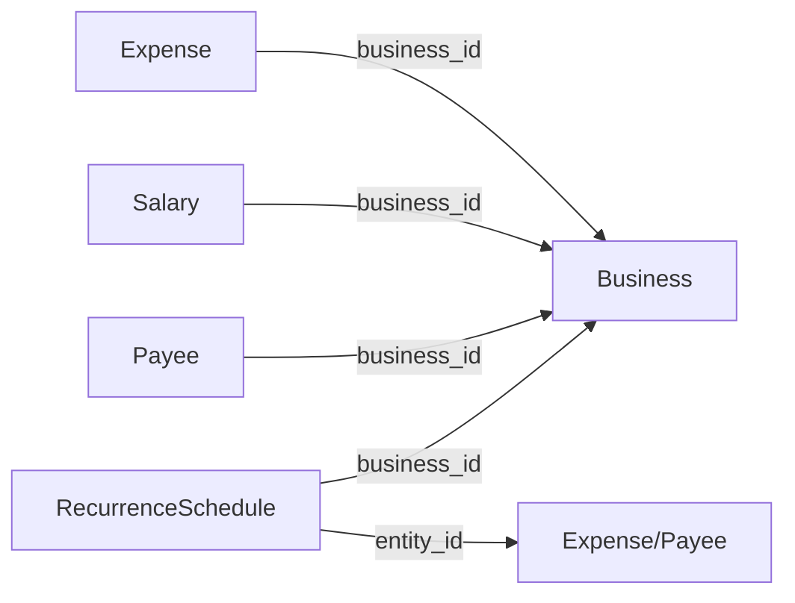

# Design Document: Expenses & Payroll Module Review

## Overview

This design covers a comprehensive code review and refactoring of the Expenses & Payroll module. The work addresses five categories of improvements applied to `ExpensesController`, `SalariesController`, `RecurrenceController`, `ExpenseService`, `SalaryService`, `RecurrenceService`, and their corresponding frontend modals.

**Goals:**
1. **Security** — Eliminate exception message leakage, add MIME-based file upload verification, enforce payee/entity ownership checks
2. **Validation** — Add input validation for amounts, dates, and category names at both service and frontend layers
3. **Architecture** — Extract inline SQL from controllers and services into repository methods, enforce 3-layer pattern
4. **Consistency** — Standardize HTTP status codes and structured error logging across all controllers
5. **Frontend** — Improve form validation with positive-number checks, date logic, and proper event listener cleanup

**Approach:** All refactoring preserves existing functional behavior. Each change is additive (new validation) or structural (moving code between layers) — no business logic changes unless explicitly required (e.g., payee balance correctness fixes).

## Architecture

### Current State

```
┌─────────────────┐     ┌─────────────────┐     ┌─────────────────┐
│ Controller      │────▶│ Service          │────▶│ Repository      │
│ (HTTP + some    │     │ (Business logic  │     │ (PDO queries)   │
│  inline SQL)    │     │  + some inline   │     │                 │
│                 │     │  SQL)            │     │                 │
└─────────────────┘     └─────────────────┘     └─────────────────┘
```

**Problems identified:**
- `SalariesController::payslip()` contains inline SQL (business info query) and instantiates Dompdf directly
- `SalaryService::generatePayroll()` has 3 inline SQL queries (employee lookup, overlap check, latest salary)
- `RecurrenceController` has private helper methods (`resolveEntityDetails`, `resolveEntityNameFromSchedule`) with 6+ inline SQL statements
- Error handling is inconsistent: some controllers leak `$e->getMessage()`, some use HTTP 400 where 422 is the project standard
- No MIME verification on file uploads (extension-only check)
- Missing input validation on the `update()` path for expenses
- No payee ownership verification in salary/expense operations

### Target State

```
┌─────────────────┐     ┌─────────────────┐     ┌─────────────────┐
│ Controller      │────▶│ Service          │────▶│ Repository      │
│ (HTTP only:     │     │ (Business logic  │     │ (ALL SQL here)  │
│  input, status, │     │  + validation +  │     │                 │
│  logging)       │     │  orchestration)  │     │                 │
└─────────────────┘     └─────────────────┘     └─────────────────┘
        │                       │
        ▼                       ▼
  Tiered exception         Ownership checks
  handling (422/404/       Payee balance math
  409/500)                 Date/amount validation
```

### Layered Responsibility After Refactoring

| Layer | Responsibilities |
|-------|-----------------|
| **Controller** | Auth, input parsing, tiered exception → HTTP status mapping, structured logging, response serialization |
| **Service** | Input validation, ownership verification, business logic, payee balance adjustments, transaction management |
| **Repository** | All SQL queries including enrichment queries currently in controllers |

## Components and Interfaces

### Modified Controllers

#### ExpensesController (changes)
- `store()` — Remove `$e->getMessage()` from error response, add structured logging
- `storeCategory()` — Remove `$e->getMessage()` from error response, add structured logging
- `uploadAttachment()` — Add MIME verification via `finfo_file()`, filename sanitization, remove message leakage

#### SalariesController (changes)
- `store()` — Remove `$e->getMessage()` from error response, add structured logging
- `generatePayroll()` — Remove `$e->getMessage()` from error response, add structured logging
- `payslip()` — Extract all logic to service layer; controller only handles headers + PDF streaming

#### RecurrenceController (changes)
- All methods — Change `InvalidArgumentException` from HTTP 400 to 422
- `listSchedules()` — Remove inline SQL enrichment, delegate to service
- `listInstances()` — Remove inline SQL enrichment and `resolveEntityDetails()` usage, delegate to service
- Remove `resolveEntityDetails()` and `resolveEntityNameFromSchedule()` private methods
- All catch blocks — Remove `$e->getMessage()` from generic Throwable responses, add structured logging

### Modified Services

#### ExpenseService (changes)
- `create()` — Add positive-amount validation, positive exchange_rate validation, date format validation, payee ownership check
- `update()` — Add full input validation (date, currency, amount, exchange_rate), payee ownership check, date format validation
- `createCategory()` / `updateCategory()` — Add name length (≤100) and printable-character validation

#### SalaryService (changes)
- `create()` — Add positive gross_amount_fc, non-negative tax_fc, positive exchange_rate validation, payee ownership check, date format validation
- `update()` — Same validations as create, payee ownership check
- `delete()` — Replace inline SQL allocation check with repository method call
- `generatePayroll()` — Replace 3 inline SQL queries with repository method calls
- New method: `generatePayslipPdf(int $salaryId): array` — Orchestrates salary lookup, business info, HTML rendering, PDF generation

#### RecurrenceService (changes)
- `listSchedulesEnriched(array $filters): array` — New method that lists schedules with entity_name, payee_id, exchange_rate enrichment
- `listInstancesEnriched(array $filters): array` — New method that lists instances with entity_name, payee_id, exchange_rate, days_overdue
- `createSchedule()` — Add ownership verification for the referenced entity
- Bulk advance payment / instance status operations — Add schedule ownership verification

### Modified Repositories

#### SalaryRepository (new methods)
- `findEmployeesWithRecurrences(int $businessId): array` — Employee lookup with recurrence schedules
- `existsOverlappingPeriod(int $payeeId, int $businessId, string $start, string $end): bool` — Period overlap check
- `findLatestForPayee(int $payeeId, int $businessId): ?array` — Latest salary template lookup
- `sumPaymentAllocationsForSalary(int $salaryId): float` — Payment allocation sum for delete guard
- `findBusinessInfo(int $businessId): array` — Business info for payslip rendering

#### RecurrenceScheduleRepository (new methods)
- `findAllEnrichedForBusiness(int $businessId, array $filters): array` — Schedules with entity metadata (JOINs for entity_name, payee_id, exchange_rate)

#### RecurrenceInstanceRepository (new methods)
- `findAllEnrichedForBusiness(int $businessId, array $filters): array` — Instances with schedule and entity metadata

#### ExpenseRepository (new methods)
- `findEntityMetadataForSchedule(int $expenseId): array` — Returns payee_name, category_name, payee_id, exchange_rate for enrichment

### Frontend Modals (changes)

#### expenseForm.modal.js
- `validateForm()` — Add positive-number check for amount_fc and exchange_rate, valid date check for expense_date
- `unmount()` — Add cleanup for input event listeners on amountFc, exchangeRate, and change event on date

#### salaryForm.modal.js
- `validateForm()` — Add period_end ≥ period_start, positive gross_amount_fc, non-negative tax_fc ≤ gross, positive exchange_rate
- `unmount()` — Add cleanup for input events on grossAmountFc, taxFc, and change event on employee

#### expenseCategories.modal.js
- `validateForm()` — Add empty/whitespace check, max-length 100 check
- `unmount()` — Ensure proper cleanup

### Structured Logging Helper

A shared logging approach will be used across all three controllers:

```php
// In each controller's catch block:
error_log(sprintf(
    '[%s] %s: %s - %s (user=%s, business=%s)',
    $modulePrefix,    // 'Expenses', 'Salaries', or 'Recurrence'
    $methodName,      // e.g., 'store', 'payslip'
    get_class($e),    // Exception class
    $e->getMessage(), // Full message for logs
    $ctx->user_id ?? 'unknown',
    $ctx->business_id ?? 'unknown'
));
```

### Tiered Exception Pattern

All controllers will follow this consistent pattern:

```php
try {
    // ... business logic
} catch (\InvalidArgumentException $e) {
    $this->logError($module, $method, $e);
    $this->json(false, null, $e->getMessage(), 422);
} catch (\RuntimeException $e) {
    $this->logError($module, $method, $e);
    $code = str_contains($e->getMessage(), 'not found') ? 404 : 422;
    $this->json(false, null, $e->getMessage(), $code);
} catch (\Throwable $e) {
    $this->logError($module, $method, $e);
    $this->serverError('Generic message here');
}
```

## Data Models

No database schema changes are required. This refactoring operates on existing tables:

- `expenses` — expense records with payee_id, amount_fc, amount_bc, exchange_rate, expense_date
- `salaries` — salary records with payee_id, gross/tax/net amounts in FC and BC, period_start/end
- `recurrence_schedules` — recurring schedule definitions (entity_type, entity_id, frequency, amounts)
- `recurrence_instances` — generated instances from schedules (due_date, status, amounts)
- `payment_allocations` — allocation records linking payments to expenses/salaries
- `payees` — payee records with business_id scoping and running balance
- `businesses` — business info used for payslip rendering
- `people` — person records linked to payees
- `expense_categories` — category names with business scoping

### Key Relationships for Ownership Verification



Ownership verification ensures that `entity.business_id = AuthContext::businessId()` before any operation proceeds.

## Correctness Properties

*A property is a characteristic or behavior that should hold true across all valid executions of a system — essentially, a formal statement about what the system should do. Properties serve as the bridge between human-readable specifications and machine-verifiable correctness guarantees.*

### Property 1: Structured Log Format Consistency

*For any* controller method in the Expenses & Payroll module and *for any* caught exception, the logged string SHALL match the pattern `[{Module}] {method}: {ExceptionClass} - {message} (user={id}, business={id})` where Module is one of Expenses, Salaries, or Recurrence.

**Validates: Requirements 2.3, 2.4, 2.5**

### Property 2: Exception-to-HTTP-Status Mapping

*For any* controller method in the module and *for any* exception type, the HTTP response status SHALL be: InvalidArgumentException → 422, RuntimeException with "not found" → 404, RuntimeException without "not found" → 422, generic Throwable → 500. The response body for Throwable SHALL never contain the exception message.

**Validates: Requirements 3.5, 1.1, 1.2, 1.3, 1.4, 1.5, 1.6, 1.7, 1.8**

### Property 3: Expense Input Validation Completeness

*For any* expense create or update request where expense_date is empty, or currency is empty/whitespace-only, or amount_fc is non-numeric, or amount_fc ≤ 0, or exchange_rate is provided and ≤ 0, the ExpenseService SHALL throw an InvalidArgumentException before any database write occurs.

**Validates: Requirements 7.1, 7.2, 7.3, 7.4, 8.1, 8.2**

### Property 4: Salary Input Validation Completeness

*For any* salary create or update request where gross_amount_fc ≤ 0, or tax_fc < 0, or exchange_rate is provided and ≤ 0, or period dates are invalid, the SalaryService SHALL throw an InvalidArgumentException before any database write occurs.

**Validates: Requirements 8.3, 8.4, 8.5**

### Property 5: Filename Sanitization Safety

*For any* input filename string, the sanitized output SHALL not contain path traversal sequences (`../`, `..\\`), null bytes (`\0`), or characters outside the set `[a-zA-Z0-9_\-.]`.

**Validates: Requirements 9.3**

### Property 6: Category Name Validation

*For any* category name that exceeds 100 characters after trimming OR contains any ASCII control character (code points 0x00–0x1F, 0x7F), the ExpenseService SHALL throw an InvalidArgumentException.

**Validates: Requirements 10.1, 10.2**

### Property 7: Payee Balance Algebraic Correctness

*For any* sequence of expense/salary create, update, and delete operations on a payee, the cumulative payee balance adjustment SHALL equal the negative sum of all currently-active expense amounts (amount_bc) and salary amounts (net_amount_bc) attributed to that payee. Specifically:
- Create: balance decreases by amount
- Update (same payee): balance adjusts by -(new - old)
- Update (payee change): old payee increases by old amount, new payee decreases by new amount
- Delete: balance increases by stored amount

**Validates: Requirements 12.1, 12.2, 12.3, 12.4, 12.5**

### Property 8: Date Format Validation

*For any* string provided as expense_date, period_start, period_end, or reference_date (when non-empty), if the string does not match `YYYY-MM-DD` format or does not represent a valid calendar date (e.g., 2024-02-30), the service SHALL throw an InvalidArgumentException.

**Validates: Requirements 13.1, 13.2, 13.3**

### Property 9: Frontend Expense Form Numeric Validation

*For any* value entered in the expense form's amount_fc field that is ≤ 0 or non-numeric, and *for any* exchange_rate value that is ≤ 0 or non-numeric, the `validateForm()` function SHALL return false and mark the field as invalid.

**Validates: Requirements 16.1, 16.2, 16.3**

### Property 10: Frontend Salary Form Validation

*For any* salary form state where period_end < period_start, or gross_amount_fc ≤ 0, or tax_fc < 0, or tax_fc > gross_amount_fc, or exchange_rate ≤ 0, the `validateForm()` function SHALL return false.

**Validates: Requirements 17.1, 17.2, 17.3, 17.4**

### Property 11: Frontend Category Modal Validation

*For any* category name that is empty/whitespace-only OR exceeds 100 characters, the expense categories modal SHALL block form submission.

**Validates: Requirements 18.1, 18.2**

### Property 12: Payee Ownership Enforcement

*For any* payee_id provided to ExpenseService or SalaryService (create or update), if that payee does not exist or does not have `business_id` matching the authenticated business, the service SHALL throw an InvalidArgumentException with message "Employee not found in this business".

**Validates: Requirements 19.1, 19.2, 19.3, 19.4**

### Property 13: Recurrence Entity Ownership Enforcement

*For any* entity_id (expense or payee) referenced in a recurrence schedule creation, and *for any* schedule_id referenced in instance operations or bulk payments, if the entity/schedule does not belong to the authenticated business, the service SHALL throw a RuntimeException with "not found" in the message.

**Validates: Requirements 20.1, 20.2, 20.3, 20.4**

## Error Handling

### HTTP Status Code Strategy

| Exception Type | HTTP Status | Response Message |
|---|---|---|
| `InvalidArgumentException` | 422 | Exception message (safe — contains validation text) |
| `RuntimeException` with "not found" | 404 | Exception message |
| `RuntimeException` (other) | 422 | Exception message (business rule violation) |
| `Throwable` (unexpected) | 500 | Generic message only (e.g., "Failed to create expense") |

### Error Logging Strategy

All unexpected errors are logged with full context before returning the generic response:

```
[Expenses] store: PDOException - SQLSTATE[23000]: Integrity constraint violation (user=42, business=7)
```

The log entry includes:
- Module prefix for easy filtering
- Method name for locating the failure point
- Exception class for categorization
- Full exception message for diagnosis
- User and business context for multi-tenant debugging
- Stack trace (via a second `error_log` call for the trace)

### Validation Error Messages

Validation errors use descriptive messages that are safe to expose to the client:
- "Expense date is required"
- "Amount must be greater than zero"
- "Currency is required"
- "Exchange rate must be positive"
- "Category name must not exceed 100 characters"
- "Employee not found in this business"
- "File content does not match expected type"

## Testing Strategy

### Property-Based Tests (PHP — PHPUnit with custom generators)

Property-based testing applies to the validation logic, balance adjustment math, and format checking in this feature. Each property test runs **minimum 100 iterations**.

**PHP Properties to Test:**
- Property 3: Expense input validation (generate invalid data combinations → verify InvalidArgumentException)
- Property 4: Salary input validation (generate invalid data combinations → verify InvalidArgumentException)
- Property 5: Filename sanitization (generate strings with dangerous characters → verify clean output)
- Property 6: Category name validation (generate long/control-char strings → verify rejection)
- Property 7: Payee balance correctness (generate operation sequences → verify net balance)
- Property 8: Date format validation (generate invalid date strings → verify rejection)
- Property 12: Payee ownership (generate cross-business payee_ids → verify rejection)

**JS Properties to Test (Vitest + fast-check):**
- Property 9: Expense form numeric validation (generate non-positive/non-numeric values → verify form fails)
- Property 10: Salary form validation (generate invalid date/amount combinations → verify form fails)
- Property 11: Category modal validation (generate invalid names → verify blocking)

**Tag format:** `Feature: expenses-payroll-review, Property {N}: {title}`

### Unit Tests (Example-Based)

- Controller error handling: verify generic messages for each method (Requirements 1.x)
- Structured logging: verify log format with mocked error_log (Requirements 2.x)
- HTTP status code mapping: verify each exception type → status (Requirements 3.x, 14.x)
- MIME verification: test with valid/invalid file types (Requirements 9.x)
- Upload uniqueness: verify filename format (Requirement 9.4)
- Frontend unmount cleanup: verify no leaked listeners (Requirements 16.4, 17.5, 18.4)
- Frontend Bootstrap feedback: verify .is-invalid + .invalid-feedback DOM (Requirements 16.5, 18.3)

### Integration Tests

- Payslip PDF generation end-to-end after refactoring (Requirements 4, 15)
- Batch payroll generation after repository extraction (Requirement 5)
- Recurrence schedule/instance listing with enrichment after refactoring (Requirement 6)
- Delete guard behavior after repository extraction (Requirement 11)

### Test Configuration

```xml
<!-- phpunit.xml additions -->
<testsuite name="Property">
    <directory>tests/Property</directory>
</testsuite>
```

```javascript
// vitest.config.js — already configured in project
// Tests in tests/expenses-payroll-review/
```
