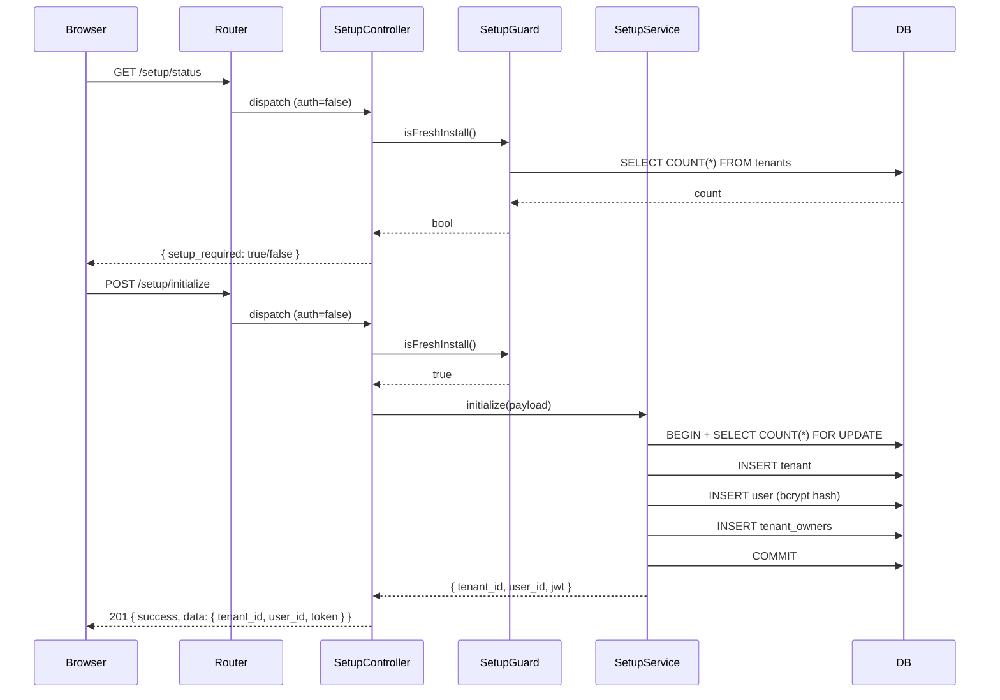
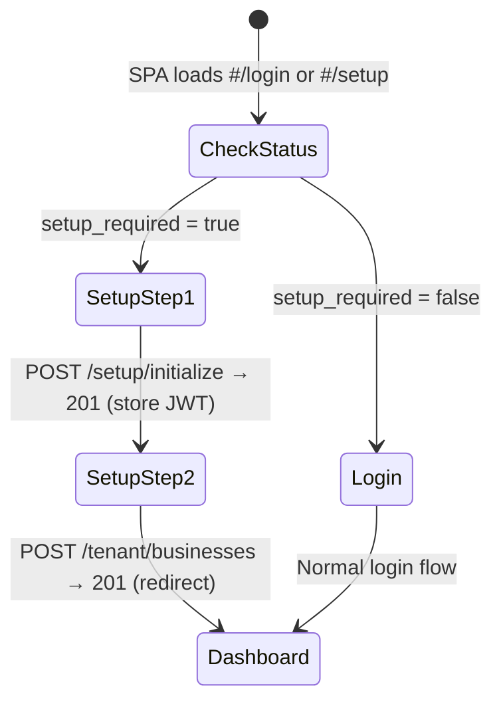
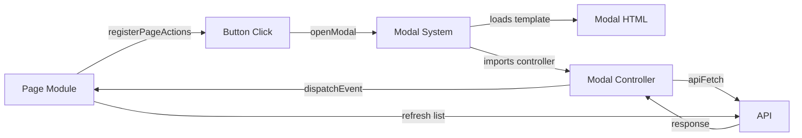

# Design Document: First Installation Flow

## Overview

This design covers two related features:

1. **Multi-Step Setup Wizard** — A backend + frontend flow that detects a fresh install (zero tenants), exposes unauthenticated setup endpoints, and guides the initial administrator through creating a tenant/owner (Step 1) and first business (Step 2) before redirecting to the dashboard.

2. **Tenant Module Modal Fixes** — Refactoring the 4 Tenant pages (businesses, owners, users, business-types) to use the established `openModal()` + `registerPageActions()` pattern from `Users/users.js`, wiring up the modal triggers that already exist in the HTML templates.

## Architecture

### Setup Flow — Request Lifecycle



### Frontend Setup Flow



### Tenant Modal Fix — Component Interaction



## Components and Interfaces

### Backend Components

#### 1. SetupGuard (`src/Services/SetupGuard.php`)

Responsible for detecting fresh-install state.

```php
class SetupGuard
{
    private PDO $db;

    public function __construct(PDO $db) { ... }

    /**
     * Returns true if zero tenants exist (fresh install).
     * Does NOT cache across requests — always queries the DB.
     */
    public function isFreshInstall(): bool
    {
        $stmt = $this->db->query('SELECT COUNT(*) FROM tenants');
        return (int) $stmt->fetchColumn() === 0;
    }
}
```

#### 2. SetupController (`src/Controllers/SetupController.php`)

Handles `/setup/status` and `/setup/initialize`. Extends `BaseController` but does NOT use `$this->auth()`.

```php
class SetupController extends BaseController
{
    private SetupGuard $guard;
    private SetupService $service;
    private string $jwtSecret;

    public function __construct(string $jwtSecret)
    {
        $db = Database::getConnection();
        $this->jwtSecret = $jwtSecret;
        $this->guard = new SetupGuard($db);
        $this->service = new SetupService($jwtSecret, $db);
    }

    public function status(): void
    {
        $this->json(true, [
            'setup_required' => $this->guard->isFreshInstall()
        ]);
    }

    public function initialize(): void
    {
        // 1. Guard check
        if (!$this->guard->isFreshInstall()) {
            $this->json(false, null, 'Setup is not available. System is already configured.', 403);
            return;
        }

        // 2. Validate input
        $input = json_decode(file_get_contents('php://input'), true);
        $errors = $this->validateSetupPayload($input);
        if (!empty($errors)) {
            $this->json(false, ['errors' => $errors], 'Validation failed', 422);
            return;
        }

        // 3. Execute setup
        $result = $this->service->initialize($input);

        if (!$result['success']) {
            $status = $result['status'] ?? 500;
            $this->json(false, null, $result['message'], $status);
            return;
        }

        $this->json(true, $result['data'], null, 201);
    }

    private function validateSetupPayload(?array $input): array { ... }
}
```

#### 3. SetupService (`src/Services/SetupService.php`)

Orchestrates tenant + owner creation within a transaction with locking.

```php
class SetupService
{
    private PDO $db;
    private string $jwtSecret;

    public function __construct(string $jwtSecret, PDO $db) { ... }

    public function initialize(array $data): array
    {
        $this->db->beginTransaction();
        try {
            // Lock check — prevents race conditions
            $stmt = $this->db->query('SELECT COUNT(*) FROM tenants FOR UPDATE');
            $count = (int) $stmt->fetchColumn();
            if ($count > 0) {
                $this->db->rollBack();
                return [
                    'success' => false,
                    'status' => 409,
                    'message' => 'Setup has already been completed by another request'
                ];
            }

            // Create tenant
            $tenantId = $this->createTenant($data['tenant_name']);

            // Create user
            $userId = $this->createUser($data, $tenantId);

            // Designate as tenant owner
            $this->designateTenantOwner($userId, $tenantId);

            $this->db->commit();

            // Generate JWT for immediate auth
            $token = $this->generateJwt($userId, $tenantId);

            return [
                'success' => true,
                'data' => [
                    'tenant_id' => $tenantId,
                    'user_id' => $userId,
                    'token' => $token
                ]
            ];
        } catch (\Throwable $e) {
            $this->db->rollBack();
            return [
                'success' => false,
                'status' => 500,
                'message' => 'Setup failed: ' . $e->getMessage()
            ];
        }
    }

    private function createTenant(string $name): int { ... }
    private function createUser(array $data, int $tenantId): int { ... }
    private function designateTenantOwner(int $userId, int $tenantId): void { ... }
    private function generateJwt(int $userId, int $tenantId): string { ... }
}
```

#### 4. Route Registration (`public/api/routes/setup.php`)

```php
use App\Controllers\SetupController;

$router->get('/setup/status',
    fn() => (new SetupController($config['jwt_secret']))->status(),
    [], false  // no permissions, auth=false
);

$router->post('/setup/initialize',
    fn() => (new SetupController($config['jwt_secret']))->initialize(),
    [], false  // no permissions, auth=false
);
```

This file is included in `public/api/index.php` **before** other route files.

### Frontend Components

#### 5. Setup Page (`public/assets/js/pages/Auth/setup.js`)

A page module following the standard `render()` / `mount()` / `unmount()` pattern. Registered in `router.config.js` with `auth: false`.

```javascript
// Key responsibilities:
// - Render step indicator + form for current step
// - Step 1: POST /setup/initialize → store JWT → advance
// - Step 2: POST /tenant/businesses → redirect to #/dashboard
// - Display validation errors inline
```

#### 6. Setup HTML Template (`public/html/Auth/setup.html`)

Contains the two-step wizard layout with:
- Step indicator (Step 1 / Step 2)
- Step 1 form: tenant_name, username, email, password, confirm_password, first_name, last_name
- Step 2 form: business_name, currency select, business_type select

#### 7. Router Config Addition

```javascript
// In router.config.js, add before login route:
{path: '#/setup', auth: false, permission: '', load: () => import('../pages/Auth/setup.js')}
```

#### 8. Auto-Redirect Logic

Added to the login page's `mount()` or as a shared utility called from both `#/login` and `#/setup` routes:

```javascript
async function checkSetupStatus() {
    const res = await fetch('api/setup/status');
    const data = await res.json();
    if (!data.success) return; // network error — stay put

    const currentHash = window.location.hash;
    if (data.data.setup_required && currentHash === '#/login') {
        window.location.hash = '#/setup';
    } else if (!data.data.setup_required && currentHash === '#/setup') {
        window.location.hash = '#/login';
    }
}
```

### Tenant Modal Fix Components

#### 9. Tenant Businesses Page (Refactored)

**File:** `public/assets/js/pages/Tenant/businesses.js`

Refactored to:
- Load HTML via `fetch('html/Tenant/businesses.html')`
- Use `registerPageActions()` for `tenant-businesses.create`
- Open modal via `openModal()` with dedicated template + controller
- Listen for `tenant-businesses.updated` event to refresh list
- Call `closeModalsInContainer()` in `unmount()`

**New files:**
- `public/html/Tenant/businessForm.modal.html` — modal-only HTML (extracted from the existing modal markup in `businesses.html`, which will be removed from the page template)
- `public/assets/js/pages/Tenant/businessForm.modal.js` — modal controller

#### 10. Tenant Owners Page (Refactored)

**File:** `public/assets/js/pages/Tenant/owners.js`

Refactored to:
- Load HTML via `fetch('html/Tenant/owners.html')`
- Use `registerPageActions()` for `tenant-owners.designate` and `tenant-owners.revoke`
- Open modal via `openModal()` for designate action
- Use `confirm()` for revoke action
- Listen for `tenant-owners.updated` event to refresh list
- Call `closeModalsInContainer()` in `unmount()`

**New files:**
- `public/html/Tenant/ownerDesignate.modal.html` — modal-only HTML
- `public/assets/js/pages/Tenant/ownerDesignate.modal.js` — modal controller

#### 11. Tenant Users Page (Refactored)

**File:** `public/assets/js/pages/Tenant/users.js`

Refactored to:
- Load HTML via `fetch('html/Tenant/users.html')`
- Use `registerPageActions()` for `tenant-users.create`
- Open modal via `openModal()` with dedicated template + controller
- Listen for `tenant-users.updated` event to refresh list
- Call `closeModalsInContainer()` in `unmount()`

**New files:**
- `public/html/Tenant/userForm.modal.html` — modal-only HTML (extracted from `users.html`)
- `public/assets/js/pages/Tenant/userForm.modal.js` — modal controller

#### 12. Tenant Business Types Page (Refactored)

**File:** `public/assets/js/pages/Tenant/business-types.js`

Refactored to:
- Load HTML via `fetch('html/Tenant/business-types.html')`
- Use `registerPageActions()` for `tenant-business-types.create`, `tenant-business-types.edit`, `tenant-business-types.delete`
- Open modal via `openModal()` for create/edit (passing `{ id: '' }` or `{ id: typeId }`)
- Use `confirm()` for delete action
- Listen for `tenant-business-types.updated` event to refresh list
- Call `closeModalsInContainer()` in `unmount()`

**New files:**
- `public/html/Tenant/businessTypeForm.modal.html` — modal-only HTML (extracted from `business-types.html`)
- `public/assets/js/pages/Tenant/businessTypeForm.modal.js` — modal controller

### Modal Template Strategy

The existing HTML templates (`businesses.html`, `owners.html`, `users.html`, `business-types.html`) already contain modal markup inline. The refactoring will:

1. **Extract** the modal `<div class="modal ...">` blocks into separate `*.modal.html` files
2. **Remove** the modal markup from the page templates (the page templates keep only the table/list content)
3. **Load** modal HTML via `openModal({ template: '...' })` which injects it dynamically

This matches the pattern in `Users/users.js` where `userForm.html` is a separate modal template loaded by `openModal()`.

## Data Models

### Setup Payload (POST /setup/initialize)

```json
{
    "tenant_name": "string (required, 1-255 chars)",
    "username": "string (required, 3-50 chars)",
    "email": "string (required, valid email format)",
    "password": "string (required, 8+ chars)",
    "first_name": "string (required, 1-100 chars)",
    "last_name": "string (required, 1-100 chars)"
}
```

### Setup Response (201)

```json
{
    "success": true,
    "data": {
        "tenant_id": 1,
        "user_id": 1,
        "token": "eyJ..."
    },
    "message": null
}
```

### Setup Status Response (200)

```json
{
    "success": true,
    "data": {
        "setup_required": true
    },
    "message": null
}
```

### JWT Payload (generated by SetupService)

The JWT generated during setup contains the same structure as the existing AuthService JWT, but with:
- `user_id` — the created user
- `tenant_id` — the created tenant
- `business_id` — null (no business yet)
- `is_tenant_owner` — true
- `permissions` — empty array (no business-scoped permissions yet)
- `roles` — empty array (no business assignment yet)

This allows the frontend to authenticate for Step 2 (POST /tenant/businesses) which only requires tenant owner status, not business-scoped permissions.

### Database Tables Affected

No new tables. The setup flow inserts into existing tables:
- `tenants` — new row with `name`
- `users` — new row with `username`, `email`, `password_hash`, `first_name`, `last_name`, `tenant_id`
- `tenant_owners` — new row linking `user_id` and `tenant_id`
- `businesses` — created in Step 2 via existing endpoint
- `business_users` — created in Step 2 via existing endpoint (role assignment)
- `accounts` — default account created in Step 2 via existing endpoint

## Correctness Properties

*A property is a characteristic or behavior that should hold true across all valid executions of a system — essentially, a formal statement about what the system should do. Properties serve as the bridge between human-readable specifications and machine-verifiable correctness guarantees.*

### Property 1: Setup Guard Correctness

*For any* non-negative integer count returned by the tenants table, the SetupGuard SHALL return `true` if and only if the count equals zero.

**Validates: Requirements 1.1, 1.2**

### Property 2: Validation Rejects Incomplete Payloads

*For any* setup payload where at least one required field (tenant_name, username, email, password, first_name, last_name) is missing or empty, the SetupController SHALL return HTTP 422 with the missing/invalid field identified in the errors array.

**Validates: Requirements 4.1, 4.2, 4.6**

### Property 3: Validation Rejects Invalid Field Formats

*For any* username shorter than 3 characters, *for any* email string not matching a valid email pattern, and *for any* password shorter than 8 characters, the SetupController SHALL return HTTP 422 with the corresponding field listed in the errors array.

**Validates: Requirements 4.3, 4.4, 4.5**

### Property 4: Security Lock Rejects When Configured

*For any* valid setup payload, when the tenants table contains one or more rows, the POST /setup/initialize endpoint SHALL return HTTP 403 and not modify the database.

**Validates: Requirements 3.1, 13.2**

### Property 5: Successful Setup Produces Correct State

*For any* valid setup payload submitted when the system is in fresh-install state, the SetupService SHALL create exactly one tenant with the given name, one user with matching username/email/first_name/last_name and a bcrypt-verifiable password hash, one tenant_owners record linking them, and return a JWT that decodes to contain the created user_id and tenant_id.

**Validates: Requirements 5.1, 5.2, 5.3, 5.4, 5.6, 5.7, 6.1**

### Property 6: Password Hash Round-Trip

*For any* password string of 8 or more characters provided during setup, `password_verify(password, stored_hash)` SHALL return true for the hash stored in the users table.

**Validates: Requirements 6.1, 6.3**

## Error Handling

### Backend Error Responses

| Scenario | HTTP Status | Response |
|----------|-------------|----------|
| System already configured | 403 | `{ success: false, message: "Setup is not available. System is already configured." }` |
| Validation failure | 422 | `{ success: false, data: { errors: {...} }, message: "Validation failed" }` |
| Race condition (concurrent setup) | 409 | `{ success: false, message: "Setup has already been completed by another request" }` |
| Transaction failure | 500 | `{ success: false, message: "Setup failed: ..." }` |
| Network error on /setup/status | — | Frontend stays on current page, no redirect |

### Frontend Error Handling

- **Step 1 validation errors (422):** Display inline next to form fields using Bootstrap's `is-invalid` class
- **Step 1 server error (500):** Display alert message above the form
- **Step 2 business creation error:** Display error message, allow retry (form stays visible)
- **Network failure on status check:** Silently stay on current page (no redirect)

### Transaction Safety

The `SetupService::initialize()` method wraps all operations in a single PDO transaction:
- `beginTransaction()` before any inserts
- `SELECT COUNT(*) FROM tenants FOR UPDATE` — acquires row-level lock to prevent races
- If lock reveals count > 0 → `rollBack()` + return 409
- If any insert throws → `rollBack()` + return 500
- On success → `commit()`

## Testing Strategy

### Unit Tests (PHPUnit)

- **SetupGuard:** Test `isFreshInstall()` returns correct boolean for mocked count values
- **SetupController validation:** Test each validation rule with specific invalid inputs
- **SetupService:** Test successful flow with mocked PDO, verify correct SQL operations called

### Property-Based Tests (PHPUnit + custom generators)

Property-based testing applies to the backend validation and setup logic:

- **Property 1:** Generate random non-negative integers, verify guard returns correct boolean
- **Property 2:** Generate payloads with random fields removed, verify 422 response
- **Property 3:** Generate strings of various lengths, verify format validation
- **Property 4:** Generate valid payloads, verify 403 when tenants exist
- **Property 5:** Generate valid payloads, verify complete state creation (integration-level PBT with test database)
- **Property 6:** Generate random password strings ≥ 8 chars, verify bcrypt round-trip

**Configuration:**
- Minimum 100 iterations per property test
- Tag format: `Feature: first-installation-flow, Property N: {title}`
- Library: PHPUnit with custom data providers generating random inputs

### Frontend Tests (Vitest + fast-check)

- **Redirect logic:** Property test that for any combination of `(setup_required, currentRoute)`, the redirect target is correct
- **Validation display:** Example-based tests verifying error messages render correctly

### Integration Tests

- **Full setup flow:** POST /setup/initialize with valid data → verify 201 + DB state
- **Concurrent setup:** Two simultaneous requests → only one succeeds (409 for the other)
- **Post-setup lockout:** After setup completes, verify all setup endpoints return 403/false

## File Inventory

### New Files

| File | Purpose |
|------|---------|
| `src/Services/SetupGuard.php` | Fresh-install detection service |
| `src/Controllers/SetupController.php` | Setup API controller |
| `src/Services/SetupService.php` | Setup orchestration (transaction + JWT) |
| `public/api/routes/setup.php` | Route registration for setup endpoints |
| `public/assets/js/pages/Auth/setup.js` | Frontend setup wizard page module |
| `public/html/Auth/setup.html` | Setup wizard HTML template |
| `public/html/Tenant/businessForm.modal.html` | Create Business modal template |
| `public/assets/js/pages/Tenant/businessForm.modal.js` | Create Business modal controller |
| `public/html/Tenant/ownerDesignate.modal.html` | Designate Owner modal template |
| `public/assets/js/pages/Tenant/ownerDesignate.modal.js` | Designate Owner modal controller |
| `public/html/Tenant/userForm.modal.html` | Create User modal template (tenant-level) |
| `public/assets/js/pages/Tenant/userForm.modal.js` | Create User modal controller (tenant-level) |
| `public/html/Tenant/businessTypeForm.modal.html` | Business Type form modal template |
| `public/assets/js/pages/Tenant/businessTypeForm.modal.js` | Business Type form modal controller |

### Modified Files

| File | Change |
|------|--------|
| `public/api/index.php` | Add `require __DIR__ . '/routes/setup.php';` before other routes |
| `public/assets/js/router/router.config.js` | Add `#/setup` route with `auth: false` |
| `public/assets/js/pages/Auth/login.js` | Add setup status check in `mount()` |
| `public/assets/js/pages/Tenant/businesses.js` | Full refactor to use openModal + registerPageActions |
| `public/assets/js/pages/Tenant/owners.js` | Full refactor to use openModal + registerPageActions |
| `public/assets/js/pages/Tenant/users.js` | Full refactor to use openModal + registerPageActions |
| `public/assets/js/pages/Tenant/business-types.js` | Full refactor to use openModal + registerPageActions |
| `public/html/Tenant/businesses.html` | Remove inline modal markup (extracted to modal file) |
| `public/html/Tenant/owners.html` | Remove inline modal markup (extracted to modal file) |
| `public/html/Tenant/users.html` | Remove inline modal markup (extracted to modal file) |
| `public/html/Tenant/business-types.html` | Remove inline modal markup (extracted to modal file) |
