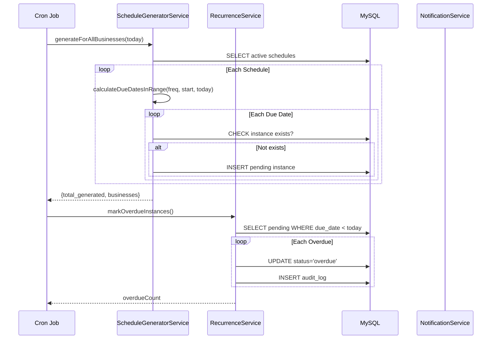
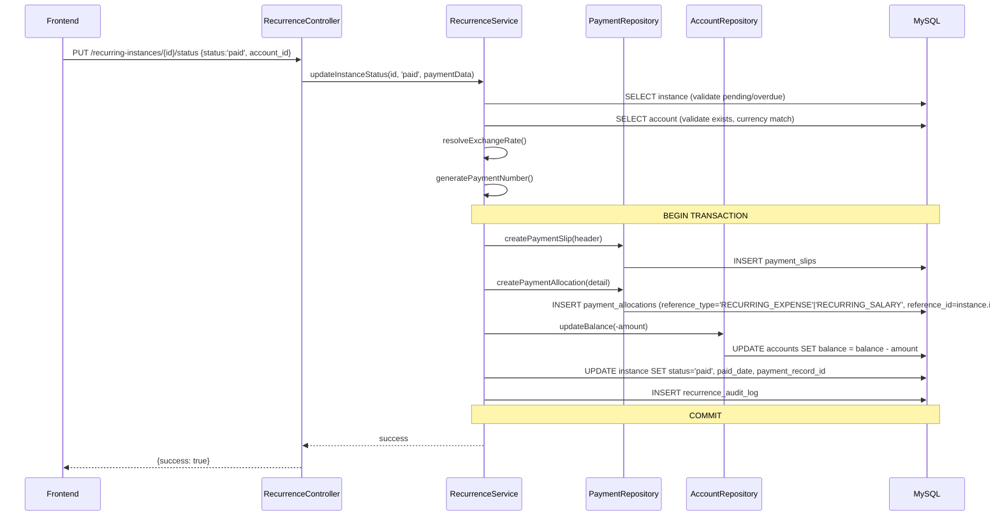
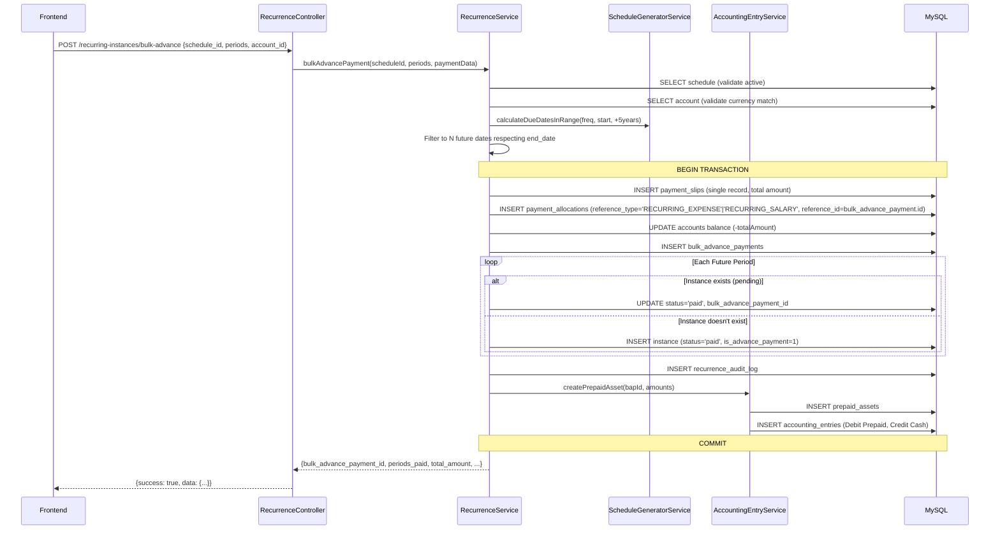
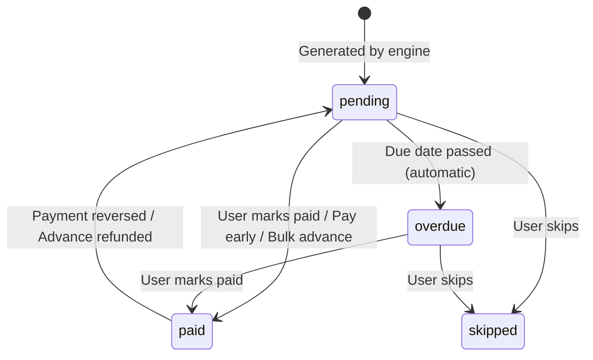

# Design Document: Recurring Fixed Expenses

## Overview

The Recurring Fixed Expenses feature implements a shared **Recurrence Engine** that automates the creation and management of periodic expense and salary obligations. It integrates with the existing Payments module (using the allocation-based payment pattern), Notification system, and a new Accounting subsystem for prepaid asset management.

The engine operates on a **schedule → instance** model: users define recurrence schedules on individual expense records (via a "Make this recurring" toggle on the Expense_Form) or salary employees, and the system generates individual instances at each due date. Instances flow through a state machine (`pending → paid|skipped|overdue`) with full audit trail, payment integration, and accrual-based accounting for advance payments.

### Key Design Decisions

1. **Shared engine for expenses and salaries** — A single `RecurrenceService` handles both entity types, differentiated by `entity_type` enum. This reduces code duplication and ensures consistent behavior.
2. **Per-expense recurrence** — Recurrence is configured on individual expense records (entity_type='EXPENSE', entity_id=expenses.id), not on expense categories. The source expense provides defaults (amount, currency, payee_id, expense_category_id) for generated instances.
3. **Allocation-based payment pattern** — When marking an instance as paid, the system creates a `payment_slip` (header for cash movement) AND a `payment_allocation` (detail row with `reference_type = 'RECURRING_EXPENSE'` or `'RECURRING_SALARY'`, `reference_id = recurrence_instance.id`). This follows the same settlement pattern used for normal expenses and salaries.
4. **Cron + manual trigger** — Daily cron handles automated generation/overdue transitions. A manual `/recurrences/evaluate` endpoint allows on-demand evaluation.
5. **Idempotent generation** — The engine uses a `UNIQUE(recurrence_schedule_id, due_date)` constraint to prevent duplicates regardless of how many times generation runs.
6. **Immutable paid instances** — Once an instance is paid (regular, early, or bulk advance), schedule modifications never alter it. Only pending instances are affected by changes.
7. **Single payment record for bulk advance** — Rather than N individual payments, one `payment_slips` record + one `payment_allocation` (reference_type pointing to `bulk_advance_payment.id`) covers the entire bulk amount.
8. **Accrual accounting for prepaid expenses** — Bulk advances create a prepaid asset; each period's portion is recognized as an expense when the due date arrives, following standard accrual accounting.

## Architecture

### High-Level Component Diagram

```mermaid
graph TD
    subgraph Frontend["Frontend (Vanilla JS SPA)"]
        EF[Expense Form<br/>expenseForm.modal.js<br/>"Make this recurring" toggle]
        SF[Salary Pages<br/>salaries.js]
        BAM[Bulk Advance Modal<br/>bulkAdvance.modal.js]
        RPM[Recurring Payment Modal<br/>recurringPaymentForm.modal.js]
        PA[Prepaid Assets Page<br/>prepaid-assets.html]
    end

    subgraph API["API Layer (PHP)"]
        RC[RecurrenceController]
        Router[Route Definitions<br/>recurrences.php]
    end

    subgraph Services["Service Layer"]
        RS[RecurrenceService]
        SGS[ScheduleGeneratorService]
        AES[AccountingEntryService]
        RAS[RecurrenceAuditService]
        NS[NotificationService]
        ERS[ExchangeRateService]
    end

    subgraph Repositories["Repository Layer"]
        RSR[RecurrenceScheduleRepository]
        RIR[RecurrenceInstanceRepository]
        BAPR[BulkAdvancePaymentRepository]
        PAR[PrepaidAssetRepository]
        RALR[RecurrenceAuditLogRepository]
        PR[PaymentRepository]
        AR[AccountRepository]
    end

    subgraph Cron["Scheduled Tasks"]
        CRON[generate-recurrences.php<br/>Daily Cron]
    end

    subgraph DB["MySQL Database"]
        T1[recurrence_schedules]
        T2[recurrence_instances]
        T3[bulk_advance_payments]
        T4[prepaid_assets]
        T5[accounting_entries]
        T6[recurrence_audit_log]
        T7[payment_slips]
        T7A[payment_allocations]
        T8[accounts]
    end

    EF --> RC
    SF --> RC
    BAM --> RC
    RPM --> RC
    PA --> RC
    Router --> RC
    RC --> RS
    RC --> AES
    RC --> RAS
    RS --> SGS
    RS --> AES
    RS --> NS
    RS --> ERS
    RS --> RSR
    RS --> RIR
    RS --> BAPR
    RS --> PAR
    RS --> RALR
    RS --> PR
    RS --> AR
    AES --> PAR
    CRON --> SGS
    CRON --> RS
    RSR --> T1
    RIR --> T2
    BAPR --> T3
    PAR --> T4
    AES --> T5
    RALR --> T6
    PR --> T7
    PR --> T7A
    AR --> T8
```

### Data Flow: Daily Cron Execution



### Data Flow: Mark Instance as Paid



### Data Flow: Bulk Advance Payment



## Components and Interfaces

### ScheduleGeneratorService (Pure Logic)

Pure function service with no side effects. Handles all date calculation logic.

```php
class ScheduleGeneratorService
{
    /**
     * Calculate the next due date from a given date based on frequency.
     * Handles month-end clamping (e.g., Jan 31 → Feb 28/29).
     */
    public function calculateNextDueDate(string $frequency, string $fromDate): string;

    /**
     * Generate all due dates within a date range (inclusive both boundaries).
     * Preserves original day across months to prevent drift.
     */
    public function calculateDueDatesInRange(string $frequency, string $startDate, string $endDate): array;

    /**
     * Calculate period boundaries (period_start, period_end) for a due date.
     * Weekly/bi-weekly: N-day window ending on due_date.
     * Monthly: 1st to last day of month. Quarterly/Yearly: standard boundaries.
     */
    public function calculatePeriodBoundaries(string $frequency, string $dueDate): array;

    /**
     * Clamp a day number to the last valid day of the given month/year.
     */
    public function adjustForMonthEnd(int $day, int $month, int $year): int;

    /**
     * Batch generation for all businesses (cron usage). No AuthContext dependency.
     */
    public function generateForAllBusinesses(string $upToDate, PDO $db): array;
}
```

### RecurrenceService (Business Logic Orchestrator)

Central service orchestrating all recurrence operations with transaction management.

```php
class RecurrenceService
{
    /**
     * Create a new recurrence schedule for a given entity.
     *
     * Validates:
     * - Entity type is valid (EXPENSE or SALARY)
     * - For EXPENSE: the expense record exists in expenses table and belongs to current business
     * - For SALARY: the payee exists and is of type Employee
     * - Date validation (end_date >= start_date when provided)
     * - No duplicate active schedule for the same entity
     *
     * For EXPENSE type, the expense itself provides the defaults (amount, currency, payee_id,
     * expense_category_id) used when generating instances.
     */
    public function createSchedule(string $entityType, int $entityId, array $data): int;
    public function getSchedule(string $entityType, int $entityId): ?array;
    public function updateSchedule(string $entityType, int $entityId, array $data): void;
    public function deactivateSchedule(string $entityType, int $entityId): void;
    public function listSchedules(array $filters = []): array;

    // Instance Status Management
    public function updateInstanceStatus(int $instanceId, string $status, array $paymentData = []): void;
    public function payEarly(int $instanceId, array $paymentData): void;
    public function bulkAdvancePayment(int $scheduleId, int $periods, array $paymentData): array;

    // Engine Evaluation (manual trigger)
    public function evaluateAll(): array;
    public function generateDueInstances(): array;
    public function transitionOverdueInstances(): array;
    public function sendDueNotifications(): void;
    public function sendOverdueReminders(): void;
    public function performExpenseRecognition(): array;

    // Query
    public function listInstances(array $filters = []): array;
    public function getInstancePayment(int $instanceId): ?array;
    public function listAdvancePayments(array $filters = []): array;
    public function getAdvancePayment(int $id): ?array;

    // Overdue (cron)
    public function markOverdueInstances(): int;
}
```

### AccountingEntryService (Accrual Accounting)

Manages prepaid assets, expense recognition, and double-entry accounting entries.

```php
class AccountingEntryService
{
    /**
     * Create a prepaid asset record linked to a bulk advance payment.
     * Also generates the initial accounting entry (Debit Prepaid, Credit Cash).
     */
    public function createPrepaidAsset(int $bulkAdvancePaymentId, array $data): int;

    /**
     * Perform expense recognition for a single period.
     * Generates entry: Debit Expense Account, Credit Prepaid Asset.
     * Increments periods_recognized. If all recognized, marks fully_amortized.
     */
    public function performExpenseRecognition(int $prepaidAssetId, string $dueDate, float $amountFc, float $amountBc): void;

    /**
     * Reverse a prepaid asset (contra entries + status='reversed').
     */
    public function reversePrepaidAsset(int $prepaidAssetId): void;

    // Query
    public function listPrepaidAssets(array $filters = []): array;
    public function getPrepaidAsset(int $id): ?array;
    public function listAccountingEntries(array $filters = []): array;
}
```

### RecurrenceController (API Layer)

Maps HTTP routes to service calls with input validation and error handling.

| Method | Endpoint | Handler | Permission |
|--------|----------|---------|-----------|
| GET | /recurrences | listSchedules | expenses.view |
| POST | /recurrences/evaluate | evaluate | expenses.manage |
| POST | /expenses/{id}/recurrence | createExpenseRecurrence | expenses.manage |
| GET | /expenses/{id}/recurrence | getExpenseRecurrence | expenses.view |
| DELETE | /expenses/{id}/recurrence | deleteExpenseRecurrence | expenses.manage |
| POST | /salaries/employees/{id}/recurrence | createSalaryRecurrence | salaries.edit |
| GET | /salaries/employees/{id}/recurrence | getSalaryRecurrence | salaries.view |
| DELETE | /salaries/employees/{id}/recurrence | deleteSalaryRecurrence | salaries.edit |
| GET | /recurring-instances | listInstances | expenses.view |
| PUT | /recurring-instances/{id}/status | updateInstanceStatus | expenses.edit |
| GET | /recurring-instances/{id}/payment | getInstancePayment | payments.view |
| POST | /recurring-instances/bulk-advance | bulkAdvancePayment | expenses.manage |
| GET | /recurring-instances/advance-payments | listAdvancePayments | expenses.view |
| GET | /recurring-instances/advance-payments/{id} | getAdvancePayment | expenses.view |
| GET | /prepaid-assets | listPrepaidAssets | expenses.view |
| GET | /prepaid-assets/{id} | getPrepaidAsset | expenses.view |
| GET | /accounting-entries | listAccountingEntries | expenses.view |
| GET | /recurring-audit-log | listAuditLog | expenses.view |

**Route Notes:**
- `POST /expenses/{id}/recurrence` — The `{id}` references an `expenses.id` record. The handler validates that the expense exists and belongs to the current business before creating the schedule with `entity_type='EXPENSE'`.
- `POST /salaries/employees/{id}/recurrence` — The `{id}` references the employee's `payee_id`. The handler validates that the payee is of type 'Employee'.
- All payment operations follow the allocation-based pattern: creating both a `payment_slip` (header) and a `payment_allocation` (detail row).

### Instance State Machine



**Transition Rules:**
- `pending → paid`: Requires `account_id`. Creates Payment_Slip + Payment_Allocation (reference_type='RECURRING_EXPENSE'|'RECURRING_SALARY', reference_id=instance.id), deducts balance.
- `pending → skipped`: No payment created. Stops notifications.
- `pending → overdue`: Automatic (cron). Triggers daily reminders.
- `overdue → paid`: Same as pending→paid. Stops reminders.
- `overdue → skipped`: Stops reminders.
- `paid → pending`: Only via reversal. Restores balance, deletes payment_allocation + payment_slip, clears payment linkage.

## Data Models

### Entity Relationship Diagram

```mermaid
erDiagram
    recurrence_schedules ||--o{ recurrence_instances : generates
    recurrence_schedules ||--o{ bulk_advance_payments : "has bulk payments"
    bulk_advance_payments ||--o{ recurrence_instances : "covers instances"
    bulk_advance_payments ||--|| prepaid_assets : "creates asset"
    prepaid_assets ||--o{ accounting_entries : "has entries"
    recurrence_schedules ||--o{ recurrence_audit_log : "logged"
    recurrence_instances ||--o{ recurrence_audit_log : "logged"
    recurrence_instances ||--o| payment_slips : "paid via"
    payment_slips ||--o{ payment_allocations : "has allocations"
    bulk_advance_payments ||--o| payment_slips : "paid via"

    recurrence_schedules {
        int id PK
        enum entity_type "EXPENSE|SALARY"
        int entity_id "expenses.id or payee_id"
        int business_id FK
        enum frequency "weekly|bi-weekly|monthly|quarterly|yearly"
        decimal default_amount
        varchar default_currency
        date start_date
        date end_date "nullable"
        boolean is_active
        datetime created_at
        datetime updated_at
    }

    recurrence_instances {
        int id PK
        int recurrence_schedule_id FK
        enum entity_type
        int business_id FK
        date due_date
        decimal scheduled_amount
        decimal actual_amount "nullable"
        varchar currency
        enum status "pending|paid|skipped|overdue"
        date paid_date "nullable"
        boolean notification_sent
        boolean is_advance_payment
        int bulk_advance_payment_id FK "nullable"
        int payment_record_id FK "nullable"
        date period_start "nullable"
        date period_end "nullable"
        json metadata "nullable"
        datetime created_at
        datetime updated_at
    }

    bulk_advance_payments {
        int id PK
        int business_id FK
        int recurrence_schedule_id FK
        decimal total_amount
        decimal total_amount_bc
        varchar currency
        int periods_count
        date payment_date
        int payment_record_id FK "nullable"
        int created_by FK
        datetime created_at
    }

    prepaid_assets {
        int id PK
        int business_id FK
        int bulk_advance_payment_id FK
        decimal total_amount
        decimal total_amount_bc
        decimal per_period_amount
        decimal per_period_amount_bc
        varchar currency
        int periods_total
        int periods_recognized
        enum status "active|fully_amortized|reversed"
        datetime created_at
        datetime updated_at
    }

    accounting_entries {
        int id PK
        int business_id FK
        date entry_date
        enum entry_type "prepaid_asset_creation|expense_recognition|prepaid_asset_reversal"
        varchar debit_account
        varchar credit_account
        decimal amount_fc
        decimal amount_bc
        varchar currency
        varchar reference_type
        int reference_id
        text description "nullable"
        datetime created_at
    }

    recurrence_audit_log {
        int id PK
        int business_id FK
        int user_id "nullable"
        enum entity_type "schedule|instance"
        int entity_id
        varchar action_type
        json previous_state "nullable"
        json new_state "nullable"
        json metadata "nullable"
        datetime created_at
    }

    payment_allocations {
        int id PK
        int payment_slip_id FK
        enum reference_type "PURCHASE_ORDER|EXPENSE|SALARY|PARTNER_PROFIT|RECURRING_EXPENSE|RECURRING_SALARY"
        int reference_id "recurrence_instance.id or bulk_advance_payment.id"
        decimal amount_fc
        decimal amount_bc
        datetime created_at
    }
}
```

### Key Indexes

| Table | Index | Purpose |
|-------|-------|---------|
| recurrence_schedules | `(business_id, entity_type, is_active)` | List active schedules per business |
| recurrence_schedules | `(entity_type, entity_id)` | Lookup schedule by entity |
| recurrence_instances | `(business_id, due_date, status)` | Query upcoming/pending/overdue |
| recurrence_instances | `UNIQUE(recurrence_schedule_id, due_date)` | Prevent duplicate instances |
| recurrence_instances | `(payment_record_id)` | Reverse lookup from payment |
| bulk_advance_payments | `(business_id)`, `(recurrence_schedule_id)` | Query by business/schedule |
| prepaid_assets | `(business_id, status)` | List active prepaid assets |
| accounting_entries | `(business_id, entry_type, entry_date)` | Filter by type and date |
| recurrence_audit_log | `(business_id, entity_type, entity_id)` | Audit history per entity |

### Frequency Calculation Rules

| Frequency | Interval | Month-End Handling |
|-----------|----------|--------------------|
| weekly | +7 days | N/A |
| bi-weekly | +14 days | N/A |
| monthly | Same day +1 month | Clamp to last day (31st → 28/29/30) |
| quarterly | Same day +3 months | Clamp to last day |
| yearly | Same day +12 months | Clamp to last day (Feb 29 handling) |

**Day preservation algorithm:** The engine stores the original start day and always targets that day number when advancing months, clamping to the month's last day if needed. This prevents "drift" (e.g., Jan 31 → Feb 28 → Mar 28 instead of Mar 31).

### Required Migration: payment_allocations Enum Extension

The existing `payment_allocations.reference_type` enum must be extended from:
```sql
ENUM('PURCHASE_ORDER','EXPENSE','SALARY','PARTNER_PROFIT')
```
to:
```sql
ENUM('PURCHASE_ORDER','EXPENSE','SALARY','PARTNER_PROFIT','RECURRING_EXPENSE','RECURRING_SALARY')
```

This migration adds two new reference types:
- `'RECURRING_EXPENSE'` — used when marking a recurring expense instance as paid (reference_id = recurrence_instance.id) and for bulk advance expense payments (reference_id = bulk_advance_payment.id)
- `'RECURRING_SALARY'` — used when marking a recurring salary instance as paid (reference_id = recurrence_instance.id) and for bulk advance salary payments (reference_id = bulk_advance_payment.id)

Migration file: `database/migrations/add_recurring_payment_allocation_types.sql`

## Correctness Properties

*A property is a characteristic or behavior that should hold true across all valid executions of a system — essentially, a formal statement about what the system should do. Properties serve as the bridge between human-readable specifications and machine-verifiable correctness guarantees.*

### Property 1: Schedule Data Round-Trip

*For any* valid schedule configuration (entity_type, entity_id, frequency, default_amount, default_currency, start_date, end_date), creating a schedule and then retrieving it SHALL return identical field values.

**Validates: Requirements 1.3, 9.4**

### Property 2: Date Validation Rejects Invalid Ranges

*For any* pair of dates (start_date, end_date) where end_date < start_date, attempting to create or update a schedule SHALL be rejected with an InvalidArgumentException.

**Validates: Requirements 1.6, 9.6**

### Property 3: Due Date Calculation Correctness

*For any* valid frequency and starting date, `calculateNextDueDate(frequency, fromDate)` SHALL produce a date that is exactly the correct interval ahead, and the resulting day SHALL never exceed the last day of the target month.

**Validates: Requirements 2.3, 2.6, 10.3, 10.6**

### Property 4: Generation Produces Correct Instances

*For any* active schedule with start_date ≤ today and no end_date (or end_date ≥ today), running generation SHALL produce instances where each instance has `scheduled_amount = schedule.default_amount`, `currency = schedule.default_currency`, `status = 'pending'`, and `due_date` matching a calculated due date in the range.

**Validates: Requirements 2.1, 2.2, 10.1, 10.2**

### Property 5: Generation Respects End Date

*For any* active schedule with an end_date, running generation SHALL never produce an instance with `due_date > end_date`.

**Validates: Requirements 2.4, 6.2, 10.4, 13.2**

### Property 6: Idempotent Generation

*For any* schedule and evaluation date, running generation N times (N ≥ 1) SHALL produce the same set of instances as running it once. Specifically, the instance count for a given (schedule_id, due_date) pair SHALL always be exactly 0 or 1.

**Validates: Requirements 2.5, 10.5, 18.1**

### Property 7: Non-Pending Instances Receive No Notifications

*For any* recurrence instance with status in {paid, skipped, overdue with notification already sent today}, the notification system SHALL not generate a new due notification for that instance.

**Validates: Requirements 3.4, 3.5, 11.4, 11.5, 15.4**

### Property 8: Notification Body Contains Required Fields

*For any* recurrence instance with a valid entity name, amount, currency, and due date, the generated notification body SHALL contain the entity name, the formatted amount with currency, and the due date string.

**Validates: Requirements 3.2, 11.2, 21.4**

### Property 9: Payment Transition Invariants

*For any* pending or overdue instance marked as paid, the resulting state SHALL have `status = 'paid'`, `paid_date` set to today, `payment_record_id` referencing a valid payment record, and if `due_date > today` then `is_advance_payment = 1`.

**Validates: Requirements 4.2, 12.2, 15.2, 15.3**

### Property 10: Scheduled Amount Preservation

*For any* recurrence instance paid with an actual_amount different from scheduled_amount, the `scheduled_amount` field SHALL remain equal to its original value (the schedule's default_amount at creation time), while `actual_amount` reflects the user-provided override.

**Validates: Requirements 4.5, 12.5**

### Property 11: Schedule Modification Preserves Immutable Instances

*For any* schedule modification (amount, frequency, end_date change), instances that have `status = 'paid'` or `is_advance_payment = 1` SHALL have their `scheduled_amount`, `actual_amount`, `status`, and `paid_date` unchanged after the modification.

**Validates: Requirements 6.1, 6.3, 13.1, 13.3, 18.2**

### Property 12: Deactivation Preserves Paid and Cancels Pending

*For any* schedule deactivation, all instances with `status = 'paid'` SHALL remain with `status = 'paid'` unchanged, and all instances with `status = 'pending'` SHALL transition to `status = 'skipped'`.

**Validates: Requirements 6.5, 13.5, 18.3**

### Property 13: Overdue Transition for Past-Due Pending Instances

*For any* instance with `status = 'pending'` and `due_date < today`, running `transitionOverdueInstances()` SHALL result in that instance having `status = 'overdue'`.

**Validates: Requirements 21.1, 21.2**

### Property 14: Bulk Advance Payment Correctness

*For any* active schedule and requested period count P (2 ≤ P ≤ 12), executing a bulk advance payment SHALL result in exactly min(P, available_periods_before_end_date) instances marked as paid with `is_advance_payment = 1`, `bulk_advance_payment_id` set, and a single `bulk_advance_payments` record with `total_amount = per_period_amount × actual_periods` and `periods_count = actual_periods`.

**Validates: Requirements 16.3, 16.4, 16.7**

### Property 15: Payment Creates Slip and Allocation with Balance Deduction

*For any* instance payment (regular, early, or bulk), the source account's balance SHALL decrease by exactly `amount_bc` (base currency equivalent), a `payment_slips` record SHALL exist with the correct `amount_fc`, `amount_bc`, and a `payment_allocations` record SHALL exist with `reference_type = 'RECURRING_EXPENSE'` (for expense instances) or `'RECURRING_SALARY'` (for salary instances) and `reference_id = recurrence_instance.id`.

**Validates: Requirements 19.2, 19.3, 19.4**

### Property 16: Bulk Advance Creates Single Payment Slip and Single Allocation

*For any* bulk advance payment covering N periods, exactly one `payment_slips` record SHALL be created with `amount_fc = per_period_amount × N`, and exactly one `payment_allocations` record SHALL be created with `reference_type = 'RECURRING_EXPENSE'` or `'RECURRING_SALARY'` and `reference_id = bulk_advance_payment.id`.

**Validates: Requirements 19.6, 19.7**

### Property 17: Audit Trail for State Changes

*For any* status-changing operation (paid, skipped, overdue, schedule_created, schedule_modified, schedule_deactivated, bulk_advance_payment), a `recurrence_audit_log` entry SHALL be created with correct `entity_type`, `entity_id`, `action_type`, `previous_state`, and `new_state` reflecting the actual before/after values.

**Validates: Requirements 20.1, 20.2, 20.3, 20.4, 20.5**

### Property 18: Prepaid Asset Amount Invariant

*For any* prepaid asset created from a bulk advance payment, `total_amount = per_period_amount × periods_total` SHALL hold, and `total_amount` SHALL equal the linked `bulk_advance_payments.total_amount`.

**Validates: Requirements 22.1**

### Property 19: Double-Entry Accounting Balance

*For any* accounting entry, `amount_fc` on the debit side SHALL equal `amount_fc` on the credit side (each entry records a balanced debit/credit pair).

**Validates: Requirements 22.2, 22.3**

### Property 20: Expense Recognition on Period Due Date

*For any* active prepaid asset with N periods where K periods have `due_date ≤ today`, running expense recognition SHALL result in `periods_recognized = K` and exactly K `expense_recognition` accounting entries existing for that asset.

**Validates: Requirements 22.3, 22.4**

### Property 21: Fully Amortized When All Periods Recognized

*For any* prepaid asset where `periods_recognized = periods_total`, the asset's status SHALL be `'fully_amortized'`, and the sum of all `expense_recognition` entry amounts SHALL equal `total_amount`.

**Validates: Requirements 22.5**

### Property 22: Reversal Produces Contra Entries and Reverts State

*For any* reversed bulk advance payment, all linked instances SHALL have `status = 'pending'`, `is_advance_payment = 0`, and `bulk_advance_payment_id = NULL`. The prepaid asset SHALL have `status = 'reversed'`, and a `prepaid_asset_reversal` accounting entry SHALL exist with the same amount as the original `prepaid_asset_creation` entry.

**Validates: Requirements 18.5, 22.12**

## Error Handling

### Validation Errors (400)

| Scenario | Error Message |
|----------|--------------|
| Invalid entity_type | "Invalid entity type. Must be one of: EXPENSE, SALARY" |
| Invalid frequency | "Invalid frequency. Must be one of: weekly, bi-weekly, monthly, quarterly, yearly" |
| Missing required field | "Missing field: {field_name}" |
| End date before start | "End date must be on or after start date" |
| Invalid date format | "Invalid date format: {value}. Expected Y-m-d" |
| Periods out of range | "Number of periods must be between 2 and 12" |
| Currency mismatch | "Currency mismatch: schedule currency is '{x}' but account currency is '{y}'" |
| Expense not found | "Expense not found or does not belong to this business" |
| Non-employee payee | "Entity not found or does not meet type constraints" |

### Business Logic Errors (404/409)

| Scenario | HTTP Code | Error Message |
|----------|-----------|--------------|
| Schedule not found | 404 | "Recurrence schedule not found" |
| Instance not found | 404 | "Recurring instance not found" |
| Account not found | 404 | "Account not found" |
| Duplicate schedule | 409 | "An active recurrence schedule already exists for this entity" |
| Already paid | 409 | "Instance is already marked as paid" |
| Invalid transition | 409 | "Cannot transition from '{current}' to '{target}'" |
| Early pay on past date | 400 | "Early payment is only allowed for instances with a future due date" |
| No future periods | 409 | "No future periods available for advance payment" |
| Inactive schedule | 409 | "Cannot create bulk advance payment on an inactive schedule" |

### Transaction Safety

All multi-step operations (payment, bulk advance, deactivation, schedule modification) are wrapped in database transactions. On any failure:
1. Transaction is rolled back
2. No partial state is persisted
3. Original exception is re-thrown for the controller to handle

### Cron Error Handling

The cron endpoint (`generate-recurrences.php`):
- Returns HTTP 500 with error message if any step fails
- Authenticates via `CRON_SECRET` query parameter (constant-time comparison)
- Returns HTTP 403 if secret is missing/invalid
- Returns structured JSON summary on success

## Testing Strategy

### Dual Testing Approach

This feature is well-suited for property-based testing because:
- The `ScheduleGeneratorService` is a set of pure functions with large input spaces (dates × frequencies)
- State transitions have clear universal invariants (idempotency, immutability of paid instances)
- Financial calculations have strict mathematical properties (balance equations, double-entry)
- The instance generation logic must handle edge cases (month-end, leap years, end_date boundaries)

**Property-Based Testing (PHP: PHPUnit + custom generators, JS: Vitest + fast-check)**

- Minimum 100 iterations per property test
- Each test tagged: `Feature: recurring-fixed-expenses, Property {N}: {description}`
- Focus areas:
  - ScheduleGeneratorService: date calculations, month-end clamping, range generation
  - RecurrenceService: state transitions, idempotent generation, balance invariants
  - AccountingEntryService: double-entry balance, amortization correctness

**Unit Tests (Example-Based)**

- UI interaction flows (modal show/hide, form validation display)
- API endpoint request/response shape
- Specific edge cases: empty schedules, zero-amount payments, single-day ranges
- Error condition paths: invalid inputs, missing permissions

**Integration Tests**

- End-to-end cron execution with real database
- Payment module integration (Payment_Slip + Payment_Allocation creation, balance updates)
- Notification system integration (correct notification types and recipients)
- Multi-business isolation (business A's schedules don't affect business B)

### Test Organization

```
tests/
├── Property/
│   └── RecurringExpenses/
│       ├── ScheduleGeneratorPropertyTest.php    # Properties 3, 5, 6
│       ├── RecurrenceServicePropertyTest.php    # Properties 1, 4, 9-14, 17
│       └── AccountingEntryPropertyTest.php      # Properties 18-22
├── Unit/
│   └── RecurringExpenses/
│       ├── ScheduleGeneratorTest.php
│       ├── RecurrenceServiceTest.php
│       └── AccountingEntryServiceTest.php
├── Integration/
│   └── RecurringExpenses/
│       ├── CronExecutionTest.php
│       ├── PaymentIntegrationTest.php
│       └── NotificationIntegrationTest.php
└── recurring-fixed-expenses/                    # JS property tests
    ├── dateCalculation.property.test.js         # Property 3 (JS port)
    ├── bulkAdvanceModal.test.js
    └── recurringUI.test.js
```

### Property Test Configuration

- PHP: PHPUnit with custom data providers generating 100+ random inputs per property
- JS: fast-check with `fc.assert(fc.property(...), { numRuns: 100 })`
- Each property test references its design property number in a comment tag
- Tag format: `// Feature: recurring-fixed-expenses, Property 3: Due Date Calculation Correctness`
